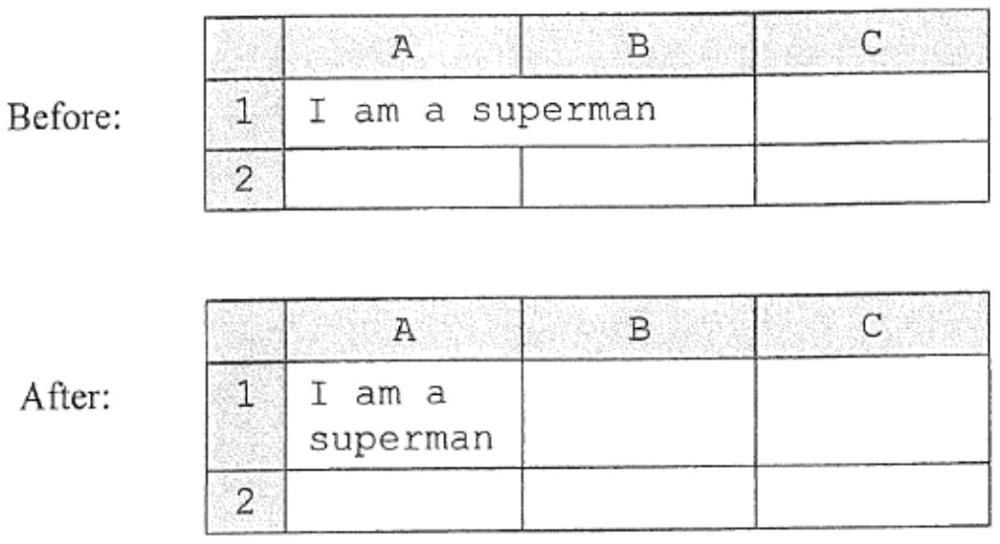
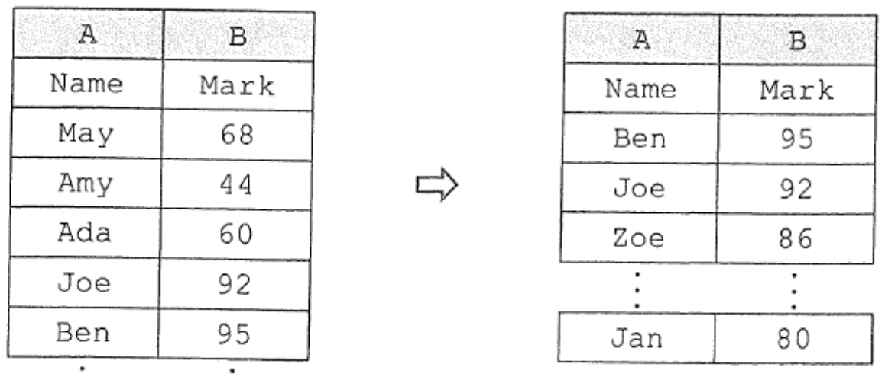
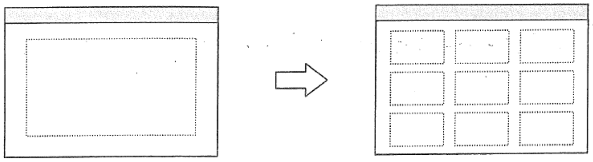
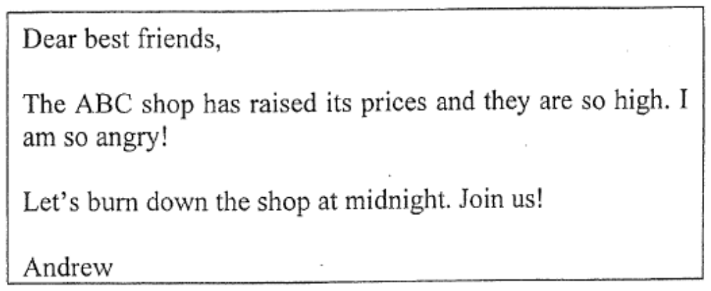
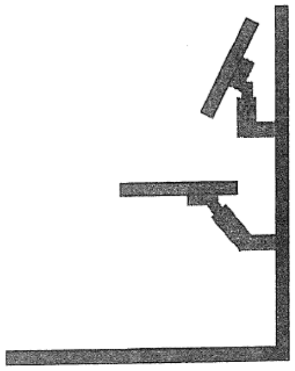

# There are 40 questions in this paper.  Choose the most suitable answers.

**1.** A bus company provides an online service for passengers to find bus routes. What information should passengers input?

(1) Starting point  
(2) Destination  
(3) Number of bus stops  
(4) Bus fare  

A. (1) and (2) only  
B. (1) and (4) only  
C. (2) and (3) only  
D. (1), (3) and (4) only  

**2.** What are the 8-bit one's complement and 8-bit two's complement of the binary number 10110₂?

| | One's complement | Two's complement |
|---|---|---|
| A. | 11101001 | 11101010 |
| B. | 01001111 | 01010000 |
| C. | 00001001 | 00001010 |
| D. | 11110110 | 11110111 |

**3.** Which of the following actions involve converting data between digital and analog forms?

(1) Playing mp3 music  
(2) Recording videos using a webcam  
(3) Copying a text file  

A. (1) and (2) only  
B. (1) and (3) only  
C. (2) and (3) only  
D. (1), (2) and (3)  

**4.** Peter configures the colour quality of a display unit. Which of the following pixels are involved?

(1) Black  
(2) White  
(3) Green  
(4) Red  
(5) Blue  

A. (1) and (2) only  
B. (3), (4) and (5) only  
C. (1), (2), (3) and (4) only  
D. (2), (3), (4) and (5) only  

**5.** Peter and Mary share a database file X and execute database queries, T1 and T2, respectively. Which of the following activities should the database management system not do?

(1) When T1 is reading X, T2 is reading X.  
(2) When T1 is writing records in X, T2 is writing records in X.  
(3) When T1 is deleting records in X, T2 is reading X.  

A. (1) only  
B. (2) only  
C. (1) and (3) only  
D. (2) and (3) only  

**6.** Which of the following statements about clicking a hyperlink in a presentation file is correct?

A. The hyperlink needs to involve HTTP.  
B. A browser will not open when the hyperlink is 'http://hkeaa.edu.hk/abe.doc'.  
C. A PDF reader will usually open when the hyperlink links to a PDF file.  
D. The presentation file will close automatically when the hyperlink links to another presentation file.  

**7.** What formatting feature is used in the spreadsheet below?



A. Merge cells  
B. Shrink text to fit  
C. Row height  
D. Wrap text  

**8.** Mr Chan wants to produce a list of students who get 80 marks or above in a test, as shown in the spreadsheet below. Which functions should he use?



A. Pivot table and sorting  
B. Sorting and searching  
C. Filtering and searching  
D. Filtering and sorting  

**9.** Assume that every household has a residential telephone number. In which of the following database applications could the residential telephone number be used as a key field?

A. Towngas accounts  
B. Student personal profiles  
C. Personal bank accounts  
D. Library cards  

**10.** Why should a software suite be used in an IT project?

(1) Data used in the project can be shared within the software suite effectively.  
(2) Data files generated by the software suite are smaller.  
(3) The project will be in a web-based format.  

A. (1) only  
B. (2) only  
C. (1) and (3) only  
D. (2) and (3) only  

**11.** Which of the following statements about a check digit for a data item is correct?

A. The data item should not contain more than 8 characters.  
B. The check digit cannot find all errors.  
C. The check digit can correct errors.  
D. The leading character of the data item should be a letter.  

**12.** When editing a document, which of the following word processing features can enhance its readability?

(1) Tables  
(2) Find and replace  
(3) Footnotes  

A. (2) only  
B. (3) only  
C. (1) and (2) only  
D. (1) and (3) only  

**13.** When using presentation software, the view mode is changed from single-slide to multiple-slide. What is/are the potential benefit(s) of this change?



(1) It is easier to insert an image.  
(2) It is easier to re-arrange slides.  
(3) It is easier to see an overview of the slides.  

A. (1) only  
B. (2) only  
C. (1) and (3) only  
D. (2) and (3) only  

**14.** Which of the following is the main development trend for display units in desktop computers?

A. USB port  
B. CPU computational power  
C. User-friendly driver programs  
D. Energy saving  

**15.** Tom currently uses a software package on a desktop computer. He tries to install this software on his tablet computer but fails. Why?

(1) The tablet computer uses a different operating system.  
(2) The tablet computer uses a virtual keyboard.  
(3) The tablet computer uses a solid-state drive.  

A. (1) only  
B. (2) only  
C. (1) and (3) only  
D. (2) and (3) only  

**16.** Why do many readers like using mobile devices to read books?

(1) The ergonomic design of mobile devices helps relieve eye strain.  
(2) Mobile devices provide various functions which make reading convenient.  
(3) It is convenient for carrying a lot of books.  

A. (1) and (2) only  
B. (1) and (3) only  
C. (2) and (3) only  
D. (1), (2) and (3)  

**17.** Carey wants to upgrade the DDR II 2G 667 MHz RAM of her computer to DDR III 2G 1333MHz RAM with a higher data transfer rate. Which of the following features should be considered?

A. Motherboard design  
B. CPU computational power  
C. Power consumption  
D. ROM size  

**18.** What is the main purpose of having a memory cache in a CPU?

A. It increases the total memory storage capacity.  
B. It facilitates the CPU processing.  
C. It supports multi-core processors on the motherboard.  
D. It supports multi-tasking operating systems.  

**19.** When buying a wireless broadband router for a network at home, which of the following considerations is not necessary?

A. The data transfer rate of the broadband connection  
B. Security protocols  
C. The IP address of the router  
D. Coverage of the router  

Answer Questions 20 and 21 with reference to the following passage.

Carol uses a digital camera to take photos of her school hall. The photos will be uploaded and shown on the school's web pages.

**20.** Which of the following image file types are suitable for her to use?

(1) PNG  
(2) GIF  
(3) JPG  
(4) TIFF  

A. (1) and (3) only  
B. (1) and (4) only  
C. (2) and (3) only  
D. (2) and (4) only  

**21.** Before uploading a photo, what should Carol do?

A. If the file size of the photo is very large, she should divide it into small files for uploading.  
B. She should reduce the photo size to fit the display.  
C. She should adjust the resolution of the photo so that it is as high as possible.  
D. She should adjust the number of colours shown in the photo to the highest number possible.  

Answer Questions 22 and 23 with reference to the following passage.

Henry lives in Hong Kong. He likes bags made in Europe so he buys a bag through the online shopping web site of a shop in France.

**22.** What are the possible reasons for Henry's choice to buy the bag online?

(1) He can select and buy the bag during office hours in France.  
(2) There are many different kinds of bags for Henry to choose from.  
(3) The bag is not for sale in Hong Kong.  
(4) He has a credit card to pay for it.  

A. (1) and (3) only  
B. (1) and (4) only  
C. (2) and (3) only  
D. (2) and (4) only  

**23.** There are different kinds of online shopping web sites. What features do they usually have?

(1) Electronic Fund Transfer  
(2) A peer-to-peer (p2p) network  
(3) Mainframe computers  
(4) A database management system (DBMS)  

A. (1) and (3) only  
B. (1) and (4) only  
C. (2) and (3) only  
D. (2) and (4) only  

**24.** Which of the following can enhance the security of online banking?

(1) Remote logon  
(2) Tokens  
(3) Peer-to-peer network  

A. (1) only  
B. (2) only  
C. (1) and (3) only  
D. (2) and (3) only  

**25.** Why should network interface cards (NICs) be used in a computer network?

(1) The network needs to support data transfer at 10GB per second.  
(2) NICs connect computers to the network.  
(3) NICs convert analog signals into digital signals and vice versa.  

A. (1) only  
B. (2) only  
C. (3) only  
D. (1) and (3) only  

**26.** When using Internet search engines, it is better to include operators like '-' in search strings because

A. the search time can be shorter.  
B. the search results include the titles of web pages only.  
C. the search results can be more relevant.  
D. the search results can include both local and foreign web sites.  

**27.** At home, Mary cannot access the HKEAA's web site by entering http://www.hkeaa.edu.hk, but she can do it by entering http://210.0.205.228. Why?

A. The DNS server is out of service.  
B. The web server is out of service.  
C. Her web browser needs an extra plug-in.  
D. The router used at home is out of order.  

**28.** John can view an online video on the computer at home but not on the computer in his school. Why?

A. The operating system does not support the video playback.  
B. The browser does not support the video playback.  
C. The video is not in HTML format.  
D. The maximum data transfer rate of the school network is low.  

**29.** In an IT project, Tom has written the source code. He tests it with valid input data items. What should he do next?

A. Check the modularity of the program design.  
B. Write the user manual.  
C. Draw the flowchart.  
D. Continue to test the program with invalid data items.  

Answer Questions 30 and 31 with reference to the following flowchart.


**30.** When P = Q and Q = R, what is the output?

A. X  
B. Y  
C. Z  
D. A system error message  

**31.** If the three input values are different, which of the following statements is correct?

A. The output should always be 'Y'.  
B. The output should always be 'Z'.  
C. The output is 'X' if P is the largest value.  
D. The output is 'X' if P is the smallest value.  

**32.** Dry run the following algorithm on the array AR.


```text
cnt ← 1
ind ← 1
while cnt < 100
    cnt ← cnt + 2
    AR[ind] ← cnt
    ind ← ind + 1
```

What is the value of AR[5]?

A. 1  
B. 7  
C. 9  
D. 11  

**33.** Which of the following statements about open source software is correct?

A. It is free of program bugs.  
B. It is cross-platform.  
C. It can be modified and distributed freely.  
D. It runs faster in a networked operating system.  

**34.** Tom wants to store some weather information obtained from the Hong Kong Observatory. A sample of the weather information is shown below.

Temperature: 25.8  
UV index: 4  
Air pollution: moderate  

Which of the following sets of data types is most appropriate?

| | Temperature | UV index | Air pollution |
|---|---|---|---|
| A. | String | Character | String |
| B. | Integer | Character | Boolean |
| C. | Real | Integer | String |
| D. | Real | String | Boolean |

**35.** Andrew creates the following group message through a social networking site.



Betty receives and forwards this message to invite her friends, but she does not join the event. Carol receives and reads this message from Betty. Carol does not take any action.

Who has/have misused the social networking site and caused damage to the society?

A. Andrew only  
B. Andrew and Betty only  
C. Andrew and Carol only  
D. Andrew, Betty and Carol  

**36.** At home, John unintentionally detects his neighbour's WiFi network without any security measures. He can fully control the wireless router. What should he do?

A. Ignore the network connection.  
B. Connect to the network for web browsing only.  
C. Connect to the network for transferring large files only.  
D. Configure the wireless router with an authentication key.  

**37.** Some teenagers in Hong Kong are addicted to playing online games. Which of the following behaviours are common in this group of teenagers?

(1) They prefer playing online games to joining face-to-face social activities.  
(2) They play online games as a way of escaping from daily life problems.  
(3) They feel irritable when being stopped from using computers.  

A. (1) and (2) only  
B. (1) and (3) only  
C. (2) and (3) only  
D. (1), (2) and (3)  

**38.** When a virus is spread through a Bluetooth connection, which of the following applications installed on a notebook computer can prevent the infection?

(1) Firewall  
(2) Email client program  
(3) Browser  

A. (1) only  
B. (2) only  
C. (1) and (3) only  
D. (2) and (3) only  

**39.** The Hong Kong Government launched the Internet Support Learning Programme in 2011. The Programme helps needy students to acquire computer equipment and Internet access services. What issue is the Government addressing?

A. e-learning  
B. Digital divide  
C. e-government  
D. Web 2.0  

**40.** In a museum, visitors can stand in front of a kiosk with a monitor and a keyboard to access visitor information. Which of the following relate to ergonomic matters?



(1) The viewing angle of the monitor is adjustable.  
(2) The height of the keyboard tray is adjustable.  
(3) Provide a mouse.  

A. (1) and (2) only  
B. (1) and (3) only  
C. (2) and (3) only  
D. (1), (2) and (3)  

**END OF PAPER**
