# There are 40 questions in this paper.  Choose the most suitable answers.

**1.** In a DBMS, a database designer designs a form for a clerk to use to enter data. Why does he choose to design a form?

A. Multimedia files can be imported.  
B. It simplifies the user interface.  
C. More data can be entered at the same time.  
D. The data entry uses less system computation time.  

**2.** A public library is going to digitise a collection of valuable antique books. What is the major benefit of digitisation?

A. The library can destroy the books to save storage space.  
B. More people can easily access the books.  
C. It promotes good ergonomic practices.  
D. It improves the protection of intellectual property.  

**3.** In data processing, a clerk in a school types in the examination marks of students from a mark sheet into a computer system. Then he prints out the marks. What should he do next?

A. Destroy the mark sheet.  
B. Sort the students by mark.  
C. Find the student with the highest mark.  
D. Check the printout against the mark sheet.  

**4.** Mary uses a utility program to group the following 100 document files and combine them into a file named ALL.ZIP, and sends an email with this file. Why does she do this?

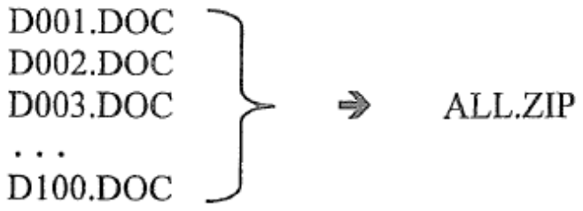

(1) It is easier to send and receive the documents.  
(2) The file size of the email is smaller.  
(3) The files become cross-platform.  

A. (1) and (2) only  
B. (1) and (3) only  
C. (2) and (3) only  
D. (1), (2) and (3)  

**5.** Arthur inserts a video clip in a presentation file and sends an email with the file to Betty. When Betty opens the file, there is only text and the video is missing. Why?

A. The video is infected with a computer virus and has been removed by an antivirus program.  
B. The presentation file is password-protected.  
C. Linking instead of embedding is used when inserting the video in the presentation file.  
D. The video is in MP4 format instead of AVI format.  

**6.** A combination lock consists of 5 separate switches. Each switch can be set to either the 'ON' or 'OFF' state. The lock can only be unlocked when all 5 switches are set to the correct switch states.

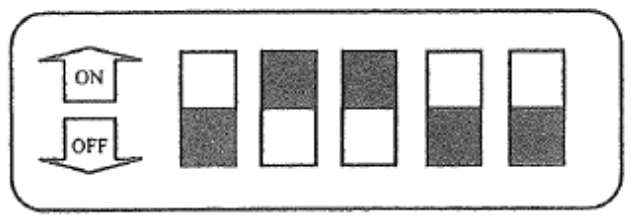

How many different combinations of switch states does this lock have?

A. 5  
B. 10  
C. 25  
D. 32  

**7.** The following two worksheets, WA1 and WA2, in a spreadsheet file are used to store the test results of Secondary 1 students in a school.

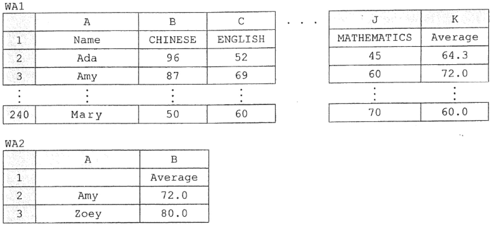

In order to find the average scores of Amy and Zoey on WA2, a VLOOKUP formula is entered into B2 and then copied into B3. What is the cell range used in the formula?

A. WA2!$A2:$B3  
B. WA1!$A2:$K240  
C. WA2!A$2:B$3  
D. WA1!A$2:K$240  

**8.** Which operations are performed by the following SQL command?


```text
SELECT * FROM EXAM WHERE CLASS='1A' ORDER BY SCORE DESC
```

(1) Sorting  
(2) Counting  
(3) Filtering  
(4) Updating  

A. (1) and (3) only  
B. (1) and (4) only  
C. (2) and (3) only  
D. (2) and (4) only  

**9.** In a data transmission system, a parity check is applied. One of the following received codes is invalid. Which one is it?

A. 0101 0101  
B. 1000 0100  
C. 1111 0001  
D. 0000 0011  

**10.** The following table in a database stores the information on employees.

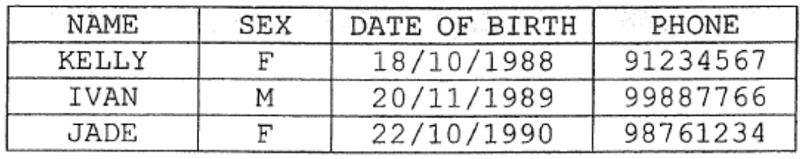

Why are the employees' dates of birth instead of their ages stored?

A. The employees' privacy can be better protected.  
B. Less memory is required for the storage.  
C. No data update is required.  
D. The related SQL queries are simpler.  

**11.** With 8-bit two's complement representation, which of the following operations can produce an overflow error?

(1) Addition of two positive integers  
(2) Addition of two negative integers  
(3) Addition of a positive integer and a negative integer  

A. (1) and (2) only  
B. (1) and (3) only  
C. (2) and (3) only  
D. (1), (2) and (3)  

**12.** When editing page numbers and hyperlinks in a document, which of the following statements is correct?

A. A browser must be open when clicking the hyperlinks.  
B. The page numbers are printed as footnotes.  
C. The hyperlinks facilitate the reading of the document.  
D. The page numbers must start from 1.  

**13.** Which of the following features in presentation software can control the transition of slides?

(1) Action button  
(2) Hyperlink  
(3) Slide layout  

A. (1) and (2) only  
B. (1) and (3) only  
C. (2) only  
D. (3) only  

**14.** Eliza edits a document with two images. The final outcome is not as expected, as shown below.

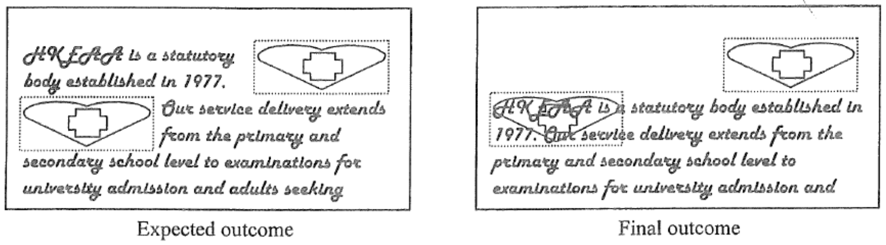

What feature in the word processor should Eliza use to correct this?

A. Object grouping  
B. Paragraph formatting  
C. Paragraph alignment  
D. Text wrapping  

**15.** Ms Wong works in a publishing company and has to create the following three documents.

(1) payment receipt  
(2) electronic book  
(3) template of a sales report  

For which document(s) should she adopt the PDF format instead of the DOC format?

A. (1) only  
B. (1) and (2) only  
C. (2) and (3) only  
D. (1), (2) and (3)  

**16.** Cathy uses 'what-if' analysis in a spreadsheet to solve a problem. Which of the following statements about the analysis is correct?

A. The 'what-if' analysis involves different data sets.  
B. The 'what-if' analysis involves different descriptions of the problem.  
C. The problem involves a database file.  
D. The problem involves a document file.  

**17.** Which of the following operations will enlarge the icons and text displayed on a visual display unit?

A. Reduce the number of colours displayed.  
B. Increase the number of colours displayed.  
C. Reduce the screen resolution.  
D. Increase the screen resolution.  

**18.** Peter upgrades his desktop computer with a touch screen. Why?

A. This is a good ergonomic practice.  
B. Many operating systems support touch screens.  
C. A touch screen can be installed easily.  
D. A touch screen allows for easier hand eye coordination than a keyboard.  

**19.** A supermarket uses thermal printers instead of dot-matrix printers to print receipts. What are the major reasons for using thermal printers?

(1) Less printing noise  
(2) Shorter printing time  
(3) More durable receipts  

A. (1) and (2) only  
B. (1) and (3) only  
C. (2) and (3) only  
D. (1), (2) and (3)  

**20.** The following diagram shows a basic computer system.

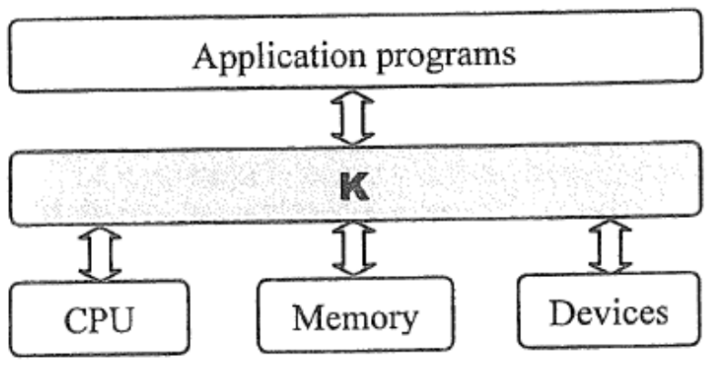

What is K responsible for?

(1) Controls devices through device drivers.  
(2) Manages memory.  
(3) Increases the number of application programs.  
(4) Schedules the running of processes.  

A. (1), (2) and (3) only  
B. (1), (2) and (4) only  
C. (1), (3) and (4) only  
D. (2), (3) and (4) only  

**21.** The 64-bit version of an operating system is better than the 32-bit version because

A. the processing power of the CPU is higher.  
B. the operating system can address more memory locations.  
C. fewer program errors will occur.  
D. the data transfer rate of RAM is higher.  

**22.** In an instruction fetch cycle, which of the following registers are involved?

(1) Accumulator  
(2) Memory Data Register (MDR)  
(3) Memory Address Register (MAR)  

A. (1) and (2) only  
B. (1) and (3) only  
C. (2) and (3) only  
D. (1), (2) and (3)  

**23.** A charity organisation wants to donate laptop computers to the children in developing countries for e-learning. With a limited budget, only one item in the original specifications can be upgraded, as shown below. Which of these is the most appropriate?

| | Original specifications | Upgrade items |
|---|---|---|
| A. | No network card | 802.11n network interface card |
| B. | Built-in graphics card | graphics card with 2G RAM |
| C. | Dual-core CPU | Quad-core CPU |
| D. | DVD disc drive | Blu-ray disc drive |

**24.** A search engine can automatically return the search results related to the country in which the computer is located. Which of the following discloses this location information?

A. The network interface card  
B. The bandwidth of the connection  
C. The operating system  
D. The Internet Service Provider  

**25.** Fiona creates a web page to show a photo of her child. In a web browser, the photo cannot be displayed, as shown below.

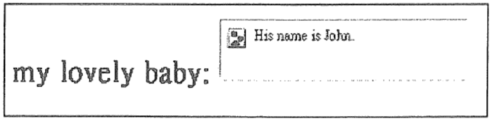

What is the possible mistake she has made?

A. Adopted improper text format.  
B. Used an incorrect filename for the photo.  
C. Missed some HTML tags.  
D. Inserted a frame that is too large.  

**26.** A company develops an internal email system. It adopts HTML format instead of plain text for the email because

A. the email size is smaller.  
B. browsers can open the email.  
C. text formatting can be applied.  
D. the POP protocol can be used.  

**27.** In an email system, what is the use of IMAP and SMTP?

A. IMAP and SMTP are application programs that regulate email transmission.  
B. IMAP and SMTP are the part of the operating system that manages email resources.  
C. IMAP and SMTP are utility programs that improve the efficiency of email transmission.  
D. IMAP and SMTP are sets of rules that determine how email is transmitted.  

**28.** In the following diagram, X is a device for transmitting high definition videos received from the Internet to the TV using streaming technology.

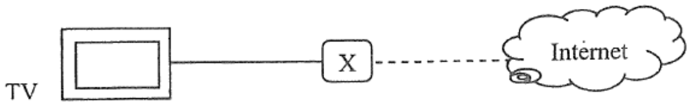

Which of the following specifications are necessary in X?

(1) 2TB hard disk  
(2) 8GB flash memory  
(3) Audio output  
(4) HDMI output  
(5) VGA output  

A. (2) and (4) only  
B. (3) and (5) only  
C. (1), (2) and (3) only  
D. (1), (4) and (5) only  

**29.** Which of the following is a function of a switch?

(1) Connects computers to form a LAN.  
(2) Controls the network traffic in a network.  
(3) Joins two networks.  
(4) Connects a LAN to the Internet.  

A. (1) and (2) only  
B. (3) and (4) only  
C. (1), (2) and (4) only  
D. (2), (3) and (4) only  

**30.** Dry run the following algorithm.

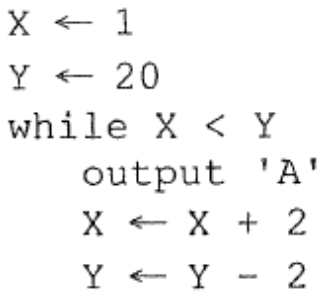

```text
X ← 1
Y ← 20
while X < Y
    output 'A'
    X ← X + 2
    Y ← Y - 2
```

How many character 'A's are displayed?

A. 5  
B. 6  
C. 10  
D. 20  

**31.** In the following algorithm, what input value of B will generate a run-time error?

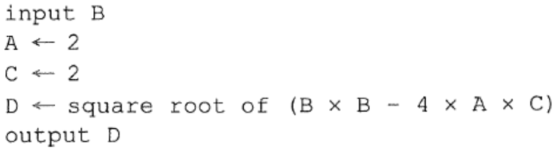

```text
input B
A ← 2
C ← 2
D ← square root of (B × B - 4 × A × C)
output D
```

A. -4  
B. 2  
C. 4  
D. 5  

**32.** The following two pseudo code segments are used for searching.

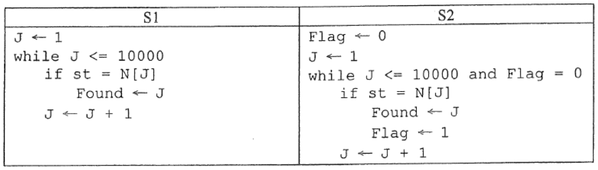

```text
S1
J ← 1
while J <= 10000
    if st = N[J]
        Found ← J
    J ← J + 1

S2
Flag ← 0
J ← 1
while J <= 10000 and Flag = 0
    if st = N[J]
        Found ← J
        Flag ← 1
    J ← J + 1
```

When comparing the execution times of the two segments, which of the following statements is correct?

A. S1 is generally faster.  
B. S2 is generally faster.  
C. They are more or less the same.  
D. The comparison cannot be determined.  

**33.** What is the major advantage of using an array in algorithm design?

A. The modular approach can be used in the design.  
B. It is useful in iteration design.  
C. The size of an array is flexible.  
D. The memory used is less.  

**34.** Which of the following statements about open source software is correct?

A. Open source software is written by open source programming languages.  
B. Open source software is executed in open source operating systems.  
C. The source code can be copied, modified and redistributed freely.  
D. Private companies cannot use open source software to make a profit.  

**35.** The following flowchart illustrates an algorithm that outputs the maximum value of four input numbers.

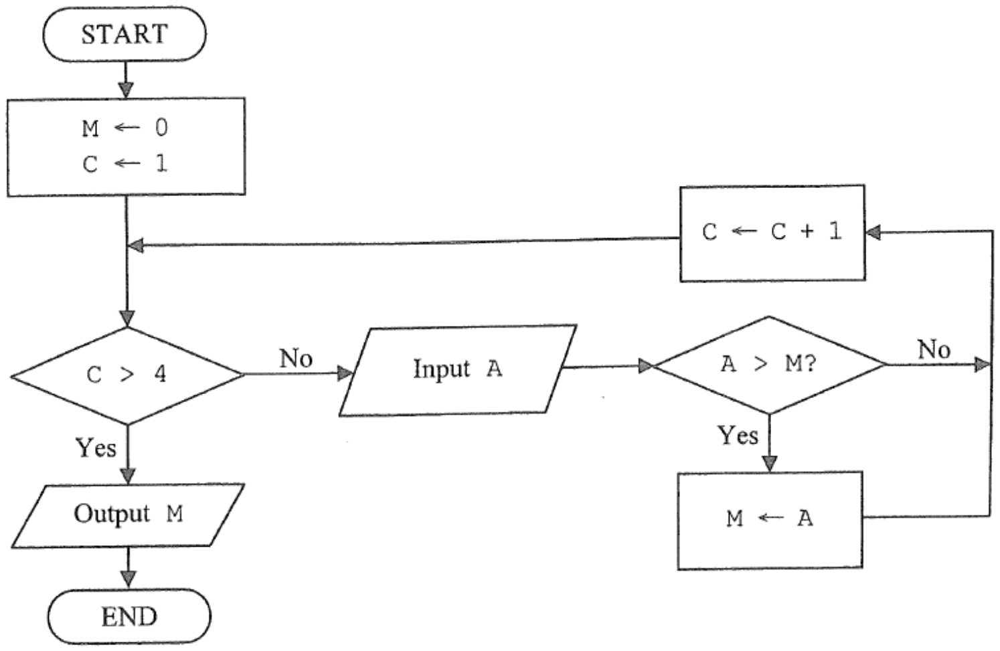

The algorithm cannot produce the correct result for one of the following sets of input numbers. Which set?

A. 0, 0, 0, 0  
B. -8, 7, 6, -3  
C. -2, -5, -4, -6  
D. 0, -1, -5, -9  

**36.** When Peter tries to change the password of his computer account, the following screen is shown.

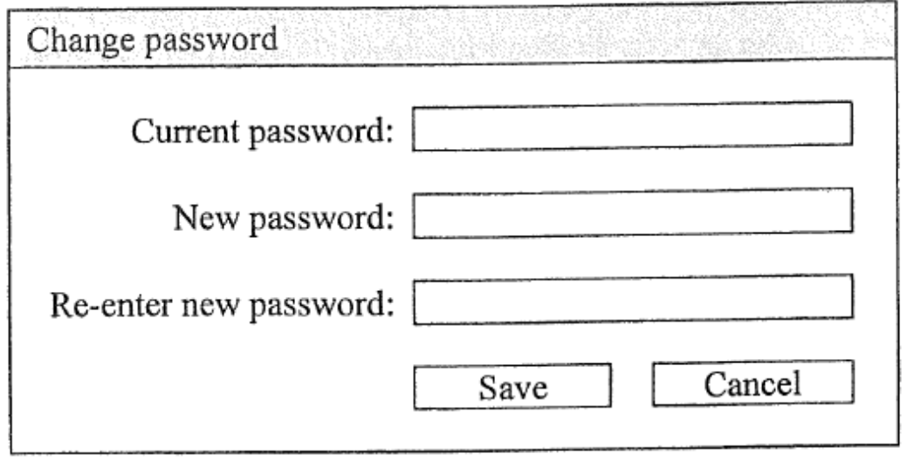

What is/are the use(s) of 'Current password'?

(1) It improves the password strength.  
(2) It minimises typing errors.  
(3) It prevents other people from changing the password.  

A. (1) and (2) only  
B. (1) and (3) only  
C. (2) only  
D. (3) only  

**37.** Which of the following can reduce the threats from using social networking web sites?

(1) Block or ignore people that you do not know or trust.  
(2) Use default privacy settings to restrict access.  
(3) Only disclose the name and address in the account.  

A. (1) only  
B. (2) only  
C. (1) and (3) only  
D. (2) and (3) only  

**38.** In a company, all URLs browsed through the office computers are recorded by a proxy server. Which of the following statements is correct?

A. The URLs should be recorded during office hours only.  
B. The records should be checked by authorised staff only.  
C. The records are the digital property of the staff.  
D. The company has committed a computer crime.  

**39.** For the sake of their health, users should take a rest after every hour of computer use. A software company wants to improve its word processing software to include this ergonomic feature. When a user uses the software for an hour, the software should

(1) display an alert message on the screen.  
(2) send an alert email to the user.  
(3) shut down the computer automatically.  

A. (1) only  
B. (2) only  
C. (1) and (3) only  
D. (2) and (3) only  

**40.** Peter uses peer-to-peer file sharing software to download a commercial application program. His friends advise him not to install it. Why?

(1) His action will create a digital divide.  
(2) The application program may be spyware.  
(3) He may infringe copyright law.  

A. (1) only  
B. (2) only  
C. (1) and (3) only  
D. (2) and (3) only  

**END OF PAPER**
