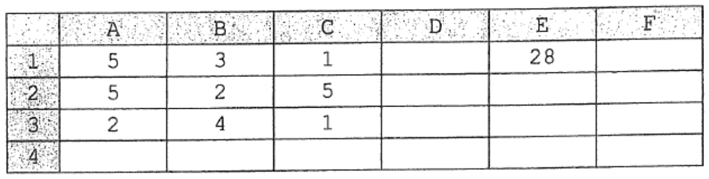
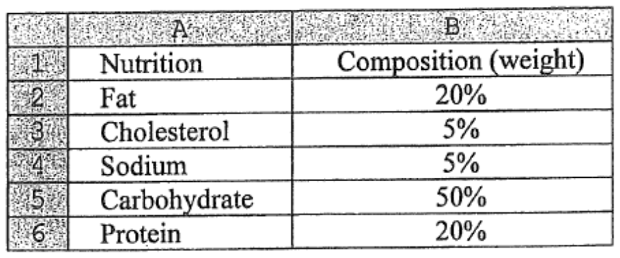
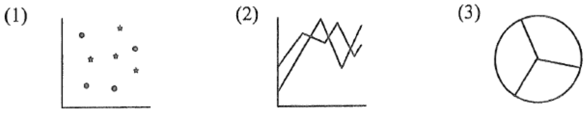
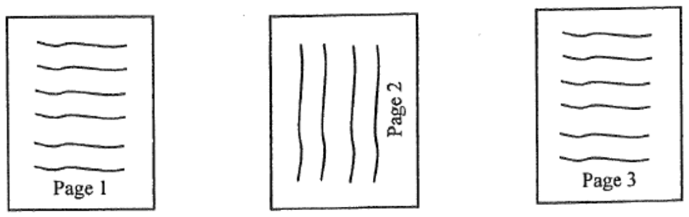
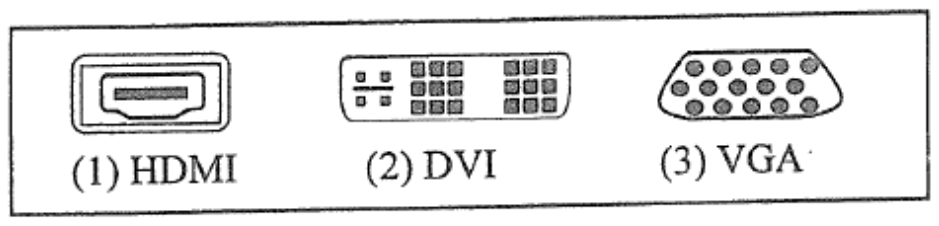
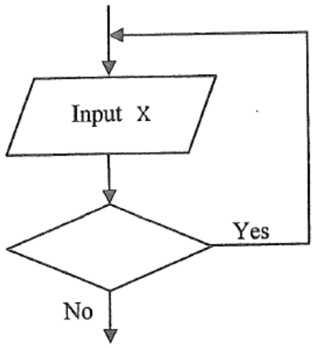
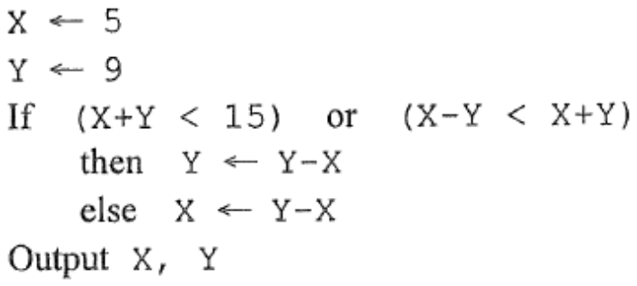
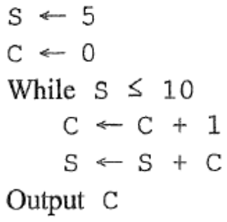

# There are 40 questions in this paper.  Choose the most suitable answers.

**1.** Which of the following activities involve(s) the conversion of analog to digital data or vice versa?

(1) Talking to a friend on a mobile phone  
(2) Listening to a radio programme over the Internet  
(3) Copying a file from a DVD-R to a hard disk  

A. (2) only  
B. (3) only  
C. (1) and (2) only  
D. (1) and (3) only  

**2.** A computer system uses the Hong Kong identity card (HKID) number as a key field for managing accounts. Its check digit is used to detect input errors made by users. Which of the following input errors can usually be found by the check digit?

(1) Use another person's HKID number.  
(2) Swap two digits in the HKID number.  
(3) Input a wrong digit in the HKID number.  

A. (1) and (2) only  
B. (1) and (3) only  
C. (2) and (3) only  
D. (1), (2) and (3)  

**3.** Increment the following numbers using 8-bit two's complement representation by 1. Which one will create an overflow error?

A. 01111111  
B. 10000000  
C. 10000001  
D. 11111111  

**4.** In a computer system, 10 bits are reserved for user identity codes and 54 bits are reserved for alias names. What is the maximum number of user accounts in the system?

A. 64  
B. 1024  
C. 10¹⁰  
D. 10⁵⁴  

**5.** Mr Lee wants to set up a cleaning service company to serve thousands of clients. He needs to process data about the service and create a monthly report for each client. Which software should he buy?

A. Word processing software  
B. Spreadsheet software  
C. Presentation software  
D. Database software  

**6.** In the following spreadsheet, the formula, '=SUM(A1:C3)', is entered in E1. What value is displayed in F2 after the formula in E1 is copied into F2?



A. 12  
B. 16  
C. 19  
D. 28  

**7.** Mr Wong wants to create a chart to display the following nutritional data.



Which type(s) of chart(s) is/are appropriate?



A. (1) only  
B. (2) only  
C. (3) only  
D. (1) and (2) only  

**8.** Only one record is retrieved after executing the following SQL command. Why?


```text
SELECT NAME, PHONE FROM EMPLOYEE
```

(1) There is only one record in EMPLOYEE.  
(2) The content of NAME or PHONE in the remaining records is empty.  
(3) There may be some other fields in EMPLOYEE.  

A. (1) only  
B. (1) and (2) only  
C. (1) and (3) only  
D. (2) and (3) only  

**9.** Jenny prints a document. The first three pages are shown below:



Which formatting features of a word processor has she used?

A. Table and footer  
B. Column and footer  
C. Margin and page orientation  
D. Section break and page orientation  

**10.** John uses his notebook computer to create a web-based presentation through a web site. He does not use the pre-installed presentation software to do so. Why?

(1) He can add more slides in the presentation.  
(2) He can edit the presentation in other computers without presentation software.  
(3) He can add video clips in the presentation.  

A. (1) only  
B. (2) only  
C. (1) and (3) only  
D. (2) and (3) only  

**11.** When creating a database table, what should be defined?

(1) Data type  
(2) Field name  
(3) Number of records  

A. (1) and (2) only  
B. (1) and (3) only  
C. (2) and (3) only  
D. (1), (2) and (3)  

**12.** Which of the following is/are the best practice when using online banking systems?

(1) Create an uncommon login name.  
(2) Use a combination of letters and numbers for the passwords and change them regularly.  
(3) Avoid using wired network when wireless network is available.  

A. (1) only  
B. (1) and (2) only  
C. (1) and (3) only  
D. (2) and (3) only  

**13.** In 2012, the US Government launched a project to explore how 'big data' could be used. 'Big data' refers to the huge amount of data collected which is difficult to process using database management systems. Which of the following are examples of 'big data'?

(1) Human DNA  
(2) User behaviour in a social networking web site  
(3) The total number of government officials in the US  

A. (1) and (2) only  
B. (1) and (3) only  
C. (2) and (3) only  
D. (1), (2) and (3)  

**14.** The following QR code is printed on an advertisement so that readers can scan the code and browse product information online through smart phones. What information is encoded in the QR code?


A. URL  
B. Telephone number of the company  
C. Type of smart phone supported  
D. Name of the product in binary codes  

**15.** A WAV file, which is a common audio file, consists of a header. Which of the following items is stored in the header?

A. Compression ratio  
B. Type of instrument used  
C. Sampling rate  
D. Type of audio player supported  

**16.** Mary converts the file *animal.bmp* to *animal.jpg*. Why?

(1) She wants to create a web page with this image.  
(2) She wants to store the image in DVD-R.  
(3) She wants to increase the resolution of the image.  

A. (1) only  
B. (2) only  
C. (1) and (3) only  
D. (2) and (3) only  

**17.** A quad-core processor is generally better than a dual-core processor because

A. more main memory is provided.  
B. the motherboard can be smaller.  
C. more instructions can be executed at the same time.  
D. a graphics processing unit (GPU) can be installed.  

**18.** Mary connects a new USB flash drive to a computer. She does not need to install a driver program for the flash drive. Why not?

A. A USB flash drive does not require a driver program.  
B. The flash drive uses the same driver program as the hard disk.  
C. The computer does not connect to the Internet.  
D. The operating system in the computer has the driver program for the flash drive already.  

**19.** A TV unit has the following three ports. High Definition (HD) videos will be output to the TV unit. Which of the following ports should be used?



A. (1) only  
B. (2) only  
C. (1) and (3) only  
D. (2) and (3) only  

**20.** A car is equipped with a global positioning system (GPS) such that the driver can get the location and time information when driving. Which of the following best describes the mode of operation of the system?

A. Batch processing  
B. Real-time processing  
C. Distributed processing  
D. Interactive processing  

**21.** Which of the following classifications is correct?

| | Computer hardware | System software |
|---|---|---|
| A. | Modem | PDF writer |
| B. | Touch screen | RAM |
| C. | Word processor | Spreadsheet |
| D. | ROM | Utility program |

**22.** Joseph installs network-attached storage (NAS) in the office network that operates as a file server. If he installs more cache memory in the NAS, which of the following can be greatly improved?

A. Storage capacity  
B. Flexibility of users' access rights  
C. Network bandwidth  
D. Data throughput  

**23.** When browsing a web page, which of the following will be involved?

(1) IP  
(2) URL  
(3) FTP  

A. (1) only  
B. (1) and (2) only  
C. (2) and (3) only  
D. (1), (2) and (3)  

**24.** In an email application, the settings of __X__ and __Y__ are used for receiving email and sending email respectively.

| | X | Y |
|---|---|---|
| A. | IMAP | POP |
| B. | IMAP | SMTP |
| C. | SMTP | IMAP |
| D. | SMTP | POP |

**25.** Mary has a wireless network with Internet access at home. She finds that the file transfer rate between a notebook computer and a desktop computer through the network is very low. What is the possible reason for this?

A. No wireless router is installed.  
B. The Internet connection is disconnected.  
C. The communication protocols used by the two computers are different.  
D. There is a thick wall between the computers and the wireless router.  

**26.** A proxy server in a school network can ____________________.

(1) increase the bandwidth of the Internet connection  
(2) filter web sites  
(3) store web pages for caching  

A. (1) only  
B. (2) only  
C. (1) and (3) only  
D. (2) and (3) only  

**27.** What is/are the advantage(s) of using tablet computers in e-learning?

(1) Students can easily carry tablet computers and access a Wi-Fi network.  
(2) Tablet computers can store a large amount of learning materials so that online resources will not be necessary.  
(3) Tablet computers have a high processing power.  

A. (1) only  
B. (2) only  
C. (3) only  
D. (2) and (3) only  

**28.** Peter can use the following two methods to download files. He chooses Method 1. Why?

Method 1: Direct download through HTTP  
Method 2: Download using Peer-to-Peer (P2P) file sharing technology  

A. HTTP is a secure channel.  
B. No dedicated software is required.  
C. The data transfer rate is higher.  
D. It is illegal to use Method 2.  

**29.** When constructing tables in a web page, which of the following attributes of the tables can be set?

(1) Page margin  
(2) Border  
(3) Text alignment  

A. (1) and (2) only  
B. (1) and (3) only  
C. (2) and (3) only  
D. (1), (2) and (3)  

**30.** The sales department of an insurance company wants to improve service to its clients. It asks the IT project manager to establish some web pages for the clients. What should the IT project manager do first?

A. Define the scope of the service.  
B. Evaluate the IT equipment needed.  
C. Estimate the project completion date.  
D. Set up a project team and recruit programmers.  

**31.** Part of a flowchart is shown below. The algorithm requests the user to repeatedly enter a number until a positive number is entered.



What should be filled in the decision box?

A. X > 0  
B. X ≥ 0  
C. X < 0  
D. X ≤ 0  

**32.** What is the output of the following algorithm?



```text
X ← 5
Y ← 9
If  (X+Y < 15)  or  (X-Y < X+Y)
    then  Y ← Y-X
    else  X ← Y-X
Output  X,  Y
```

A. 4  4  
B. 4  9  
C. 5  4  
D. 5  9  

**33.** What is the output of the following algorithm?



```text
S ← 5
C ← 0
While  S ≤ 10
    C ← C + 1
    S ← S + C
Output  C
```

A. 11  
B. 5  
C. 4  
D. 3  

**34.** Which of the following public policies can improve the digital divide in Hong Kong?

(1) Subsidise low-income families so that they can get Internet access at home.  
(2) Provide computer equipment to students in need.  
(3) Give free training courses to citizens who lack basic IT skills.  

A. (1) and (2) only  
B. (1) and (3) only  
C. (2) and (3) only  
D. (1), (2) and (3)  

**35.** Mary is a teenager and makes a new friend, Ada, through a random search function in a social networking web site. Ada wants to meet Mary the following Monday night at 10 p.m. in a restaurant. Mary's eldest brother advises her not to meet Ada. What is the major reason?

A. Mary can use another function in the social networking web site to make new friends.  
B. Mary's eldest brother cannot join the meeting.  
C. Ada's identity is not confirmed.  
D. Mary can meet another friend earlier.  

**36.** John does not download patches to upgrade the operating system of his computer. Which of the following statements best describes the possible consequences?

A. The license of the operating system will soon expire and he will have to re-install it.  
B. The operating system may be more vulnerable to attacks by hackers.  
C. The computer cannot connect to the Internet.  
D. The IP address of the computer may need to be changed.  

**37.** Which of the following can help visually impaired persons to browse the web?

(1) Braille display device  
(2) Web filtering software  
(3) Screen magnification software  

A. (1) only  
B. (2) only  
C. (1) and (3) only  
D. (2) and (3) only  

**38.** Which of the following statements about copyright protection in Hong Kong is correct?

A. Ideas are not protected unless they are in the form of expressions or products.  
B. The Customs and Excise Department cannot take legal action against copyright piracy unless the copyright owners file a complaint.  
C. A book cannot be protected unless it is published in Hong Kong.  
D. Computer programs are not protected unless the copyright owners inform the Office of the Government Chief Information Officer (OGCIO).  

**39.** Which of the following actions for desktop computers is/are environmentally-friendly?

(1) Enable the power management function.  
(2) Lower the screen resolution.  
(3) Use LED monitors instead of CRT monitors.  

A. (1) only  
B. (2) only  
C. (1) and (3) only  
D. (2) and (3) only  

**40.** In an office network, a technician installs a firewall instead of antivirus software. What is the major reason for this?

A. The computers in the office can be protected from adware.  
B. The network can be protected from online security threats.  
C. File transfer through the network can be faster.  
D. The network can withstand virus attacks.  

**END OF PAPER**
