# There are 40 questions in this paper.  Choose the most suitable answers.

**1.** An 8-bit code 10010011 is received without an error. The last bit is a parity bit. Using the same parity check, which of the following received codes has an error?

A. 00111111  
B. 10000010  
C. 10011011  
D. 00110101  

**2.** Arrange the following 4-bit numbers using two's complement representation in ascending order.

(1) 1000  
(2) 0100  
(3) 0111  
(4) 1111  

A. (4) < (1) < (3) < (2)  
B. (1) < (4) < (2) < (3)  
C. (2) < (3) < (1) < (4)  
D. (3) < (2) < (4) < (1)  

**3.** When using a database management systems tool, what is the major purpose of a query?

A. Adjust the layout of a database report.  
B. Help users enter data.  
C. Extract information from a database.  
D. Collect feedback from users.  

**4.** A company uses a smart card system to record the attendance records of its employees. When an employee enters the company's office, he puts his smart card on a card reader and a new record is generated and stored in a database table. Which of the following fields are essential in the new record?

(1) Smart card number  
(2) Employee's name  
(3) Employee's department  
(4) Time of entering the office  

A. (1) and (3) only  
B. (1) and (4) only  
C. (2) and (3) only  
D. (2) and (4) only  

**5.** 10,000 runners participate in a marathon competition. Each runner has a unique identity code stored in a RFID (radio-frequency identification) tag on one of his or her shoes. What is the minimum storage size required in each tag?

A. 1 byte  
B. 2 bytes  
C. 3 bytes  
D. 4 bytes  

Answer Questions 6 and 7 with reference to the following passage.

In a law firm, the lawyers need to read many archive documents every day. The firm plans to scan and store its archive documents as digital images so that the lawyers can use computers to search and view the documents.

**6.** What is the major benefit of such digitisation?

A. The intellectual property of the documents can be well protected.  
B. The lawyers can easily make copies of the documents.  
C. The lawyers can save time typing documents.  
D. The lawyers can easily retrieve and read a document.  

**7.** The law firm uses optical character recognition (OCR) technology to convert digital images into document files. Which of the following attributes can highly affect the accuracy of the conversion during the scanning process?

A. DPI (dots per inch) resolution  
B. Colour depth  
C. File format  
D. Image size  

**8.** Which of the following functions in word processing is applied to 'Please read Handbook for Candidates' at the bottom of the page in the document below?

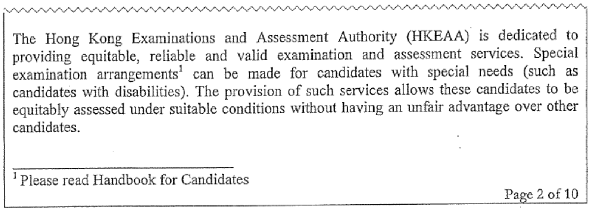

A. Footnote  
B. Indentation  
C. Index  
D. Centre alignment  

**9.** What is the order of sizes of the three character sets, ASCII, Big-5 code and Unicode?

A. ASCII < Unicode < Big-5 code  
B. ASCII < Big-5 code < Unicode  
C. Unicode < ASCII < Big-5 code  
D. Unicode < Big-5 code < ASCII  

**10.** Consider the spreadsheet below.

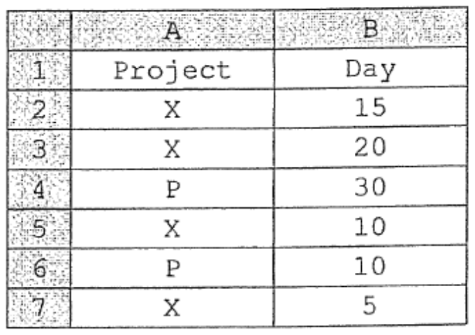

What is the output value of the following formula?

=SUMIF(A2:A7, "X", B2:B7)

A. 90  
B. 80  
C. 50  
D. 20  

**11.** When inserting a hyperlink in a slide in a presentation file, which of the following can be linked?

(1) A video file  
(2) A web site  
(3) A spreadsheet file  

A. (1) and (2) only  
B. (1) and (3) only  
C. (2) and (3) only  
D. (1), (2) and (3)  

**12.** During data input, which of the following can minimise input errors?

(1) Two's complement  
(2) Double entry  
(3) Type check  

A. (1) only  
B. (3) only  
C. (1) and (2) only  
D. (2) and (3) only  

**13.** Which of the following components in a Central Processing Unit (CPU) fetches an instruction from the main memory?

A. Arithmetic and Logic Unit (ALU)  
B. Memory Address Register (MAR)  
C. Program Counter (PC)  
D. Control Unit (CU)  

**14.** The table MACHINE has four records, as shown below.

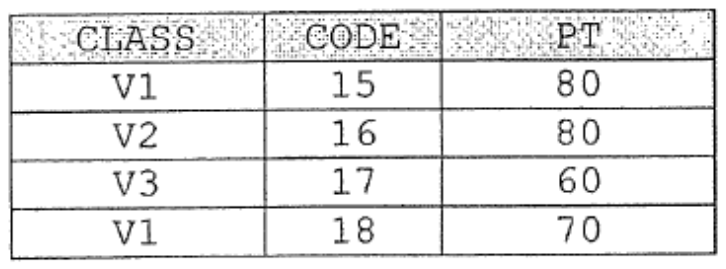

What is the output of the following SQL command?


```text
SELECT CODE FROM MACHINE WHERE CLASS <> 'V1' AND PT < 80
```

A. 15  
B. 16  
C. 17  
D. 18  

**15.** A university assigns a student number, YYYYNNNG, to every new student where

YYYY is the year of enrollment (e.g. 2015),  
NNN is a 3-digit number ranging from 000 to 999, and  
G is the area of study (1 stands for science and 2 stands for non-science).  

According to this scheme, how many student numbers the university can assign in the year of 2015?

A. 999  
B. 1000  
C. 2000  
D. 3998  

**16.** Which of the following functions does an operating system usually have?

(1) Provision of a user interface  
(2) Analysis of 'What-if' scenarios  
(3) Allocation of memory  
(4) Construction of web pages  

A. (1) and (3) only  
B. (1) and (4) only  
C. (2) and (3) only  
D. (2) and (4) only  

**17.** Which of the following statements about cache memory in CPU are correct?

(1) It is better than main memory in terms of access speed.  
(2) It stores frequently-used data and recently-used data.  
(3) It is non-volatile.  

A. (1) and (2) only  
B. (1) and (3) only  
C. (2) and (3) only  
D. (1), (2) and (3)  

**18.** In a supermarket, the original barcode of a product is shown below.

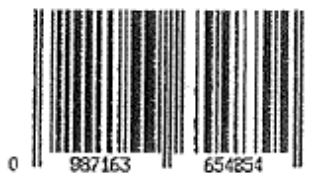

Part of the barcode of the product is covered. Which of the following cannot be properly scanned?

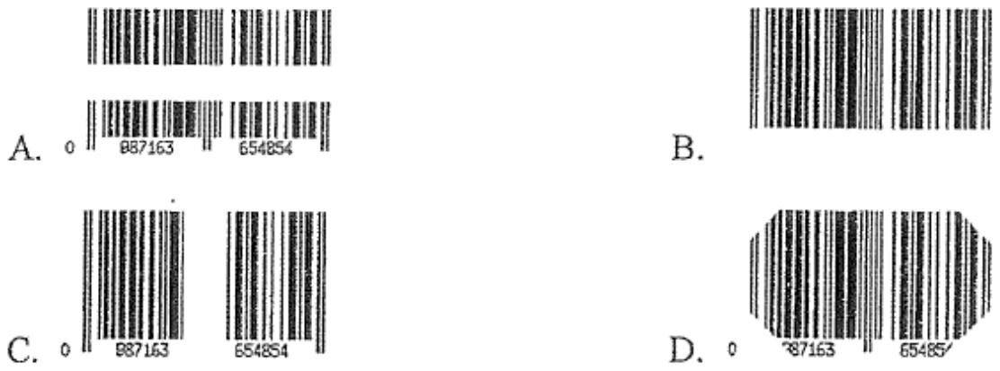

**19.** Mary creates a file in HTML format instead of text format. Why?

(1) Text format is not cross-platform.  
(2) The file can store hyperlinks.  
(3) Videos can be displayed when opening the file.  

A. (1) and (2) only  
B. (1) and (3) only  
C. (2) and (3) only  
D. (1), (2) and (3)  

Answer Questions 20 and 21 with reference to the following passage.

A company invents a smart thermostat to control the temperature of a house through the Internet. Customers can install the smart thermostat in their house and adjust the heating/cooling functions of the air conditioner from a smart phone.

**20.** Which of the following best describe the application of the smart thermostat?

(1) multi-user system  
(2) batch processing system  
(3) distributed processing system  
(4) real-time system  

A. (1) and (3) only  
B. (1) and (4) only  
C. (2) and (3) only  
D. (2) and (4) only  

**21.** The smart thermostat connects to the Internet through a wireless connection. What is the advantage of this?

A. It is convenient for installing and controlling the thermostat.  
B. TCP/IP protocol can be used.  
C. The data can be encrypted before transmission.  
D. Customers are required to enter a password to control the smart thermostat.  

**22.** On a web page, some data are entered using a drop-down list instead of a text box, as shown below. What are the major benefits of this design?

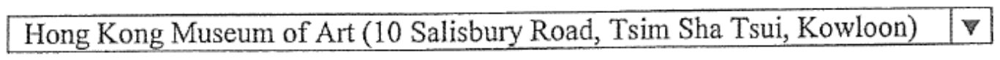

(1) Decrease the input time.  
(2) Reduce input errors.  
(3) Allow more input words.  

A. (1) and (2) only  
B. (1) and (3) only  
C. (2) and (3) only  
D. (1), (2) and (3)  

**23.** Mary receives an anonymous email, saying that the attached file photos.exe includes some photos of Mary. She tries to execute the file but no photos are displayed. What is/are the possible reason(s)?

(1) Photo editing software has not been installed in Mary's computer.  
(2) The file contains malicious code that harms Mary's computer.  
(3) The email server cannot execute the file.  

A. (1) only  
B. (2) only  
C. (1) and (3) only  
D. (2) and (3) only  

**24.** A cloud computing company not only provides cloud storage but also allows customers to make their files available offline. What is the major benefit of this arrangement?

A. Customers can remove the files from the cloud storage easily.  
B. Customers can increase the bandwidth of the network connection.  
C. Customers can access the files through their smart phones.  
D. Customers can edit the files without Internet connection.  

**25.** Peter uses a web authoring tool to create a web page under the edit mode 'Design View', as shown below.

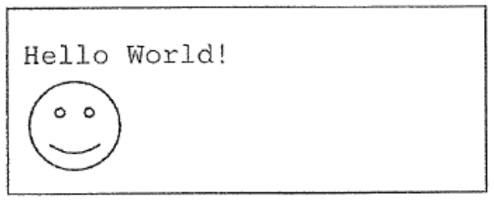

He then changes to another mode 'Code View'. Which of the following could be shown?

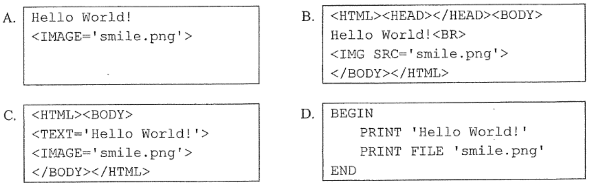

```text
A.
Hello World!
<IMAGE='smile.png'>

B.
<HTML><HEAD></HEAD><BODY>
Hello World!<BR>

</BODY></HTML>

C.
<HTML><BODY>
<TEXT='Hello World!'>
<IMAGE='smile.png'>
</BODY></HTML>

D.
BEGIN
    PRINT 'Hello World!'
    PRINT FILE 'smile.png'
END
```

**26.** David answers the following question in his school assignment: 'What is the history of the HKEAA?' He uses a search engine and finds the following paragraph:

The HKEAA was established in 2077...

Which of the following actions is/are appropriate?

(1) Put the entire paragraph in a search engine and search for similar results.  
(2) Browse other web sites to validate the information.  
(3) Copy the paragraph to the assignment.  

A. (1) only  
B. (2) only  
C. (1) and (3) only  
D. (2) and (3) only  

**27.** John edits the font colour of a web page. How many different colours can he choose?

A. 256 × 256 × 256  
B. 16 × 16 × 16  
C. 8 × 8 × 8  
D. 3 × 3 × 3  

**28.** What kind of iteration is used in the following segment of a flowchart?

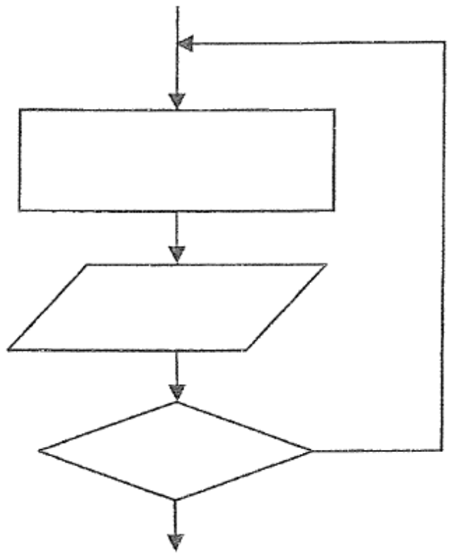

A. Multi-way selection  
B. For loop  
C. Pre-test loop  
D. Post-test loop  

**29.** The following pseudocode represents part of an algorithm.

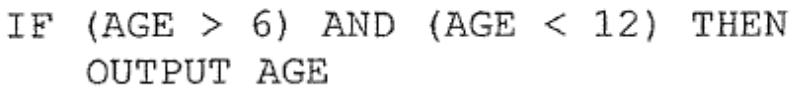

```text
IF (AGE > 6) AND (AGE < 12) THEN
    OUTPUT AGE
```

Which of the following sets of test data is the most appropriate?

A. 3 6 10 12 40  
B. 4 5 6 8 11  
C. 6 8 9 10 12  
D. 7 9 11 12 13  

**30.** An array DAT stores English names as shown below.

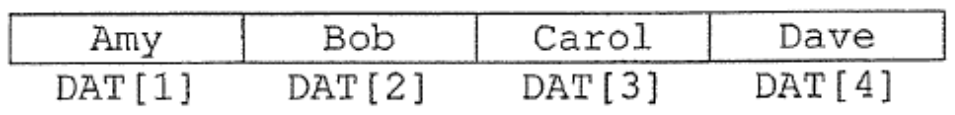

After executing the following algorithm, which element in DAT stores 'Carol'?

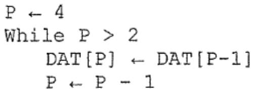

```text
P ← 4
While P > 2
    DAT[P] ← DAT[P-1]
    P ← P - 1
```

A. DAT[1]  
B. DAT[2]  
C. DAT[3]  
D. DAT[4]  

**31.** Consider the algorithm below.

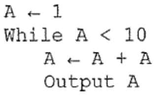

```text
A ← 1
While A < 10
    A ← A + A
    Output A
```

Which of the following values is/are included in the output?

(1) 6  
(2) 8  
(3) 16  

A. (1) only  
B. (2) only  
C. (1) and (3) only  
D. (2) and (3) only  

**32.** Peter changes the format of his audio files from wav to mp3. What is his main reason for doing this?

A. Store the mp3 files in a network-attached storage (NAS) device.  
B. Increase the quality of the audio data.  
C. Reduce the storage space required for the audio data.  
D. Create MIDI files for the audio data.  

**33.** When solving a problem in a project, Mary needs to define the scope of the problem precisely. What is/are the major reason(s) for doing this?

(1) She can break down the problem into sub-problems effectively.  
(2) She can use a truth table to illustrate the solution.  
(3) She can ignore the boundary cases when testing the algorithm.  

A. (1) only  
B. (2) only  
C. (1) and (3) only  
D. (2) and (3) only  

**34.** Cindy meets her friends and shares her photos. She does not upload the photos to her social networking account. Why not?

(1) Cindy wants to own the copyright of the photos.  
(2) Cindy wants to protect her personal privacy.  
(3) Cindy wants to prevent her account from being hacked.  

A. (1) only  
B. (2) only  
C. (1) and (3) only  
D. (2) and (3) only  

**35.** The logon page of an online banking system requires customers to enter a 6-digit number generated by their security token, as shown below.

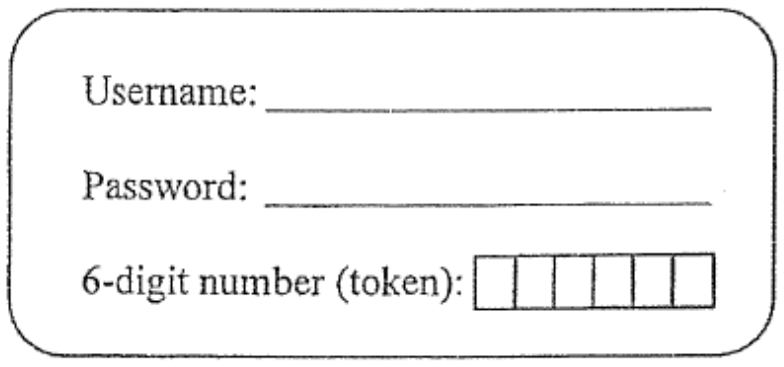

What is the purpose of using the token?

A. Prevent the computer from virus infection.  
B. Allow customers to enter a token value without their password.  
C. Authenticate customers' identity.  
D. Act as a firewall.  

**36.** Mr Chan wants to buy a tablet computer for his 8-year-old daughter, Susan. Which of the following actions is/are appropriate?

(1) Mr Chan should buy a tablet computer with a longer battery life.  
(2) Susan should use the tablet computer with a mouse.  
(3) Susan should take a 5-minute break after using the tablet computer for 30 minutes.  

A. (1) only  
B. (2) only  
C. (1) and (3) only  
D. (2) and (3) only  

**37.** Which of the following is/are ergonomic design(s)?

(1) A password can be set on a wireless router to prevent access by unauthorised users.  
(2) The angle of the elevation/depression of a monitor display is adjustable.  
(3) The text shown in word processing software can be enlarged.  

A. (1) only  
B. (2) only  
C. (3) only  
D. (1), (2) and (3)  

**38.** Which of the following statements about phishing email is/are correct?

(1) Phishing email is a type of advertisement that a company sends out to target recipients.  
(2) Phishing email is typically carried out by sending target recipients an email with a fake web site to acquire their personal information.  
(3) Target recipients will not be able to use their computers for a few days after a phishing attack.  

A. (1) only  
B. (2) only  
C. (1) and (3) only  
D. (2) and (3) only  

**39.** Recently some countries have attracted more females to study ICT courses and to work in the ICT industry. What is the benefit of this policy?

A. Widen the digital divide.  
B. Reduce the computer crime rate.  
C. Increase the salary.  
D. Expand ICT innovations.  

**40.** Which of the following functions is provided by a typical Internet browser?

A. Block unauthorised access to the computer.  
B. Generate a public key.  
C. Prevent attack from computer virus.  
D. Support the Secure Sockets Layer (SSL) in online transactions.  

**END OF PAPER**
