# There are 40 questions in this paper.  Choose the most suitable answers.

**1.** In a spreadsheet, 5-digit membership numbers for a sports club, 00001, 00002, ..., 99999, are entered in some cells. Which of the following cell formats should be used?

A. General format  
B. Number format  
C. Text format  
D. Scientific notation format  

**2.** In a device, 8 bits and 16 bits are used to store a character and an integer respectively. How many bytes are required to store the string ' HKDSE5 ' ?

A. 6 bytes  
B. 7 bytes  
C. 48 bytes  
D. 56 bytes  

**3.** Study the following three SQL commands.

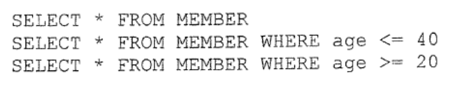

```text
SELECT * FROM MEMBER
SELECT * FROM MEMBER WHERE age <= 40
SELECT * FROM MEMBER WHERE age >= 20
```

The results of the three SQL commands are the same. Which of the following is/are the possible cause(s)?

(1) MEMBER is empty.  
(2) The values of the field age in MEMBER range from 20 to 40 inclusive.  
(3) age is the only field in MEMBER.  

A. (1) only  
B. (3) only  
C. (1) and (2) only  
D. (2) and (3) only  

**4.** Mary produces daily sales reports for a supermarket on a word processor, using the data and charts stored in several spreadsheet files. The data and charts are updated frequently. Which of the following is most helpful to her?

A. Mail merge  
B. 'what-if' scenarios  
C. Object linking and embedding  
D. SQL  

**5.** A code consists of 6 digits where the digit on the far right is a check digit. The check digit method used for the code is that the sum of all 6 digits is divisible by 10. Which of the following codes is valid?

A. 246822  
B. 246824  
C. 246826  
D. 246828  

**6.** Mary creates a compressed file containing image files stored in several folders. She uploads the compressed file to the Internet for sharing with her friends. What are the benefits of using a compressed file?

(1) The folder structure can be maintained.  
(2) Mary's friends can preview the images before downloading the compressed file.  
(3) The compressed file can be protected by password.  

A. (1) and (2) only  
B. (1) and (3) only  
C. (2) and (3) only  
D. (1), (2) and (3)  

**7.** Consider the following values, P, Q and R.

P = 10001000₂  
Q = 10001000₁₀  
R = 10001000₁₆  

Which of the following is correct?

A. P > Q > R  
B. P > R > Q  
C. R > P > Q  
D. R > Q > P  

**8.** 1111 1111 is an 8-bit number using two's complement representation. What is its decimal value?

A. -1  
B. 0  
C. 1  
D. 255  

**9.** Which of the following are characteristics of the Information Age?

(1) Information is widely distributed via the Internet.  
(2) Information can be quickly accessed by the public.  
(3) All company information on the Internet is correct.  

A. (1) and (2) only  
B. (1) and (3) only  
C. (2) and (3) only  
D. (1), (2) and (3)  

**10.** When editing numerical data in a spreadsheet, which of the following statements is correct?

A. Only relevant numerical data will be updated automatically.  
B. Only relevant charts with the numerical data will be updated automatically.  
C. Only relevant data in a single worksheet will be updated automatically.  
D. Relevant data in multiple worksheets will be updated automatically.  

**11.** Which of the following items can be included in a portable document format (PDF) file?

(1) Hyperlinks  
(2) Photos  
(3) Formatted text  

A. (1) and (2) only  
B. (1) and (3) only  
C. (2) and (3) only  
D. (1), (2) and (3)  

**12.** Peter uses a word processor to produce the rundown of a music performance, as shown below:

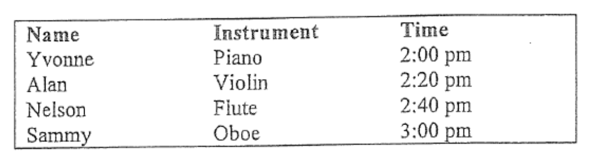

Which of the following can help Peter produce the rundown?

(1) Set tab stops.  
(2) Set columns.  
(3) Insert a table.  

A. (1) and (2) only  
B. (1) and (3) only  
C. (2) and (3) only  
D. (1), (2) and (3)  

**13.** The following figure illustrates the components of an information system.

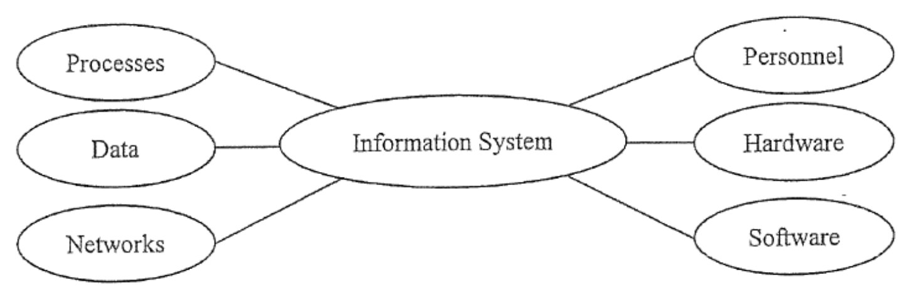

Which of the following matches is not correct ?

| | Component | Example |
|---|---|---|
| A. | Personnel | Chief Information Officer (CIO) |
| B. | Software | Operating system |
| C. | Data | FTP |
| D. | Networks | WAN |

Answer Question 14 and 15 with reference to the following passage.

Mary uses presentation software to create a self-running slide show with verbal commentary. She uploads the slide show to her web site so that the public can view it.

**14.** Which of the following must Mary do when creating the slide show?

A. Set the timing of each slide.  
B. Create hyperlinks in the slides.  
C. Create animation effects in the slides.  
D. Insert background music in the slides.  

**15.** When Mary chooses the file format for the slide show, which of the following is important?

A. Encryption support  
B. Cross-platform  
C. Object Linking and Embedding (OLE)  
D. SQL support  

**16.** Which of the following is/are the advantage(s) of using Unicode over Big-5 code?

(1) Unicode is cross-platform.  
(2) Unicode has a bigger character set.  
(3) New characters can be defined in Unicode.  

A. (1) only  
B. (2) only  
C. (1) and (3) only  
D. (2) and (3) only  

**17.** A booking system consists of several booking counters in different locations in a city. Customers can buy tickets for theatres through one of the booking counters. Which of the following best describes the booking system?

A. Real-time system  
B. Batch processing system  
C. Distributed processing system  
D. Parallel processing system  

**18.** Peter finds that when editing video files, the performance of his home computer is better than that of his office computer. Which of the following is/are the possible cause(s) for this?

(1) The read/write access speed of a hard disk  
(2) The storage size of ROM  
(3) CPU's clock rate  

A. (1) only  
B. (2) only  
C. (1) and (3) only  
D. (2) and (3) only  

**19.** Which of the following functions will an operating system usually provide?

(1) Control of processes  
(2) Allocation of memory  
(3) Record of network traffic  

A. (1) and (2) only  
B. (1) and (3) only  
C. (2) and (3) only  
D. (1), (2) and (3)  

**20.** The clock rate of a CPU is 2 GHz. Which of the following statements is correct?

A. The CPU executes 2×10⁹ instructions in a second.  
B. The CPU performs 2×10⁹ clock cycles in a second.  
C. The cache memory of the CPU transfers 2×10⁹ instructions in a second.  
D. The ALU of the CPU takes 2×10⁹ clock cycles for an instruction.  

**21.** Peter upgrades a server by replacing the hard disk with a solid-state disk (SSD). Which of the following properties of SSD benefit(s) the upgrade?

(1) Higher data transfer rate  
(2) Lower power consumption  
(3) Smaller storage capacity  

A. (2) only  
B. (3) only  
C. (1) and (2) only  
D. (1) and (3) only  

**22.** When a personal computer is turned on, it loads data from the ROM and checks that all major components are functioning properly. ROM cannot be replaced by RAM in this process because

A. the storage size of RAM is smaller.  
B. RAM is volatile.  
C. the data transfer rate of RAM is lower.  
D. RAM is random access.  

**23.** The Internet of Things (IoT) refers to the networks formed by devices which can collect and exchange data. The networks are usually connected to the Internet. Which of the following items should the devices usually have?

A. an IP address  
B. a CPU with a high processing power  
C. a DNS  
D. a large storage capacity  

**24.** Peter watches a webcasting video at home using streaming technology and finds that the video does not play smoothly. Which of the following are the possible causes?

(1) Duration of the video  
(2) Method of Internet access  
(3) Bandwidth of the Internet connection  

A. (1) and (2) only  
B. (1) and (3) only  
C. (2) and (3) only  
D. (1), (2) and (3)  

**25.** The Hong Kong Special Administrative Region Government has set up GovWiFi to provide free wireless Internet access and citizens can opt to use the unencrypted connection or the encrypted connection. Which of the following statements is correct?

A. Citizens can only enjoy Internet access at designated spots.  
B. Citizens cannot access online banking web sites through the unencrypted connection.  
C. Citizens' devices can be protected from computer viruses through the encrypted connection.  
D. Citizens will have priority to book the Government leisure facilities through GovWiFi.  

**26.** Mr Li considers some communication links for building a network in a company and compares their effective data transfer rates. Which of the following comparisons is correct?

A. Cat 6 (twisted pair) < Satellite < Fibre optics  
B. Satellite < Cat 6 (twisted pair) < Fibre optics  
C. Cat 6 (twisted pair) < Fibre optics < Satellite  
D. Satellite < Fibre optics < Cat 6 (twisted pair)  

**27.** Peter plans to upload the background music of his school web site but the web site has limited storage space. Which of the following file formats is appropriate?

A. WAV  
B. AVI  
C. MPEG2  
D. MP3  

**28.** When placing a table in a web page, which of the following is not a table setting?

A. Number of cells  
B. Formulas in cells  
C. Colour of cells  
D. Width of the table  

**29.** A simple web page is shown below.

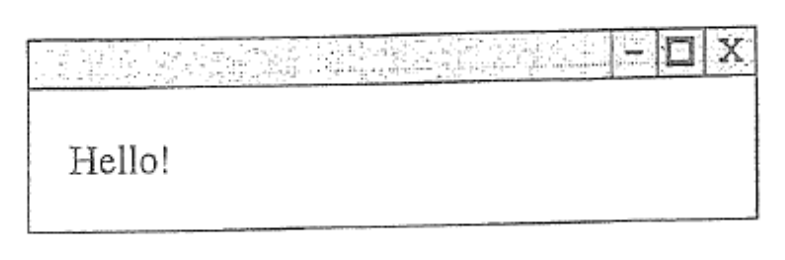

Which of the following is the HTML code of the web page?

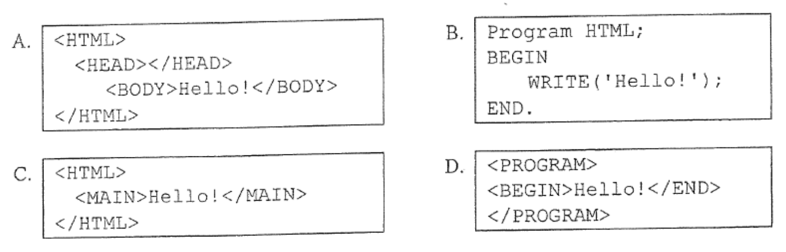

```text
A.
<HTML>
<HEAD></HEAD>
<BODY>Hello!</BODY>
</HTML>

B.
Program HTML;
BEGIN
    WRITE('Hello!');
END.

C.
<HTML>
<MAIN>Hello!</MAIN>
</HTML>

D.
<PROGRAM>
<BEGIN>Hello!</END>
</PROGRAM>
```

**30.** Which of the following pseudocodes produce the same result?

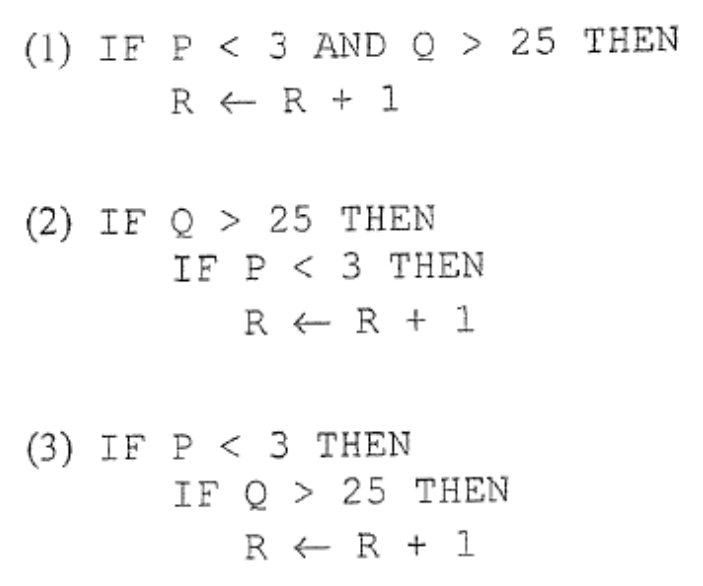

```text
(1) IF P < 3 AND Q > 25 THEN
        R ← R + 1

(2) IF Q > 25 THEN
        IF P < 3 THEN
            R ← R + 1

(3) IF P < 3 THEN
        IF Q > 25 THEN
            R ← R + 1
```

A. (1) and (2) only  
B. (1) and (3) only  
C. (2) and (3) only  
D. (1), (2) and (3)  

**31.** What is the output of the following algorithm?

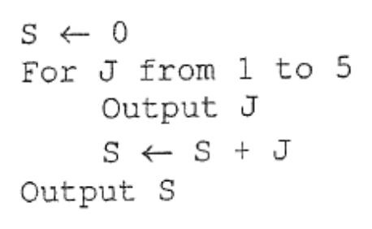

```text
S ← 0
For J from 1 to 5
    Output J
    S ← S + J
Output S
```

A. 12345  
B. 1234515  
C. 5432115  
D. 5432121  

**32.** NUM is an integer array. What is the output of the following algorithm?

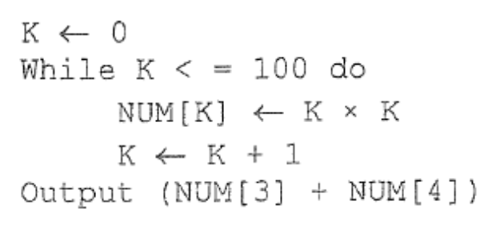

```text
K ← 0
While K <= 100 do
    NUM[K] ← K × K
    K ← K + 1
Output (NUM[3] + NUM[4])
```

A. 7  
B. 25  
C. 49  
D. 100  

**33.** Study the problem shown in the Input-Process-Output (IPO) cycle below.

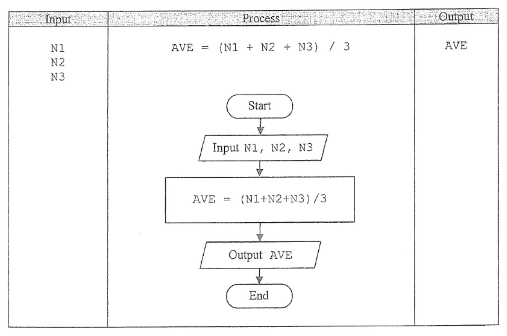

Which of the following statements is not correct?

A. The IPO cycle illustrates the data type and data structure.  
B. The problem shown is to find the average of three numbers.  
C. The IPO cycle illustrates a solution to the problem.  
D. The control structure of the flowchart shown in the 'Process' is a sequence.  

**34.** A bank has a secure room which only a few staff members can enter. Which of the following security measures is the most secure one for controlling access?

A. password  
B. smart card  
C. fingerprint  
D. key  

Answer Question 35 and 36 with reference to the following passage.

Cathy receives an anonymous email about changing the password of her online banking account, as shown below. She clicks the hyperlink in the email and a malicious web site is displayed.

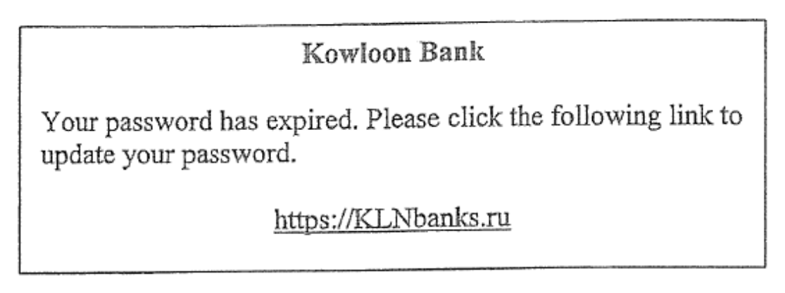

**35.** Which of the following security issues is/are mainly involved in the instance?

(1) Eavesdropping  
(2) Intrusion  
(3) Phishing  

A. (1) only  
B. (2) only  
C. (1) and (3) only  
D. (2) and (3) only  

**36.** Which of the following actions can help Cathy ensure that she is browsing a trusted web site?

A. Ensure that the domain name does not contain '.ru'.  
B. Verify the digital certificates of the web site.  
C. Follow hyperlinks in emails sent by friends instead of anonymously.  
D. Enable a firewall before browsing the Internet.  

**37.** What is the aim of the following policy?

"The Government helps families in need acquire computers and Internet access, and delivers personal support and training to them so children and parents can tap the online world's potential."

A. Promoting the freedom of information on the Internet  
B. Supporting e-government services  
C. Promoting the change in the nature of work  
D. Bridging the digital divide  

**38.** Peter is a student and does the following actions. Which of them are illegal?

(1) Uses a BT program to share his homework.  
(2) Uses a BT program to download copyrighted songs for his own use.  
(3) Buys copyrighted software and makes copies for his best friends only.  

A. (1) and (2) only  
B. (1) and (3) only  
C. (2) and (3) only  
D. (1), (2) and (3)  

**39.** Mary downloads three types of programs, P, Q and R from the Internet. She can use P for a trial period, changes the source code of Q and only uses some functions in R. Which type(s) of program is/are shareware?

A. P only  
B. Q only  
C. P and R only  
D. Q and R only  

**40.** Betty buys a voice recognition dictionary mobile application to check meanings of words. When she installs the application in her mobile device, it shows the following request.

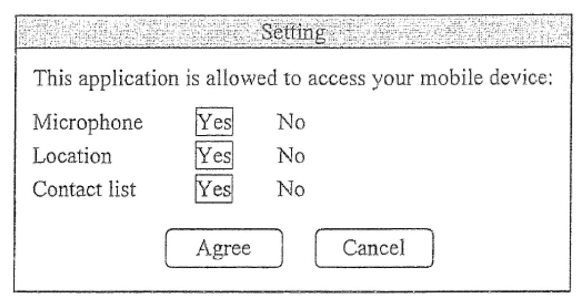

Which of the following settings should Betty allow?

(1) Microphone  
(2) Location  
(3) Contact list  

A. (1) only  
B. (2) only  
C. (1) and (3) only  
D. (2) and (3) only  

**END OF PAPER**
