# There are 40 questions in this paper.  Choose the most suitable answers.

**1.** Three plaintext files contain some characters, as shown below:

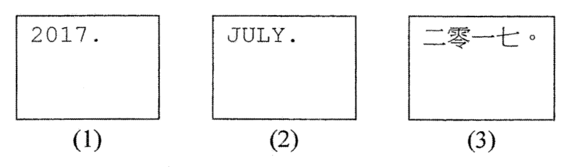

Assume that Unicode (UTF-8) is adopted. Which of the following comparative statements about the file sizes is correct?

A. (1) > (3)  
B. (2) > (1)  
C. (2) > (3)  
D. (3) > (2)  

**2.** There are two methods for entering dates into a web page, as shown below:

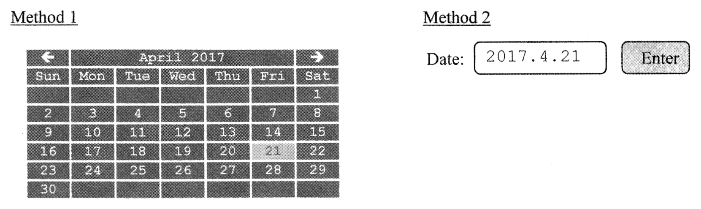

What are the benefits of using Method 1 instead of Method 2?

(1) Reduces input errors.  
(2) It is more user-friendly.  
(3) Detects errors by parity checking.  

A. (1) and (2) only  
B. (1) and (3) only  
C. (2) and (3) only  
D. (1), (2) and (3)  

**3.** Which of the following are the major benefits of using Object Linking and Embedding (OLE) in office automation software?

(1) Data from different applications can be included in a single file.  
(2) Data from different applications can remain synchronised.  
(3) Data from different applications can be stored in the same folder.  

A. (1) and (2) only  
B. (1) and (3) only  
C. (2) and (3) only  
D. (1), (2) and (3)  

**4.** Amy plans to upload her photos to cloud storage. What is the benefit of using JPG format instead of BMP format in this case?

A. Decreases the width and length of the photos.  
B. Decreases the file size of the photos.  
C. Increases the number of pixels in the photos.  
D. Increases the number of colours in the photos.  

**5.** When a digital photo is printed on photo paper, the top and bottom parts of the photo paper are unused. What is/are the possible reason(s) for this?

(1) The aspect ratios of the digital photo and the photo paper are not the same.  
(2) The file size of the digital photo is too large.  
(3) The colour depth of the digital photo is too low.  

A. (1) only  
B. (2) only  
C. (1) and (3) only  
D. (2) and (3) only  

**6.** In a college, the registration form for each student has a unique bar code. The college will digitise the forms and store them in PDF format. What is/are the major benefit(s) of handling the forms in this way?

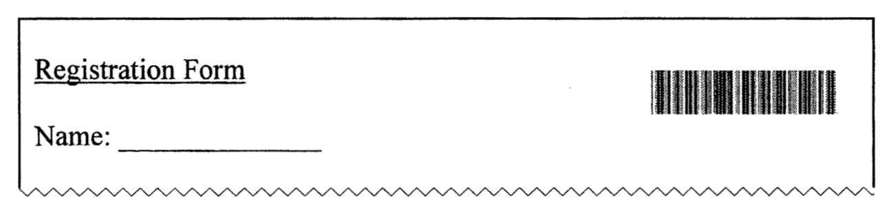

(1) The forms can be retrieved and used in different operating systems.  
(2) Searching for a form can be faster.  
(3) The forms can be printed on high quality paper.  

A. (2) only  
B. (3) only  
C. (1) and (2) only  
D. (1) and (3) only  

**7.** When creating an online email account, the following step needs to be completed.

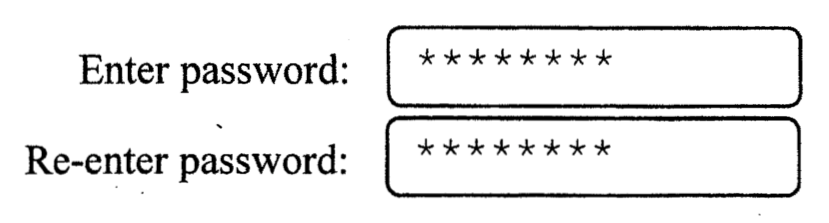

What is the purpose of re-entering the password?

A. Data collection  
B. Data verification  
C. Data organisation  
D. Data validation  

**8.** Which of the following actions involve the conversion of analog to digital data?

(1) Using software to convert a spreadsheet file into a PDF file  
(2) Using software to convert speech to text  
(3) Using a digital camera to take photos  

A. (1) and (2) only  
B. (1) and (3) only  
C. (2) and (3) only  
D. (1), (2) and (3)  

**9.** A black-and-white display board uses 8×8 pixels to illustrate a pattern. The upper left 4 pixels must be black at any time. How many different patterns can the display board illustrate?

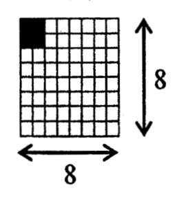

A. 60  
B. 120  
C. 2³⁶  
D. 2⁶⁰  

**10.** What is the major benefit of using a form in a database management system?

A. Simplifies data entry.  
B. Simplifies report printing.  
C. Saves storage space.  
D. Filters data in a single database table.  

**11.** For a chain convenience store, in which of the following examples should 'what-if' scenarios in spreadsheets be used?

(1) Estimates monthly expenses by changing different parameters.  
(2) Produces monthly sales analysis.  
(3) Compares sales data from different branches.  

A. (1) only  
B. (2) only  
C. (1) and (3) only  
D. (2) and (3) only  

**12.** The following calculations involve 8-bit numbers using two's complement representation. Which one will generate an overflow error?

A. 0001 0101 + 1000 1000  
B. 0111 0011 + 1000 1000  
C. 1100 0110 + 1000 1000  
D. 1111 1100 + 1000 1000  

**13.** Read the following survey data on ways of going home:

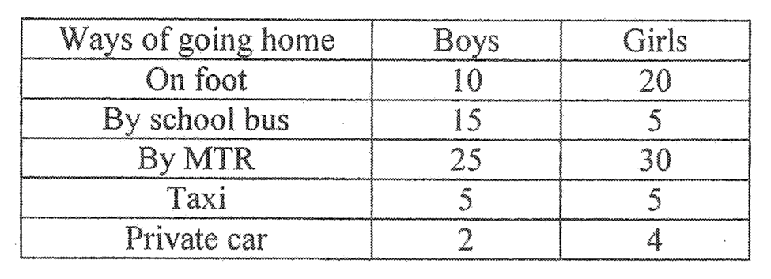

Which of the following types of spreadsheet charts can best represent data on the first three ways of going home?

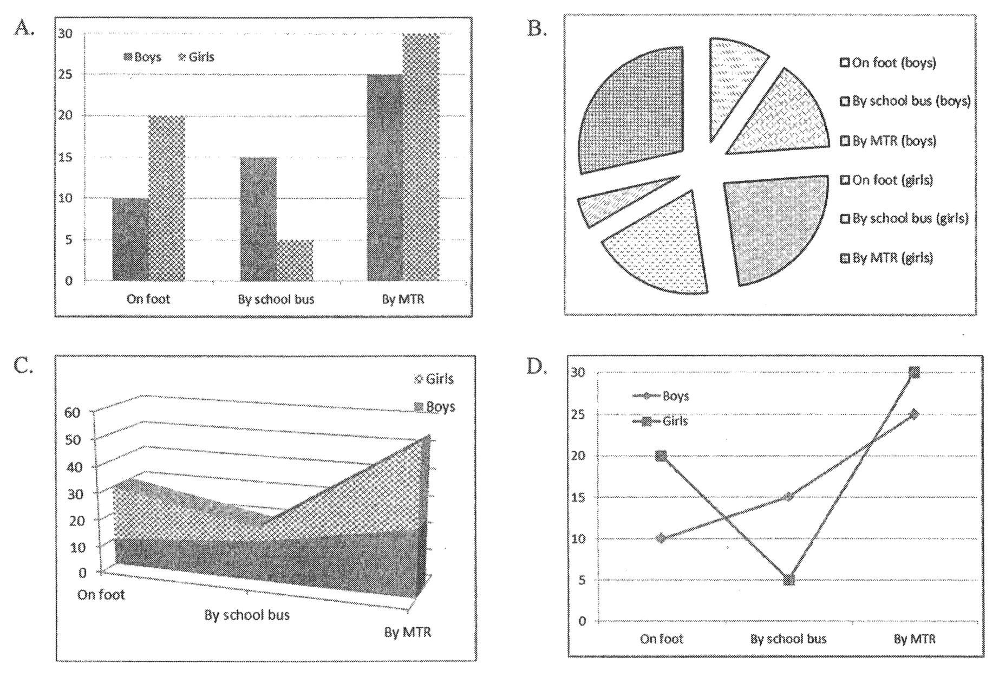

**14.** Colour codes are used when defining the background colour on a web page. What is the range of hexadecimal values for the colour codes?

A. 0 to 99  
B. 0 to FF  
C. 1 to 64  
D. 1 to AA  

**15.** Which of the following items is/are system software?

(1) Spreadsheet software  
(2) Operating system  
(3) Driver program  

A. (1) only  
B. (2) only  
C. (1) and (3) only  
D. (2) and (3) only  

**16.** Consider the following steps in a machine cycle for a particular instruction:

(1) Executes the instruction.  
(2) Writes data in memory.  
(3) Translates the instruction into the operation code and operands.  
(4) Retrieves the instruction from memory.  

What is the correct order of the steps?

A. (3) → (1) → (2) → (4)  
B. (3) → (2) → (4) → (1)  
C. (4) → (1) → (3) → (2)  
D. (4) → (3) → (1) → (2)  

**17.** A computer is used to edit videos. Which of the following specifications have a significant impact on the performance of the computer?

(1) Size of RAM  
(2) Number of USB ports  
(3) CPU clock rate  

A. (1) and (2) only  
B. (1) and (3) only  
C. (2) and (3) only  
D. (1), (2) and (3)  

**18.** Which of the following statements about the registers in CPU is correct?

A. Their read/write data transfer rates are high.  
B. Their functions are the same.  
C. They are used as secondary storage.  
D. Their total storage size is usually larger than 1 GB.  

**19.** What information is usually provided by the system monitoring software in an operating system?

(1) Current processes  
(2) Memory usage  
(3) Network traffic  

A. (1) and (2) only  
B. (1) and (3) only  
C. (2) and (3) only  
D. (1), (2) and (3)  

**20.** Which of the following is/are the government e-services provided by GovHK?

(1) Enrolling for community recreation and sports programmes  
(2) Applying for admission to universities in Hong Kong  
(3) Renewing borrowed public library books  

A. (1) only  
B. (2) only  
C. (1) and (3) only  
D. (2) and (3) only  

**21.** Mary wants to buy a keyboard for her tablet computer. Which of the following connections is/are commonly used for keyboards?

(1) Fibre optics  
(2) USB cable  
(3) Bluetooth  

A. (1) only  
B. (2) only  
C. (1) and (3) only  
D. (2) and (3) only  

**22.** Bank customers can withdraw cash from their accounts through Automated Teller Machines (ATMs). Which of the following systems best describe(s) this operation?

(1) Interactive system  
(2) Real-time system  
(3) Batch processing system  

A. (2) only  
B. (3) only  
C. (1) and (2) only  
D. (1) and (3) only  

**23.** Which of the following is the major function of a switch in a school computer network?

A. Facilitates data transmission between computers.  
B. Prevents unauthorised access.  
C. Increases the network bandwidth.  
D. Provides email services for users.  

**24.** Which of the following is/are the advantage(s) of setting up a wireless network to replace a wired network?

(1) Increased network speed.  
(2) Enhanced network security.  
(3) Increased mobility of computers.  

A. (1) only  
B. (3) only  
C. (1) and (2) only  
D. (2) and (3) only  

**25.** Amy wants to buy a colour laser printer for use at home. What specifications should she consider?

(1) Brightness (lm)  
(2) Printing speed (ppm)  
(3) Resolution (dpi)  

A. (1) and (2) only  
B. (1) and (3) only  
C. (2) and (3) only  
D. (1), (2) and (3)  

**26.** Peter is going to set up a web site for his new company so that customers can access his web site through any one of the following links:

web.goodcompany.hk  
www.goodcompany.hk  
www.goodcompany.com.hk  
www.goodcompany.com  
web.goodcompany.com  

How many domain names does he need to register?

A. 1  
B. 2  
C. 3  
D. 4  

**27.** A web page of a company displays its eight branches in China, as shown below:

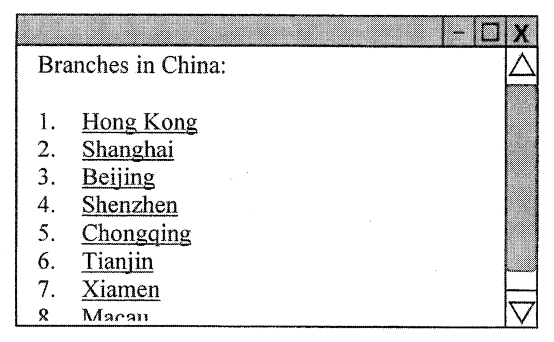

Which of the following modifications can let users clearly view all the branches without using the scroll bar on the right hand side?

(1) Reduces the font size.  
(2) Decreases the character spacing.  
(3) Uses a table with multiple columns.  

A. (1) and (2) only  
B. (1) and (3) only  
C. (2) and (3) only  
D. (1), (2) and (3)  

**28.** A web page displays some images. In addition to the names of the image files, what other information will be included in the HTML code of the web page?

(1) The paths of the image files  
(2) The size of the image files  
(3) The IP address of the server that stores the HTML file  

A. (1) only  
B. (2) only  
C. (1) and (3) only  
D. (2) and (3) only  

**29.** The following segment of a flowchart is used to represent a task in a cinema ticket booking system. What is the task?

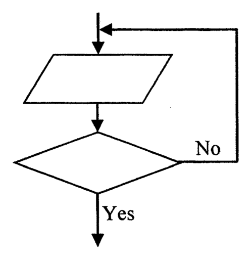

A. Prints a ticket.  
B. Calculates a ticket price.  
C. Displays a 'welcome' message.  
D. Validates the number of tickets entered.  

**30.** The problem-solving procedures for developing a computer system are listed below. What is the correct order of the procedures?

(1) Tests the system.  
(2) Defines the problem.  
(3) Designs the algorithm.  
(4) Writes the program codes.  

A. (2) → (4) → (3) → (1)  
B. (2) → (3) → (4) → (1)  
C. (3) → (2) → (4) → (1)  
D. (3) → (4) → (2) → (1)  

**31.** What is the output of the following algorithm?

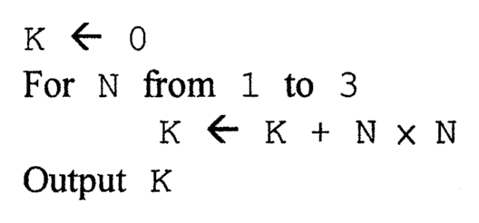

```text
K ← 0
For N from 1 to 3
    K ← K + N × N
Output K
```

A. 3  
B. 9  
C. 14  
D. 30  

**32.** Study the following statement:

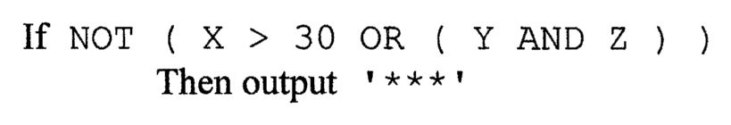

```text
If NOT ( X > 30 OR ( Y AND Z ) )
    Then output '****'
```

For which of the following combinations of the values X, Y and Z will '****' be displayed?

| | X | Y | Z |
|---|---|---|---|
| A. | 20 | TRUE | TRUE |
| B. | 30 | FALSE | FALSE |
| C. | 40 | FALSE | FALSE |
| D. | 50 | FALSE | TRUE |

**33.** A is an array with A[1], A[2], ... , A[N] storing N non-zero values.  What is the purpose of the following algorithm?

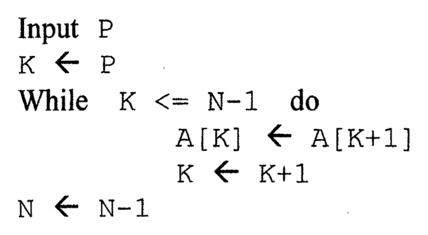

```text
Input P
K ← P
While K <= N-1 do
    A[K] ← A[K+1]
    K ← K+1
N ← N-1
```

A. Removes the P-th value in A.  
B. Increases the value of P by 1.  
C. Swaps the values of A[K] and A[K+1] for K <= N-1.  
D. Calculates the sum of the values in A.  

**34.** Which of the following is/are security measure(s) an online bank can use to authenticate customers' identities?

(1) Antivirus software  
(2) Security token  
(3) Digital watermark  

A. (1) only  
B. (2) only  
C. (1) and (3) only  
D. (2) and (3) only  

**35.** Which of the following may have security risks?

(1) Using a public computer in a coffee shop to log on to an online bank  
(2) Using the Wi-Fi network provided by a shopping centre to check email  
(3) Using a public computer to check the digital certificate of a web site  

A. (1) and (2) only  
B. (1) and (3) only  
C. (2) and (3) only  
D. (1), (2) and (3)  

**36.** Which of the following behaviours may infringe intellectual property rights?

(1) Sending an email with a virus to a friend  
(2) Hacking into an online bank account  
(3) Posting a scanned newspaper on a personal web site  
(4) Uploading a video of a TV programme to the Internet  

A. (1) and (2) only  
B. (1) and (4) only  
C. (2) and (3) only  
D. (3) and (4) only  

**37.** What changes have been brought about by the emergence of the Information Age?

(1) More office space is needed.  
(2) New ICT-related jobs appear and change the job market.  
(3) There are more opportunities to acquire information and to learn new things.  

A. (1) and (2) only  
B. (1) and (3) only  
C. (2) and (3) only  
D. (1), (2) and (3)  

**38.** Ransomware is malware that encrypts victims' computer files and demands a ransom payment to restore them. How can we minimise the impact of ransomware?

(1) Creates backups of computer files regularly.  
(2) Do not open anonymous or phishing email.  
(3) Do not download pirated copies of computer software through p2p software.  

A. (1) and (2) only  
B. (1) and (3) only  
C. (2) and (3) only  
D. (1), (2) and (3)  

**39.** What are the major reasons for applying ergonomic design principles to computers in the work environment?

(1) Prevents repetitive strain injury.  
(2) Saves on costs of setting up computers.  
(3) Provides a customised, adjustable setup for meeting different people's needs.  

A. (1) and (2) only  
B. (1) and (3) only  
C. (2) and (3) only  
D. (1), (2) and (3)  

**40.** The World Health Organization (WHO) states that 15% of the world's population have disabilities. What can we do for these people to improve the access to ICT significantly?

A. Gives persons with disabilities notebook computers.  
B. Sets up free computer centres for persons with disabilities to access the Internet.  
C. Develops appropriate tools for persons with disabilities to access ICT.  
D. Provides free ICT training for persons with disabilities.  

**END OF PAPER**
