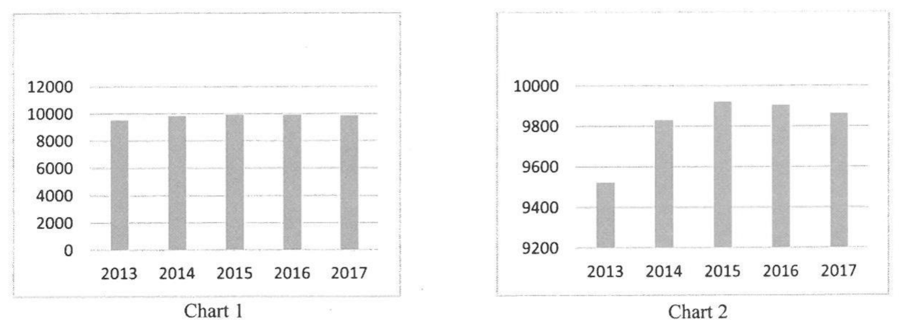
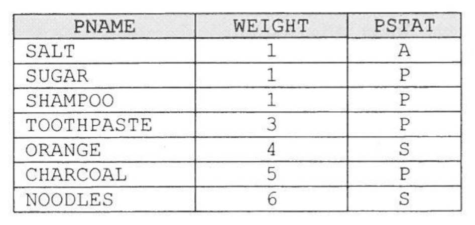
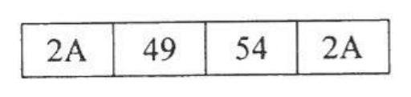
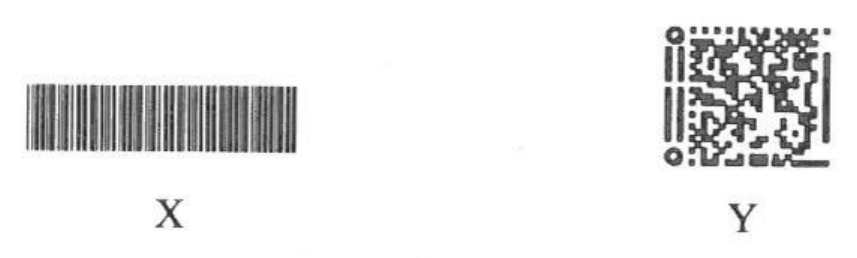
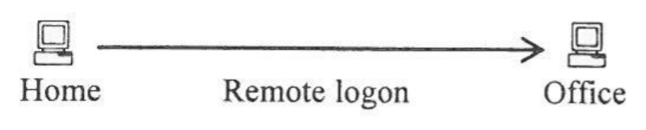
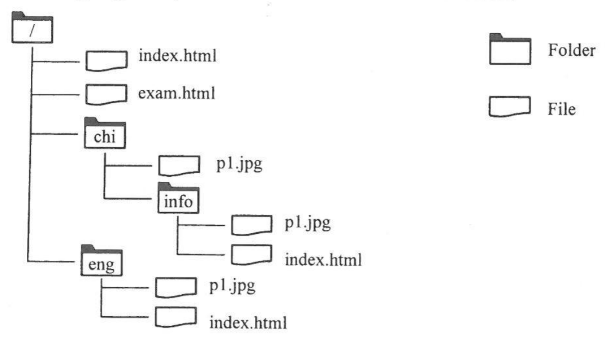
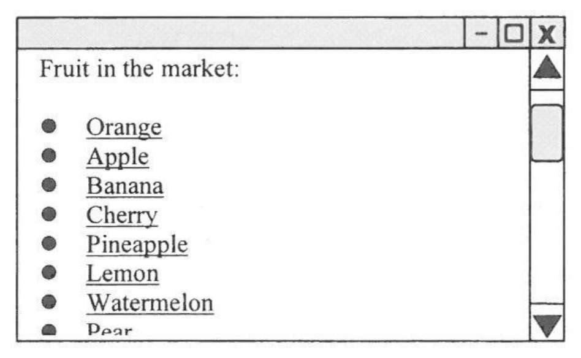
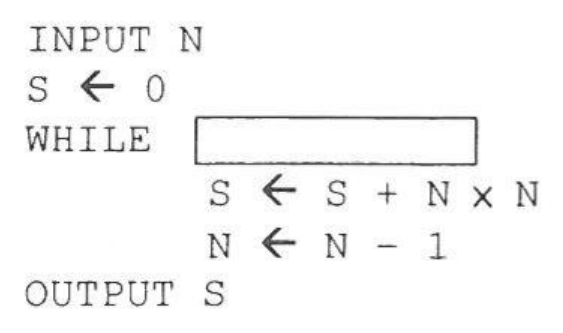
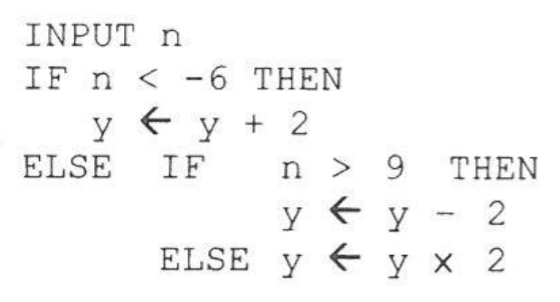
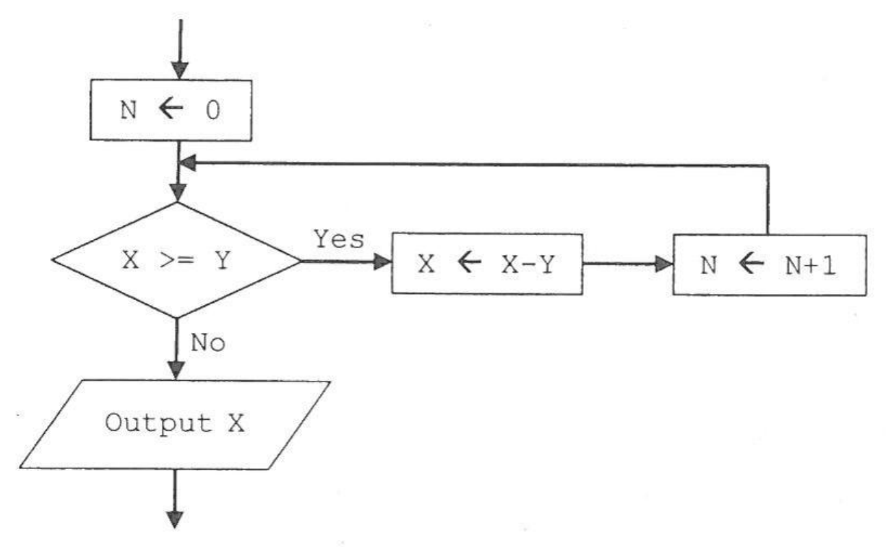

# There are 40 questions in this paper.  Choose the most suitable answers.

**1.** Peter creates Chart 1 in a spreadsheet file. He wants to modify Chart 1 so that it becomes Chart 2. Which chart setting should he change?



A. Legend  
B. Data source  
C. Axis  
D. Chart type  

**2.** A database table PROD has seven records, as shown below:



What would be the output after executing the following SQL command?


```text
SELECT MAX(WEIGHT) FROM PROD WHERE PSTAT <> 'S'
```

A. 1  
B. 5  
C. 6  
D. 11  

**3.** When changing the password of a school Intranet account, which of the following is an example of data verification?

A. Input a new password twice.  
B. Input a new password and a mobile phone number.  
C. Input a new password that consists of at least one special character.  
D. Input the old password and a new password.  

**4.** The file sizes of the following original files are all 1 MB. Under normal circumstances, after compressing them, which compressed file has the largest file size?

| | Original files | Compressed files |
|---|---|---|
| A. | testA.html | testA.zip |
| B. | testB.doc | testB.zip |
| C. | testC.txt | testC.zip |
| D. | testD.jpg | testD.zip |

**5.** Below is an example of Korean text:

안 녕 하 세 요

Which of the following character encoding methods can be used to represent Korean text?

(1) ASCII  
(2) Unicode  
(3) Big-5 code  

A. (1) only  
B. (2) only  
C. (1) and (3) only  
D. (2) and (3) only  

**6.** Which of the following are appropriate for presenting a storyboard?

(1) A slide show  
(2) A multimedia document  
(3) A database file  

A. (1) and (2) only  
B. (1) and (3) only  
C. (2) and (3) only  
D. (1), (2) and (3)  

**7.** A company designs a mobile application to process staff records. In each record, 10 bits are used to store staff numbers and 12 bytes are used to store Chinese names. How many staff records can the mobile application support?

A. 2¹⁰  
B. 2¹²  
C. 2²²  
D. 2⁹⁶  

**8.** John writes a program to process student information, including student name, average mark and number of subjects taken. Which data types should John use for storing the corresponding student information?

| | Student name | Average mark | Number of subjects taken |
|---|---|---|---|
| A. | Boolean | integer | real |
| B. | Boolean | real | integer |
| C. | character | integer | real |
| D. | character | real | integer |

**9.** Which of the following is the 8-bit two's complement representation of the decimal value -8?

A. 1000 1000  
B. 1111 1000  
C. 1000 0000  
D. 0000 1000  

**10.** Mary inserts a hyperlink in a document file. What are the possible consequences when following the hyperlink?

(1) Open a video file.  
(2) Jump to another page of this document.  
(3) Jump to a page of another document.  

A. (1) and (2) only  
B. (1) and (3) only  
C. (2) and (3) only  
D. (1), (2) and (3)  

**11.** A text file contains a character string '\*IT\*'. Peter uses a program to view the ASCII codes of the character string in the hexadecimal number system, as shown below:



How many bits are required to store the character string?

A. 8  
B. 16  
C. 32  
D. 64  

**12.** Which of the following elements can be included in a PDF file?

(1) Photos  
(2) Videos  
(3) Hyperlinks  

A. (1) and (2) only  
B. (1) and (3) only  
C. (2) and (3) only  
D. (1), (2) and (3)  

**13.** The following two barcodes, X and Y, are found on a soft drink can and an advertising poster respectively. What is the major difference between them?



A. The area of X must be larger than that of Y.  
B. Only Y can be read by a smartphone.  
C. Y can represent more data.  
D. Y cannot represent characters.  

**14.** Which of the following statements about mail merge is correct?

A. Only one file is needed in each mail merge.  
B. Mail merge is mainly used for sending email.  
C. Data can be sorted and filtered for a mail merge.  
D. Mail merge usually involves presentation software.  

**15.** Free online encyclopedias such as Wikipedia contain a huge number of articles. Which of the following statements about the online encyclopedias are correct?

(1) People can search the relevant articles for a topic quickly.  
(2) The articles have no copyright.  
(3) These encyclopedias are updated frequently.  

A. (1) and (2) only  
B. (1) and (3) only  
C. (2) and (3) only  
D. (1), (2) and (3)  

**16.** A router should be used to connect ________________________.

A. two different networks  
B. a printer and a local area network  
C. two computers  
D. a computer to a server  

**17.** Which of the following are the basic functions of an operating system?

(1) Email management  
(2) Memory management  
(3) Input/output management  

A. (1) and (2) only  
B. (1) and (3) only  
C. (2) and (3) only  
D. (1), (2) and (3)  

**18.** Why is a solid state drive (SSD) commonly used in mobile devices instead of a hard disk drive?

A. The physical size of a SSD is smaller.  
B. The storage capacity of a SSD is smaller.  
C. The data access rate of a SSD is lower.  
D. Mobile devices do not support hard disk drives.  

**19.** Which of the following can help reduce the time needed to access files in a hard disk drive?

A. Redundant Array of Independent Disks (RAID)  
B. Virtual Private Network (VPN)  
C. Driver programs  
D. Defragmentation software  

**20.** Read the configuration of a desktop computer below:

- Intel® Core™ i7 CPU
- 16GB DDR4 RAM
- 1TB SSD
- 802.11ac Wi-Fi

What information can be found out from the configuration?

(1) The viewable size of the display unit  
(2) The maximum data transfer rate of a wireless network  
(3) The time to start up a computer  

A. (1) only  
B. (2) only  
C. (1) and (3) only  
D. (2) and (3) only  

**21.** Which of the following are the latest trends in hard disk drive development?

(1) Lower power consumption  
(2) Longer lifespan  
(3) More built-in software provided  

A. (1) and (2) only  
B. (1) and (3) only  
C. (2) and (3) only  
D. (1), (2) and (3)  

**22.** Which of the following statements about the fetch-decode-execute cycle in a CPU is correct?

A. Registers are used in the cycle.  
B. The cycle is an assembly language program.  
C. The sequence of the instructions in the cycle mainly depends on the CPU clock rate.  
D. The cycle is mainly used to perform arithmetic operations.  

**23.** In a Point-of-Sale system in a restaurant, which of the following is/are the reason(s) for using thermal printers to print receipts?

(1) The receipt printout can be kept longer.  
(2) It is quiet during printing.  
(3) The printing time is short.  

A. (1) only  
B. (2) only  
C. (1) and (3) only  
D. (2) and (3) only  

**24.** At home, Mary logs on to a computer in her office and does some word processing.



Which of the following statements about the remote logon is correct?

A. Both computers should have the same word processing software.  
B. Both computers should have the same firewall.  
C. The remote logon supports data encryption.  
D. Two computers are involved and hence word processing is faster.  

**25.** The following diagram is part of the folder structure of www.abc.edu.hk:



Which of the following URLs is not valid?

A. http://www.abc.edu.hk/chi/p1.jpg  
B. http://www.abc.edu.hk/info/chi/p1.jpg  
C. http://www.abc.edu.hk/eng/p1.jpg  
D. http://www.abc.edu.hk/index.html  

**26.** Which of the following is not an email protocol?

A. IMAP  
B. SMTP  
C. POP  
D. FTP  

**27.** Amy can browse the web site of ABC School through its IP address, but not its URL. What is the possible reason for this?

A. The corresponding web pages have not been uploaded onto the web server.  
B. The domain name system (DNS) server is temporarily out of service.  
C. The browser in use is not the latest version.  
D. Some plug-ins for the browser in use have not been installed.  

**28.** When watching videos from a web site using streaming technology, which of the following will be involved?

(1) DNS  
(2) FTP  
(3) IP  

A. (1) and (2) only  
B. (1) and (3) only  
C. (2) and (3) only  
D. (1), (2) and (3)  

**29.** Study the following web page:



Which of the following can improve the ease of navigation?

(1) Tables  
(2) Frames  
(3) Background music  

A. (2) only  
B. (3) only  
C. (1) and (2) only  
D. (1) and (3) only  

**30.** The following algorithm is used to find the value of ( 1² + 2² + 3² + . . . + N² ).



```text
INPUT N
S ← 0
WHILE [            ]
    S ← S + N × N
    N ← N - 1
OUTPUT S
```

What should be in the box?

A. N > 0  
B. N > 1  
C. N < 0  
D. N < 1  

**31.** Study the following algorithm:



```text
INPUT n
IF n < −6 THEN
    y ← y + 2
ELSE IF  n > 9  THEN
        y ← y - 2
    ELSE y ← y × 2
```

Which of the following sets of input data is most suitable for testing the algorithm?

A. -6, 0, 9  
B. -2, 0, 1, 2  
C. -20, -6, 0, 9, 15  
D. -20, -10, 0, 1, 10, 20  

**32.** Study the following segment of a flowchart:



Suppose that the initial values of X and Y are 14 and 4 respectively. What is the output?

A. 0  
B. 1  
C. 2  
D. 3  

**33.** Suppose that X = 1, Y = 2 and Z = 3. Which of the following Boolean expressions is 'true'?

A. ( (X = 1)  AND  (Y > -2) )  AND  (Z > 3)  
B. ( (X = 1)  AND  (Y > -2) )  OR  (Z > 3)  
C. ( (X = 1)  OR  (Y > -2) )  AND  (Z > 3)  
D. (X = 1)  AND  ( (Y > -2)  AND  (Z > 3) )  

**34.** What are the characteristics of using modularity for designing computer solutions?

(1) Usually modularity is used to solve simple problems.  
(2) Modules may be reusable.  
(3) The development cost is higher.  
(4) Modules can be independently developed.  

A. (1) and (3) only  
B. (1) and (4) only  
C. (2) and (3) only  
D. (2) and (4) only  

**35.** What are the good ergonomic practices in software design?

(1) Fixed font size  
(2) Appropriate system messages to users  
(3) Consistent user interface  

A. (1) and (2) only  
B. (1) and (3) only  
C. (2) and (3) only  
D. (1), (2) and (3)  

**36.** Ms Lee is a photographer. Mr Cheung downloads a lot of copyright photos from her web site and uses them in his tutorial school without her approval. What legal consequences are there of doing this?

(1) Mr Cheung needs to compensate Ms Lee.  
(2) Mr Cheung commits a criminal offence.  
(3) Mr Cheung needs to close down his tutorial school.  

A. (1) and (2) only  
B. (1) and (3) only  
C. (2) and (3) only  
D. (1), (2) and (3)  

**37.** Why do we need Secure Sockets Layer (SSL) on the Internet?

A. An IP address includes at least four values.  
B. The socket for power supply can be protected.  
C. Data transmission can be faster.  
D. Data can be safely transmitted.  

**38.** What is/are the major benefit(s) of using data encryption for transferring confidential information over the Internet?

(1) Hackers cannot collect the encrypted data easily.  
(2) Hackers cannot read the confidential information easily.  
(3) Hackers cannot delete the confidential information easily.  

A. (1) only  
B. (2) only  
C. (1) and (3) only  
D. (2) and (3) only  

**39.** What is/are the appropriate measure(s) to take to protect the intellectual property rights of photos posted on the Internet?

(1) Digital signature  
(2) Digital watermark  
(3) Firewall  

A. (1) only  
B. (2) only  
C. (1) and (3) only  
D. (2) and (3) only  

**40.** What is/are the benefit(s) of using a fingerprint over a password for authentication in computer systems?

(1) In general, the input time is shorter.  
(2) The system development cost is cheaper.  
(3) It results in fewer mistakes as long as the finger is clean.  

A. (1) only  
B. (2) only  
C. (1) and (3) only  
D. (2) and (3) only  

**END OF PAPER**
