# There are 40 questions in this paper.  Choose the most suitable answers.

**1.** Which of the following statements about two's complement is/are correct?

(1) Overflow errors will not occur in arithmetic operations.  
(2) The maximum value for an 8-bit number is 0111 1111.  
(3) The minimum value for an 8-bit number is 1111 1111.  

A. (1) only  
B. (2) only  
C. (1) and (3) only  
D. (2) and (3) only  

**2.** Peter creates a school newsletter and posts it on a web page. The newsletter is in portable document format (PDF) instead of word document format because

(1) hyperlinks can be included.  
(2) the newsletter will be displayed in the same way on any device.  
(3) the resolution of images in the newsletter will be higher.  

A. (1) only  
B. (2) only  
C. (1) and (3) only  
D. (2) and (3) only  

**3.** In order for a factory manager to decide on the number of machines to be bought to produce pencils, he needs to consider time and cost constraints. What spreadsheet feature should he use to do this?

A. Pivot table  
B. Multiple worksheets  
C. 'What-if' analysis  
D. Sorting data using multiple criteria  

**4.** Mary uses a text editor to enter the following 5 traditional Chinese characters and saves them in a text file. The file size is 10 bytes.

世上無難事

Which of the following statements about the text file is/are correct?

(1) Each Chinese character occupies 2 bytes.  
(2) ASCII code is used to represent the characters.  
(3) The text file does not support Big-5 code.  

A. (1) only  
B. (2) only  
C. (1) and (3) only  
D. (2) and (3) only  

**5.** The file sizes of the following original files are all 10 MB. After converting them, which converted file has the smallest file size, under normal circumstances?

| | Original file | Converted file |
|---|---|---|
| A. | testA.MP4 | testA.AVI |
| B. | testB.MP3 | testB.WAV |
| C. | testC.BMP | testC.JPG |
| D. | testD.GIF | testD.BMP |

Answer Questions 6 and 7 with reference to the following database table STUDENT.

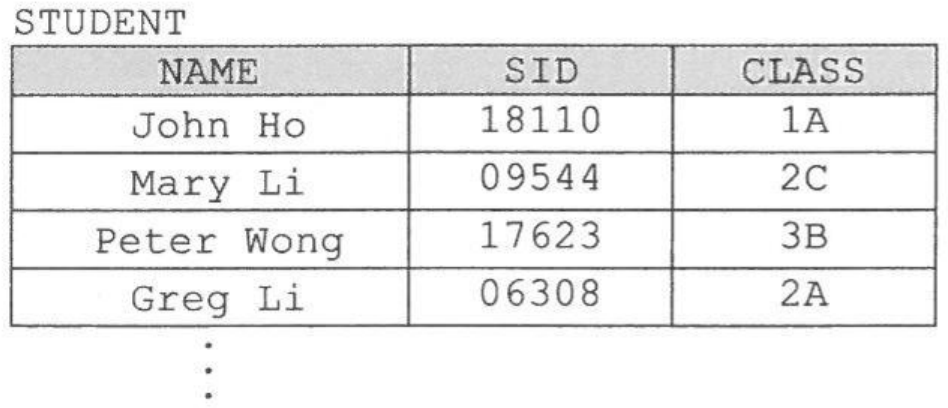

**6.** What is/are the possible data type(s) for SID in STUDENT?

(1) Integer  
(2) Character  
(3) Boolean  

A. (1) only  
B. (2) only  
C. (1) and (3) only  
D. (2) and (3) only  

**7.** STUDENT is exported into a spreadsheet. What spreadsheet feature produces a similar output to executing the following SQL command in a DBMS tool?

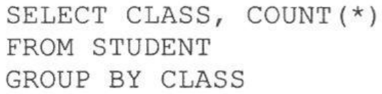

```text
SELECT CLASS, COUNT(*)
FROM STUDENT
GROUP BY CLASS
```

A. Sorting  
B. Cell references in formulas  
C. Object Linking and Embedding  
D. Pivot table  

**8.** Eva creates a report with 200 pages. Which of the following word processing operations can reduce the number of pages used?

(1) Change the line spacing of the text.  
(2) Change the text alignment.  
(3) Change the margins of pages.  
(4) Create a table of contents with hyperlinks.  

A. (1) and (3) only  
B. (1) and (4) only  
C. (2) and (3) only  
D. (2) and (4) only  

**9.** Radio frequency identification (RFID) readers are installed in the door of an office. Amy has an ID badge containing a RFID tag with a 2 KB storage capacity. Her personal information occupies 200 bytes. Every time she enters or leaves the office, a record of 40 bytes is created and stored on her badge. How many records can the badge store?

A. 44  
B. 46  
C. 48  
D. 50  

**10.** A device is sending 8-bit data in a network where the last bit is a parity bit. One of the following received data has an error. Which one is it?

A. 0010 0010  
B. 1111 0000  
C. 0011 0011  
D. 1010 0111  

**11.** Study the following online registration form:

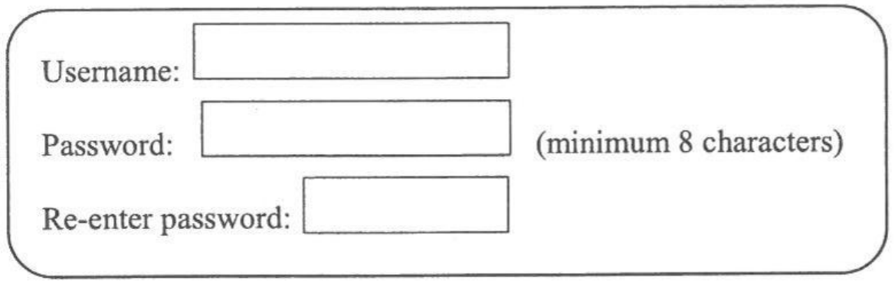

Which of the following is/are involved in the online registration?

(1) Data verification  
(2) Data compression  
(3) Data validation  

A. (1) only  
B. (2) only  
C. (1) and (3) only  
D. (2) and (3) only  

**12.** An IP address (IPv6) consists of 8 groups of 4-digit hexadecimal numbers separated by colons, as shown in the following example:

2001:08AB:2347:AFF0:1234:CC23:98D2:1A45

How many possible addresses are there in this IP addressing?

A. 2³²  
B. 16³²  
C. 32²  
D. 32¹⁶  

**13.** Which of the following is the **least** important when creating a self-running presentation?

A. Template  
B. Slide layout  
C. Insertion of pictures  
D. Index  

**14.** Susan plans to buy a new computer for video editing. In general, which of the following is the **least** important factor that she should consider?

A. Computation power  
B. RAM size  
C. Number of USB ports  
D. Hard disk storage capacity  

**15.** Which of the following statements about the accumulator in a CPU is correct?

A. It is used by the Arithmetic and Logic Unit (ALU) for calculation.  
B. It is used by the Control Unit (CU) to store a memory address temporarily.  
C. It stores the memory address of the next instruction to be executed.  
D. It controls the flow of data in a bus.  

**16.** What is the possible outcome of lowering the clock rate of a CPU in a desktop computer?

A. Consumes less electricity.  
B. Increases the accuracy of computation.  
C. Enhances the performance of the WiFi connection.  
D. Increases the protection of the computer from hacking.  

**17.** Peter has an e-ticket for a concert, as shown below:

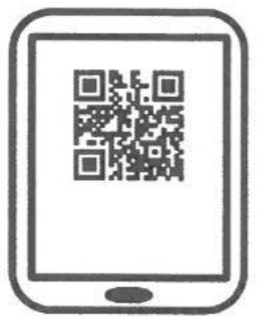

Which of the following statements about the barcode on the e-ticket is/are correct?

(1) Information on the barcode may be decoded even if part of the barcode is damaged.  
(2) Only one type of data, such as numeric data, can be encoded at a time.  
(3) The barcode can be scanned successfully in a maximum of three directions.  

A. (1) only  
B. (2) only  
C. (1) and (3) only  
D. (2) and (3) only  

**18.** Which of the following systems depends on network connectivity?

A. Real-time system  
B. Single-user system  
C. Batch processing system  
D. Distributed processing system  

**19.** Arrange the following in ascending order by data transfer rate.

(1) Solid State Drive (SSD)  
(2) Memory cache  
(3) RAM  

A. (1), (3), (2)  
B. (1), (2), (3)  
C. (3), (2), (1)  
D. (3), (1), (2)  

**20.** Which of the following are the major networking functions of a typical computer operating system?

(1) Allowing communication between computers  
(2) Controlling the network bandwidth of a connection between two computers  
(3) Providing some measure of network security to protect the computers from unauthorised access  

A. (1) and (2) only  
B. (1) and (3) only  
C. (2) and (3) only  
D. (1), (2) and (3)  

**21.** Below is a typical computer network for a school campus:

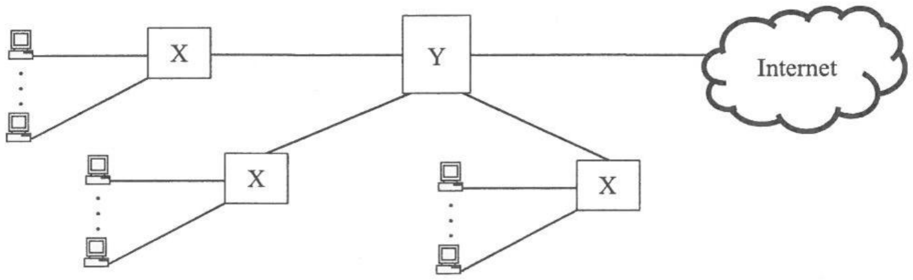

What are X and Y?

| | X | Y |
|---|---|---|
| A. | Switch | Network interface card |
| B. | Access Point (AP) | Network interface card |
| C. | Router | Access Point (AP) |
| D. | Switch | Router |

**22.** Which of the following are the advantages of using a LAN over a WAN?

(1) Higher data transfer rate  
(2) Larger network coverage  
(3) Lower setup cost  

A. (1) and (2) only  
B. (1) and (3) only  
C. (2) and (3) only  
D. (1), (2) and (3)  

**23.** The following two URLs can be used to access the same web site:

'http://202.8.88.24' and 'http://www.hkedcity.net'

Which of the following statements about the two URLs is/are correct?

(1) The DNS server may translate 'www.hkedcity.net' to '202.8.88.24'.  
(2) A URL must include HTTP.  
(3) The web pages accessed through the IP address are more secure.  

A. (1) only  
B. (2) only  
C. (1) and (3) only  
D. (2) and (3) only  

**24.** What is/are the advantage(s) of using a network connection on a leased line instead of by broadband?

(1) The connection is more reliable.  
(2) The cost is lower.  
(3) The bandwidth is guaranteed.  

A. (1) only  
B. (2) only  
C. (1) and (3) only  
D. (2) and (3) only  

**25.** In HTML, which of the following are the attributes of a table (TABLE)?

(1) URLs of the contents of cells  
(2) Space between cells  
(3) Media types of the contents of cells  
(4) Background colour  

A. (1) and (3) only  
B. (1) and (4) only  
C. (2) and (3) only  
D. (2) and (4) only  

**26.** Which of the following activities transfers **minimal** data through the Internet?

A. Sending an email of 10 KB with a 2 MB audio file to 50 receivers  
B. Uploading and converting an image of 10 MB to JPG format using an online tool  
C. Updating a web page of 10 KB containing a hyperlink to a 2 GB file  
D. Watching a 60-minute video of 500 MB online using streaming technology  

**27.** Which of the following statements about streaming technology is/are correct?

(1) A music performance can be viewed live.  
(2) HTTP cannot be used.  
(3) Illegal distribution of movies can be controlled.  

A. (1) only  
B. (2) only  
C. (1) and (3) only  
D. (2) and (3) only  

**28.** What are the boundary cases for testing in the following segment of an algorithm?

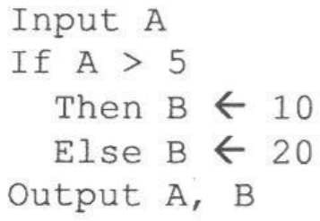

```text
Input A
If A > 5
    Then B ← 10
    Else B ← 20
Output A, B
```

(1) 5  
(2) 6  
(3) 10  
(4) 20  

A. (1) and (2) only  
B. (3) and (4) only  
C. (2), (3) and (4) only  
D. (1), (2), (3) and (4)  

**29.** age is an integer variable and IsStudent is a Boolean variable. Which of the following Boolean expressions produce the same result?

(1) (age < 25) AND (IsStudent = TRUE)  
(2) NOT ((age >= 25) OR (IsStudent = FALSE))  
(3) (age > 25) OR (IsStudent = TRUE)  

A. (1) and (2) only  
B. (1) and (3) only  
C. (2) and (3) only  
D. (1), (2) and (3)  

**30.** What is the output of the following algorithm?

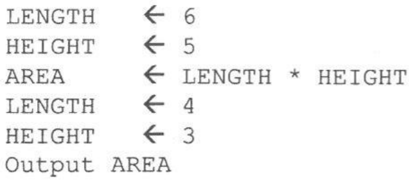

```text
LENGTH  ← 6
HEIGHT  ← 5
AREA    ← LENGTH * HEIGHT
LENGTH  ← 4
HEIGHT  ← 3
Output AREA
```

A. 12  
B. 20  
C. 24  
D. 30  

**31.** N is an array and N[1], N[2], N[3] and N[4] store 1, 3, 5 and 7 respectively.  What is the output of the following algorithm?

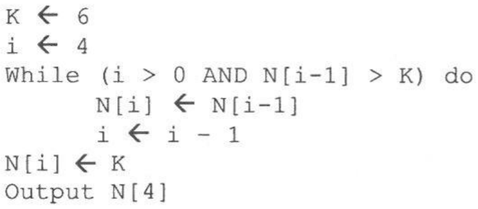

```text
K ← 6
i ← 4
While (i > 0 AND N[i-1] > K) do
    N[i] ← N[i-1]
    i ← i - 1
N[i] ← K
Output N[4]
```

A. 4  
B. 5  
C. 6  
D. 7  

**32.** Study the following algorithm:

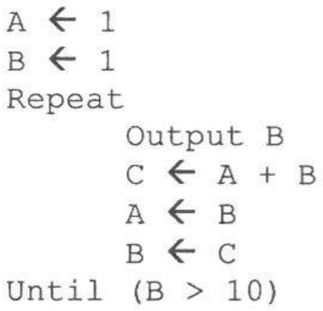

```text
A ← 1
B ← 1
Repeat
    Output B
    C ← A + B
    A ← B
    B ← C
Until (B > 10)
```

How many times will 'Output B' be executed?

A. 4  
B. 5  
C. 6  
D. 7  

**33.** Y is an array. What is the output of the following algorithm?

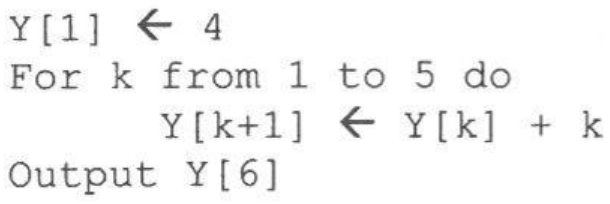

```text
Y[1] ← 4
For k from 1 to 5 do
    Y[k+1] ← Y[k] + k
Output Y[6]
```

A. 10  
B. 14  
C. 15  
D. 19  

**34.** Study the following segment of a flowchart:

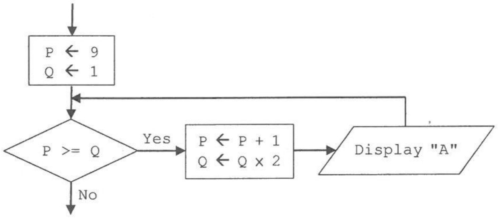

How many "A" will be displayed?

A. 0  
B. 2  
C. 4  
D. 5  

**35.** ABC Coffee Shop offers free WiFi for customers. The details are:

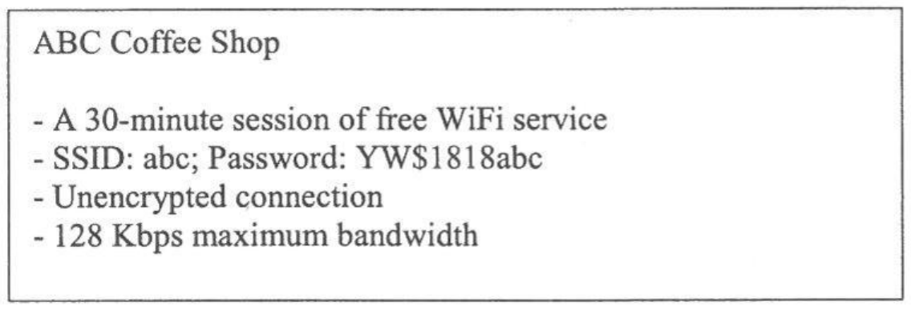

Customers should not use the WiFi connection for online banking because

A. the free session is too short.  
B. the SSID is too short and easily guessed.  
C. the data passing through the connection is not encrypted.  
D. the maximum bandwidth is still too low.  

**36.** A photographer posts his photos to a social media web site for the public to look at. Which of the following can be applied to the photo to protect his intellectual property?

A. Hong Kong Public Key Infrastructure (PKI)  
B. Secure Sockets Layer (SSL)  
C. Digital certificate  
D. Digital watermark  

**37.** Which of the following will help overcome the digital divide in a city?

(1) Implementing a Bring-Your-Own-Device (BYOD) policy in schools to replace desktop computers  
(2) Providing more free WiFi hotspots  
(3) Providing more than one free email account for each citizen  

A. (1) only  
B. (2) only  
C. (1) and (3) only  
D. (2) and (3) only  

**38.** Ms Li finds that the file server in his company is infected by ransomware. Some important document files have been encrypted and cannot be opened. What should she do?

(1) Try to put the encrypted files in another file server and open them.  
(2) Report the incident to the police.  
(3) Pay the ransom to acquire the password.  

A. (1) only  
B. (2) only  
C. (1) and (3) only  
D. (2) and (3) only  

**39.** Why do people develop open source software?

(1) They want to earn more money from selling their software.  
(2) They want more people to use their software.  
(3) They want to own the copyright of the software.  

A. (1) only  
B. (2) only  
C. (1) and (3) only  
D. (2) and (3) only  

**40.** Which of the following actions will most likely infringe copyright in Hong Kong?

A. Using peer-to-peer file sharing software to share personal videos  
B. Broadcasting a street view live through a social media web site  
C. Uploading TV programmes to a personal web site and sharing them with friends  
D. Using peer-to-peer file sharing software to search for an audio file  

**END OF SECTION A**
