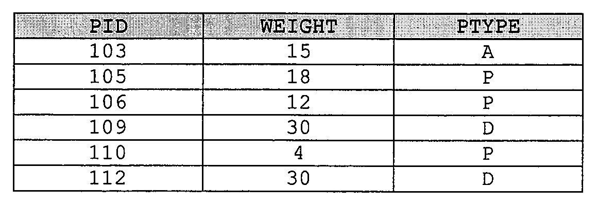
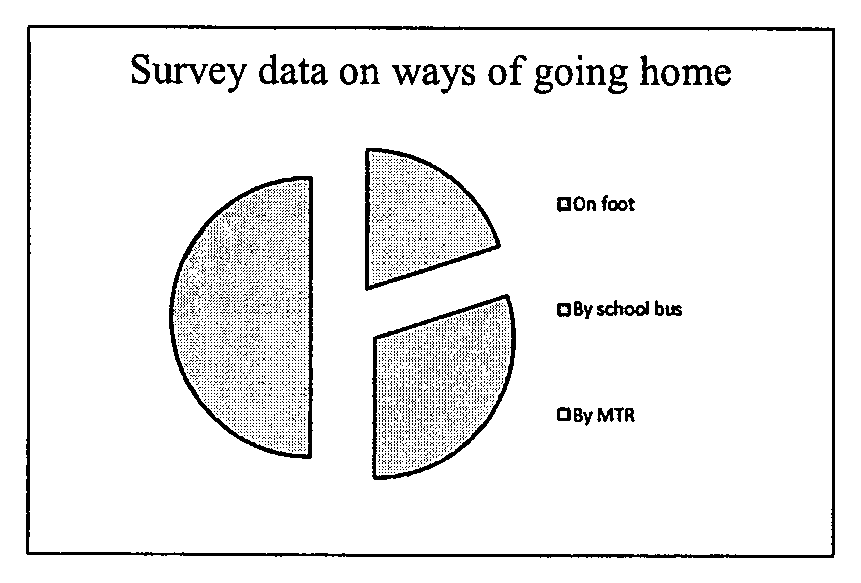
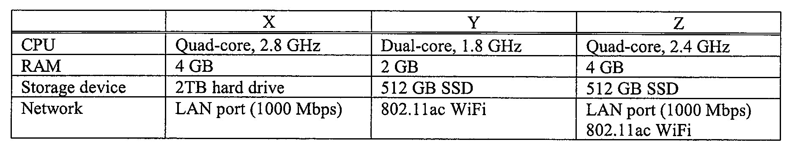
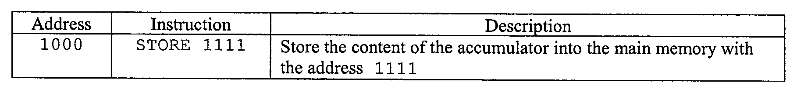
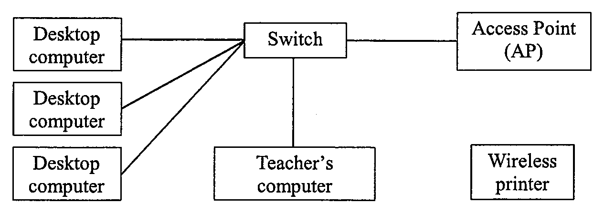
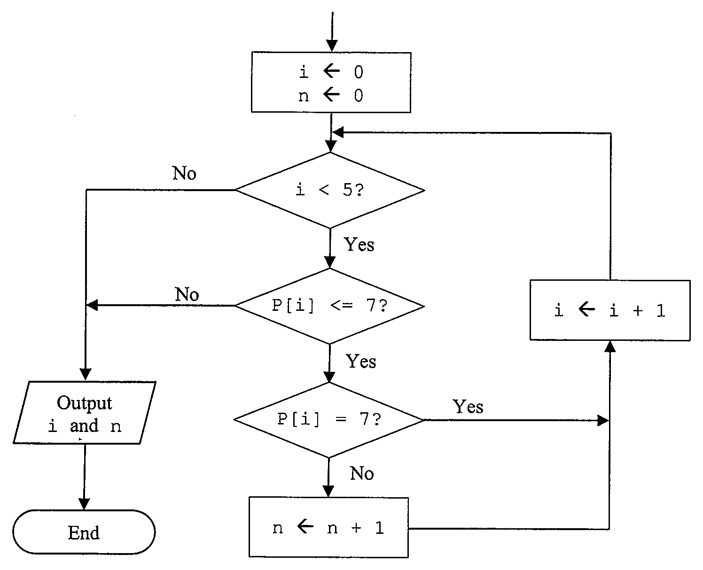
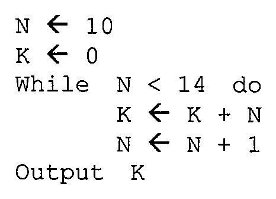
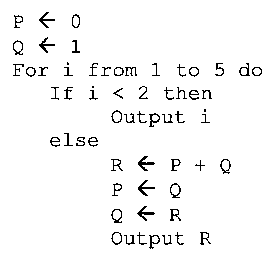
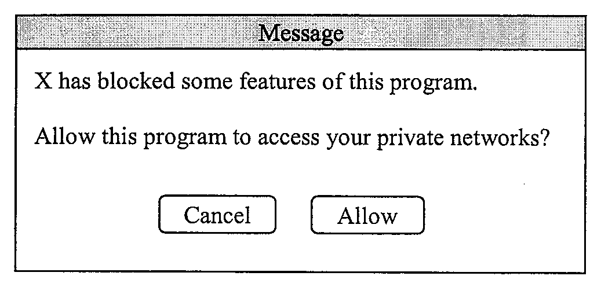
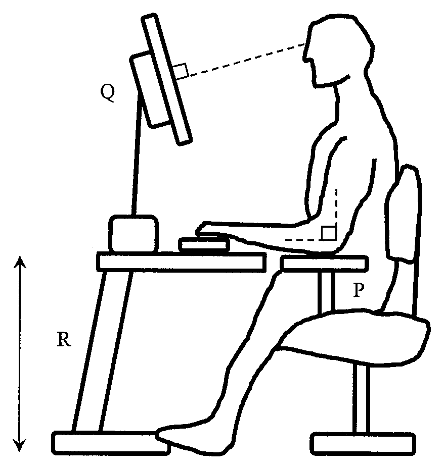

# There are 40 questions in this paper.  Choose the most suitable answers.

**1.** A Hong Kong identity card number is wrongly entered into a computer system, as shown below:

| Original number | Wrong input |
|---|---|
| A123456(3) | A213456(3) |

Which of the following can help detect this error?

(1) Range check  
(2) Input data twice  
(3) Check digit  

A. (1) and (2) only  
B. (1) and (3) only  
C. (2) and (3) only  
D. (1), (2) and (3)  

**2.** Which of the following decimal values is equivalent to 1010 0001 in 8-bit two's complement representation?

A. 33  
B. -33  
C. 95  
D. -95  

**3.** Amy uses JPG format instead of BMP format when scanning photos. What is/are the possible reason(s) for this?

(1) To decrease the file size of the photos  
(2) To increase the number of pixels per photo  
(3) To increase the number of colours displayed  

A. (1) only  
B. (2) only  
C. (1) and (3) only  
D. (2) and (3) only  

**4.** A company has 30 000 employees. Each employee has a staff number. What is the minimum number of bits required to represent the staff numbers?

A. 5  
B. 14  
C. 15  
D. 32  

**5.** Assume that X = 2 and Y = 3. Which of the following Boolean expressions returns TRUE?

A. ( (X > Y) AND (Y > 4) ) OR (1 > X)  
B. ( (X < Y) AND (Y > 4) ) OR (1 > X)  
C. (X > Y) AND ( (Y < 4) OR (1 < X) )  
D. (X < Y) AND ( (Y < 4) OR (1 < X) )  

**6.** Which of the following character sets can be used to represent simplified Chinese characters, traditional Chinese characters and English characters?

(1) ASCII  
(2) Unicode  
(3) GB code  

A. (1) only  
B. (2) only  
C. (1) and (3) only  
D. (2) and (3) only  

**7.** What of the following is/are the benefit(s) of e-government?

(1) Government information can be more easily accessed by the public in digital format.  
(2) The data security of the government information is enhanced.  
(3) The digital divide in society can be closed.  

A. (1) only  
B. (2) only  
C. (1) and (3) only  
D. (2) and (3) only  

**8.** Mary sends an email with a document in PDF instead of DOC format. What is/are the possible reason(s) for this?

(1) The document can be encrypted.  
(2) The page layout of the document can be preserved.  
(3) Multimedia elements can be included.  

A. (1) only  
B. (2) only  
C. (1) and (3) only  
D. (2) and (3) only  

**9.** Ms Li plans to design and produce student result slips using student information and examination marks stored in a database. What should she do?

A. Create reports using database software.  
B. Create hyperlinks to the database using word processing software.  
C. Create SQL commands using spreadsheet software.  
D. Import data and create a pivot table using spreadsheet software.  

**10.** For which of the following tasks should spreadsheet 'what-if' scenarios be created?

(1) Find the students who are awarded 90 marks or above in a Mathematics examination.  
(2) Estimate the cost of a product produced by different manufacturers.  
(3) Create a chart of monthly average temperatures.  

A. (1) only  
B. (2) only  
C. (1) and (3) only  
D. (2) and (3) only  

**11.** There are 6 records in a database table PET, as shown below:



What value(s) will be included in the output of the following SQL statement?

```text
SELECT SUM(WEIGHT) FROM PET GROUP BY PTYPE
```

(1) 109  
(2) 15  
(3) 34  
(4) 60  

A. (1) only  
B. (2) only  
C. (3) and (4) only  
D. (2), (3) and (4) only  

**12.** A teacher creates a presentation which includes the following slide.



Which element(s) of the slide should the teacher edit to create a more attractive presentation?

(1) SQL  
(2) Font  
(3) Chart  

A. (1) only  
B. (2) only  
C. (1) and (3) only  
D. (2) and (3) only  

**13.** Which of the following processes is an example of data collection?

A. Taking Towngas meter readings  
B. Inserting a bank card into an automated teller machine  
C. Putting a photo on a scanner for scanning  
D. Entering test marks written on a mark sheet into a spreadsheet  

Answer Questions 14 and 15 with reference to the following specifications of computers X, Y and Z. All computers use the same operating system.



**14.** Which computer(s) has/have the best computational power?

A. X  
B. Y  
C. Z  
D. Y and Z  

**15.** Which computer(s) take(s) the shortest time to boot up?

A. X  
B. Y  
C. Z  
D. X and Z  

**16.** Which of the following is not an advantage of an SSD over a hard drive?

A. Consumes less electricity.  
B. Generates less heat.  
C. Supports random access.  
D. Provides a higher access speed.  

**17.** Which of the following descriptions of a driver program is correct?

A. Enables the operating system to manage files.  
B. Enables the operating system to control a scanner.  
C. Monitors the status of virus checking.  
D. Monitors the usage of RAM.  

**18.** Consider the following instruction.



In the fetch-decode-execute cycle, what does 'fetch' do?

A. Obtains the instruction from the main memory with the address 1000.  
B. Obtains the instruction from the main memory with the address 1111.  
C. Obtains the content of the accumulator.  
D. Calculates the address of the next instruction by using the control unit (CU).  

Answer Questions 19 and 20 with reference to the following network diagram.



**19.** What service will the teacher's computer commonly provide for the desktop computers?

(1) File sharing  
(2) Email  
(3) Web browsing  

A. (1) only  
B. (2) only  
C. (1) and (3) only  
D. (2) and (3) only  

**20.** In order to allow all desktop computers to connect to the wireless printer, which of the following actions should be taken?

A. The AP should be installed between the switch and teacher's computer.  
B. The teacher's computer should be turned on.  
C. The switch should be replaced by a router.  
D. The wireless printer should be connected to the AP.  

**21.** Which of the following only support(s) sequential access?

(1) DVD-RW  
(2) Magnetic tape  
(3) Flash memory  

A. (1) only  
B. (2) only  
C. (1) and (3) only  
D. (2) and (3) only  

**22.** Which of the following statements about the components in a computer is not correct?

A. The arithmetic and logic unit (ALU) is used to perform arithmetic operations.  
B. The accumulator is a register that stores arithmetic and logic results.  
C. The data transfer rate of registers is higher than that of the main memory.  
D. Data buses are used to transfer control signals between the main board and input/output devices.  

**23.** Which of the following is not appropriate for enhancing students' information literacy?

A. Watching documentaries about the ocean online  
B. Searching for the installation password of a software package through an online discussion forum  
C. Reading school newsletters through the school intranet  
D. Finding the history of computers through the Internet  

**24.** Which of the following can improve the quality of video conferencing?

(1) A camera with a higher resolution  
(2) A larger storage capacity  
(3) A higher network bandwidth  

A. (1) only  
B. (2) only  
C. (1) and (3) only  
D. (2) and (3) only  

**25.** Which of the following protocols is/are involved when browsing https://www.gov.hk?

(1) FTP  
(2) IP  
(3) DNS  

A. (1) only  
B. (2) only  
C. (1) and (3) only  
D. (2) and (3) only  

**26.** Which of the following can be used to identify a host computer on the Internet?

(1) Email address  
(2) IP address  
(3) Computer name  

A. (1) only  
B. (2) only  
C. (1) and (3) only  
D. (2) and (3) only  

**27.** What is the main function of a network interface card?

A. To find a route for sending data packets  
B. To make a computer communicate over a network  
C. To enhance the security level of a communication link  
D. To support satellite communication  

**28.** When Eva logs on to a web site, she will receive an SMS message on her phone with a password. What is the SMS message about?

A. Parity checking  
B. Digital watermark  
C. Digital signature  
D. Authentication  

Answer Questions 29 and 30 with reference to the following segment of a flowchart. The initial values of P[0], P[1], P[2], P[3] and P[4] are 7, 7, 6, 7 and 9 respectively.



**29.** What is the output value of i?

A. 2  
B. 3  
C. 4  
D. 5  

**30.** What is the output value of n?

A. 1  
B. 2  
C. 3  
D. 4  

**31.** What is the output of the following algorithm?



```text
N ← 10
K ← 0
While N < 14 do
    K ← K + N
    N ← N + 1
Output K
```

A. 14  
B. 33  
C. 46  
D. 60  

**32.** What is the output of the following algorithm?



```text
P ← 0
Q ← 1
For i from 1 to 5 do
    If i < 2 then
        Output i
    else
        R ← P + Q
        P ← Q
        Q ← R
        Output R
```

A. 1 1 2 2 4  
B. 1 1 2 3 5  
C. 1 2 3 4 5  
D. 1 2 4 8 16  

**33.** What is the output of the following algorithm?


```text
P ← 1
Q ← 2
Repeat
    P ← P + 1
    Q ← Q * 2
Until (P > 4)
Output Q
```

A. 4  
B. 5  
C. 16  
D. 32  

**34.** A bank updates its automatic teller machine system with new restrictions on cash withdrawals, as follows:

- Available cash notes $100, $500 and $1 000
- Minimum withdrawal amount = $200
- Maximum withdrawal amount = $10 000

Which of the following sets of withdrawal amounts should be used as test data for this system update?

A. 50, 500, 7000, 8000, 9000, 10 000  
B. 100, 200, 300, 500, 1 000, 30 000  
C. 100, 200, 600, 950, 10 000, 11 000  
D. 100, 1 000, 15 000, 20 000, 25 000, 30 000  

**35.** A student is addicted to online gaming and plays more than 8 hours every day. Which of the following health problems might he encounter?

(1) Sleep problems  
(2) Vision problems  
(3) Emotional problems  

A. (1) and (2) only  
B. (1) and (3) only  
C. (2) and (3) only  
D. (1), (2) and (3)  

**36.** In a computer network, which of the following can protect a user's privacy from a hacker attack?

(1) Create backup of data.  
(2) Update the operating system.  
(3) Install a firewall.  

A. (1) and (2) only  
B. (1) and (3) only  
C. (2) and (3) only  
D. (1), (2) and (3)  

**37.** What is/are the major characteristic(s) of open source software?

(1) Developers can set the selling price.  
(2) Users can change the source code.  
(3) All functions of the software can be used during the trial period.  

A. (1) only  
B. (2) only  
C. (1) and (3) only  
D. (2) and (3) only  

**38.** An online shop collects its members' personal information. Which of the following actions is/are not appropriate without members' consent?

(1) The shop encrypts and uploads all personal information to cloud storage.  
(2) The shop sends all personal information to other online shops which provide other services to members.  
(3) When a member unregisters his/her membership, the shop keeps the personal information permanently to help with his/her re-registration in the future.  

A. (1) only  
B. (2) only  
C. (1) and (3) only  
D. (2) and (3) only  

**39.** When Peter installs a game from a hyperlink sent by his friend, a dialogue box pops up, as shown below:



What is X in the dialogue box?

A. Firewall  
B. Browser  
C. File manager application  
D. Device manager application  

**40.** The picture below illustrates good ergonomic practices for using a computer.



Which of the following settings are necessary?

(1) The angle of the armrest at P should be adjustable.  
(2) The angle of the display unit at Q should be adjustable.  
(3) The height of the table at R should be adjustable.  

A. (1) and (2) only  
B. (1) and (3) only  
C. (2) and (3) only  
D. (1), (2) and (3)  

**END OF SECTION A**
