# There are 40 questions in this paper.  Choose the most suitable answers.

**1.** Which of the following can effectively format a document in word processing software?

(1) Setting the default font as the most frequently-used font type and font size  
(2) Using pre-set styles for headings  
(3) Enabling the auto-correction function  

A. (1) and (2) only  
B. (1) and (3) only  
C. (2) and (3) only  
D. (1), (2) and (3)  

**2.** Which of the following additions of numbers in 8-bit two's complement representation will result in an overflow error?

A. 0011 0110 + 0011 1100  
B. 0100 0010 + 1000 0001  
C. 1001 1100 + 1111 0110  
D. 1011 1010 + 1100 0100  

**3.** The ASCII codes for the characters 'X' and 'Z' in hexadecimal are ________ and 5A respectively.

A. 3A  
B. 3C  
C. 58  
D. 59  

**4.** When creating a database table in database software, what should users usually set?

(1) The data type of each field  
(2) The maximum number of records  
(3) Primary key  

A. (1) and (2) only  
B. (1) and (3) only  
C. (2) and (3) only  
D. (1), (2) and (3)  

**5.** Eva uses WAV format instead of MP3 format when recording music performance. What is/are the benefit(s) of this?

(1) The file size of the audio file is larger.  
(2) The audio quality is better.  
(3) There are no cross-platform issues.  

A. (1) only  
B. (2) only  
C. (1) and (3) only  
D. (2) and (3) only  

**6.** Tim uses the 'table of contents' feature in word processing software, as shown below. When inserting a new chapter, ____________.

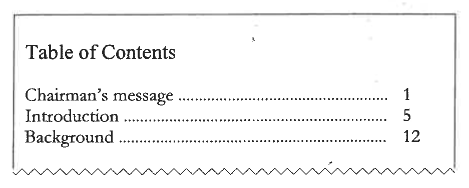

A. Tim has to input a formula for calculating the page numbers  
B. Tim has to input the chapter name in the table of contents  
C. the page numbers can be updated accordingly  
D. the new chapter will be inserted as the last chapter  

**7.** John adds verbal annotations to a presentation file. Which of the following statements is/are correct?

(1) The file size of the presentation increases.  
(2) The number of slides in the presentation increases.  
(3) Videos cannot be embedded in slides with a verbal annotation.  

A. (1) only  
B. (2) only  
C. (1) and (3) only  
D. (2) and (3) only  

**8.** Mary is a marketing manager and plans to send invitation letters to selected customers. She will extract data from a customer database. What information processes should she do?

(1) Filtering  
(2) Mail merging  
(3) 'What-if' analysis  

A. (1) and (2) only  
B. (1) and (3) only  
C. (2) and (3) only  
D. (1), (2) and (3)  

**9.** What is the purpose of asking a user to enter a password twice in an online system?

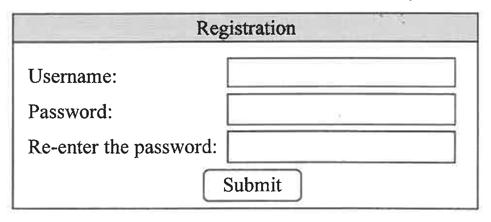

A. Data validation  
B. Data verification  
C. Data organisation  
D. Data preparation  

**10.** Peter wants to add the content in X.jpg and Y.xlsx to Z.docx using object linking. Which of the following statements about Object Linking and Embedding (OLE) is correct?

A. OLE does not apply to the file format of X.  
B. The file size of X should be smaller than that of Z before Peter's action.  
C. The file size of Z will be larger than that of Y after Peter's action.  
D. Changes to data in Y can affect the subsequent printout of Z.  

**11.** What is/are the major advantage(s) of using a form for data entry in database software?

(1) It reduces input errors.  
(2) It shortens the execution time of SQL statements.  
(3) It requires less storage space.  

A. (1) only  
B. (2) only  
C. (1) and (3) only  
D. (2) and (3) only  

**12.** The basic concept of the 'Input-Process-Output' cycle is illustrated in the following chart. What are X and Y?

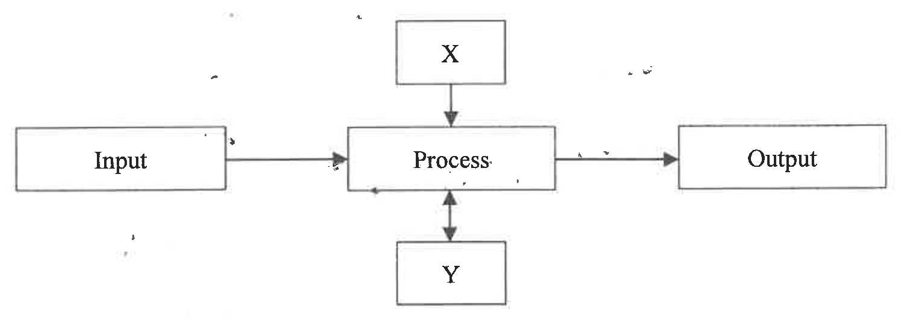

| | X | Y |
|---|---|---|
| A. | Unicode | Binary number |
| B. | Internet | Network device |
| C. | Program | Storage |
| D. | Database | Query |

**13.** Eva uses a spreadsheet to store hundreds of records of online meetings, as follows:

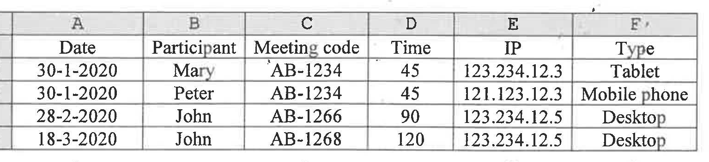

She wants to create a pivot table to find the number of meetings that each participant has attended.

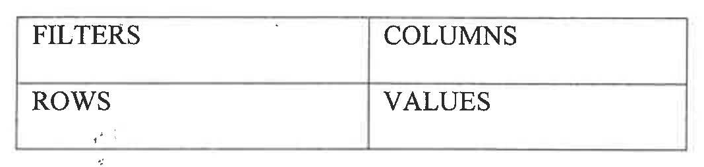

In which of the following areas should 'Participant' be put?

(1) FILTERS  
(2) COLUMNS  
(3) ROWS  
(4) VALUES  

A. (1) only  
B. (4) only  
C. (1) and (2) only  
D. (3) and (4) only  

**14.** Which of the following can be the specifications of a scanner for scanning documents and photos?

(1) 802.11n supported  
(2) 24-bit colour depth  
(3) Built-in 64 MB RAM  

A. (1) and (2) only  
B. (1) and (3) only  
C. (2) and (3) only  
D. (1), (2) and (3)  

**15.** Which of the following requires a driver program?

(1) Editing a word processing document  
(2) Connecting to a new printer  
(3) Removing a software package  

A. (1) only  
B. (2) only  
C. (1) and (3) only  
D. (2) and (3) only  

**16.** David builds a computer system at home that his friends can log in to and on which they can play an online football game together. Which of the following modes of processing is/are involved?

(1) Online interactive processing  
(2) Batch processing  
(3) Real-time processing  

A. (1) only  
B. (2) only  
C. (1) and (3) only  
D. (2) and (3) only  

**17.** John has a desktop computer installed with a 500GB SSD and a 2TB hard disk drive. Why is an operating system installed in the SSD instead of the hard disk drive?

A. The operating system is not open source software.  
B. The files of the operating system are frequently used.  
C. The storage size required for the operating system is smaller than 500 GB.  
D. Data files need to be stored in the hard disk.  

**18.** Which of the following is a recent development in CPU?

A. Pre-installation of an operating system  
B. Decreasing the number of processing units  
C. Increasing the clock rate  
D. Increasing the power consumption  

**19.** Peter wants to buy a computer for using multimedia learning software packages. Which of the following is the least important factor?

A. Storage size of SSD  
B. Storage size of RAM  
C. Storage size of ROM  
D. CPU clock rate  

**20.** What are the advantages of using an e-book reading device instead of a tablet computer to read e-books?

(1) Lower power consumption  
(2) Lighter in weight  
(3) Higher computational power  

A. (1) and (2) only  
B. (1) and (3) only  
C. (2) and (3) only  
D. (1), (2) and (3)  

**21.** The instruction of the assembly language 'LOAD 1000' is executed in a CPU. Which of the following components decodes the instruction?

A. Buses  
B. Registers  
C. ALU  
D. CU  

**22.** Which of the following is commonly used for connecting two LANs?

A. Firewall  
B. Broadband modem  
C. Router  
D. Anti-virus software  

**23.** Which of the following is not a multimedia file format?

A. ZIP  
B. MP3  
C. MP4  
D. PNG  

**24.** A supermarket will provide an online platform for customers to buy food. Which of the following should be considered when designing the user interface?

(1) Font size  
(2) Colour  
(3) Language  

A. (1) and (2) only  
B. (1) and (3) only  
C. (2) and (3) only  
D. (1), (2) and (3)  

**25.** Mary can use her mobile phone in her office to control the appliances connecting to a Wi-Fi network at home. Which of the following are involved?

(1) LAN  
(2) Internet  
(3) Access Point  

A. (1) and (2) only  
B. (1) and (3) only  
C. (2) and (3) only  
D. (1), (2) and (3)  

**26.** Mr Li rents online file storage services for the staff working in his office, instead of setting up file servers. Why?

(1) The bandwidth of the Internet connection for the office is not sufficient.  
(2) Additional technical staff is not needed in the office.  
(3) It gives flexibility when increasing the storage size.  

A. (1) only  
B. (2) only  
C. (1) and (3) only  
D. (2) and (3) only  

**27.** Which of the following about HTTP is/are correct?

(1) It is used to transfer hypertext documents.  
(2) It is used to translate URLs into IP addresses.  
(3) It is used to store the browsing history.  

A. (1) only  
B. (2) only  
C. (1) and (3) only  
D. (2) and (3) only  

**28.** In a school playground, although a wired network has been installed, the school installs an Access Point connecting to the network. Why?

(1) Students can use tablet computers for lessons.  
(2) The network can be used 24 hours a day.  
(3) The data transfer rate for the network connections is higher.  

A. (1) only  
B. (2) only  
C. (1) and (3) only  
D. (2) and (3) only  

**29.** What is the output of the following algorithm?

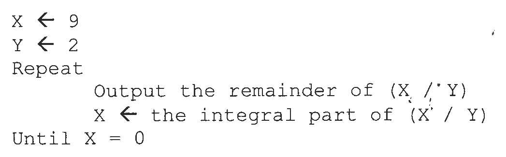

```text
X ← 9
Y ← 2
Repeat
    Output the remainder of (X / Y)
    X ← the integral part of (X / Y)
Until X = 0
```

A. 10  
B. 110  
C. 101  
D. 1001  

**30.** After writing the source code of a program, which of the following should be done according to the problem-solving procedures?

(1) Outline the input and output requirements of the problem.  
(2) Test the program with boundary cases.  
(3) Define the scope of the problem.  

A. (1) only  
B. (2) only  
C. (1) and (3) only  
D. (2) and (3) only  

**31.** Assume that X = 5, Y = 6 and Z = 7. Which of the following Boolean expressions returns TRUE?

A. ( (X < 0) AND (Y >= 6) ) AND (Z > 10)  
B. ( (X < 0) OR (Y <= 6) ) AND (Z > 10)  
C. ( (X < 0) OR (Y >= 6) ) AND (Z > 10)  
D. ( (X < 0) OR (Y <= 6) ) OR (Z > 10)  

**32.** What is the output of the following algorithm with the initial values in the array P?

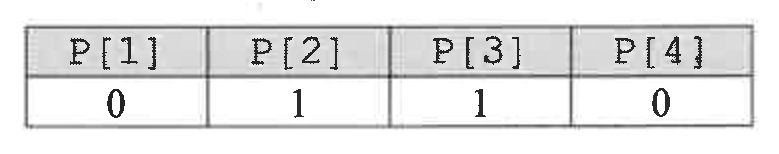

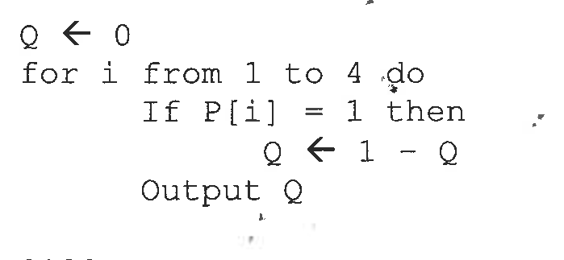

```text
Q ← 0
for i from 1 to 4 do
    If P[i] = 1 then
            Q ← 1 - Q
    Output Q
```

A. 0100  
B. 0110  
C. 1000  
D. 1001  

**33.** What is the output of the following algorithm?

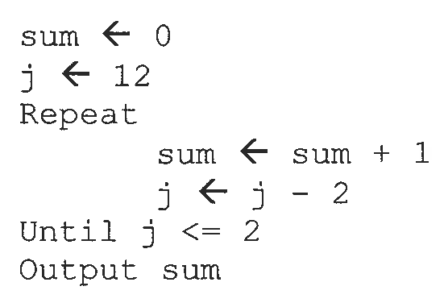

```text
sum ← 0
j ← 12
Repeat
    sum ← sum + 1
    j ← j - 2
Until j <= 2
Output sum
```

A. 7  
B. 6  
C. 5  
D. 4  

**34.** What is the output of the following algorithm?

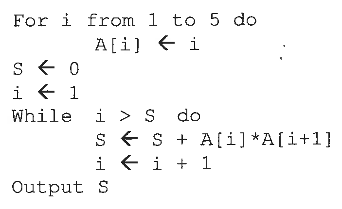

```text
For i from 1 to 5 do
    A[i] ← i
S ← 0
i ← 1
While i > S do
    S ← S + A[i]*A[i+1]
    i ← i + 1
Output S
```

A. 40  
B. 20  
C. 8  
D. 2  

**35.** What is the output of the following algorithm?

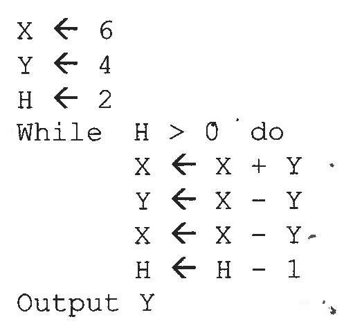

```text
X ← 6
Y ← 4
H ← 2
While H > 0 do
    X ← X + Y
    Y ← X - Y
    X ← X - Y
    H ← H - 1
Output Y
```

A. 10  
B. 6  
C. 4  
D. 2  

**36.** What can Alice do when using open source software?

(1) Seek approval from the software developer before using the software.  
(2) Amend the source code for her own use.  
(3) Amend the source code drastically and own the copyright of the entire software.  

A. (1) only  
B. (2) only  
C. (1) and (3) only  
D. (2) and (3) only  

**37.** What should be considered when using information from the Internet to write a report?

(1) Some information on the Internet is unreliable.  
(2) Most information on the Internet is free.  
(3) Many hackers steal personal information through social media.  

A. (1) only  
B. (2) only  
C. (1) and (3) only  
D. (2) and (3) only  

**38.** Which of the following can narrow the digital divide in the society?

(1) Providing computers to students for learning  
(2) Providing self-service kiosks for ordering food in restaurants  
(3) Using electronic payment to replace cash payment in shops  

A. (1) only  
B. (2) only  
C. (1) and (3) only  
D. (2) and (3) only  

**39.** Which of the following Internet activities are probably infringements of copyright?

(1) Extracting a video from an old movie DVD and uploading it to the Internet  
(2) Drawing a picture and sharing it with friends using peer-to-peer (p2p) software  
(3) Downloading newspaper articles from the Internet and publishing a book containing them  

A. (1) and (2) only  
B. (1) and (3) only  
C. (2) and (3) only  
D. (1), (2) and (3)  

**40.** Which of the following is/are the common measures for online systems to authenticate user identities?

(1) DNS  
(2) Security tokens  
(3) Firewalls  

A. (1) only  
B. (2) only  
C. (1) and (3) only  
D. (2) and (3) only  

**END OF SECTION A**
