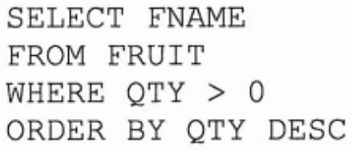
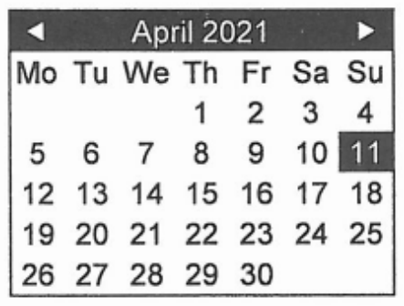
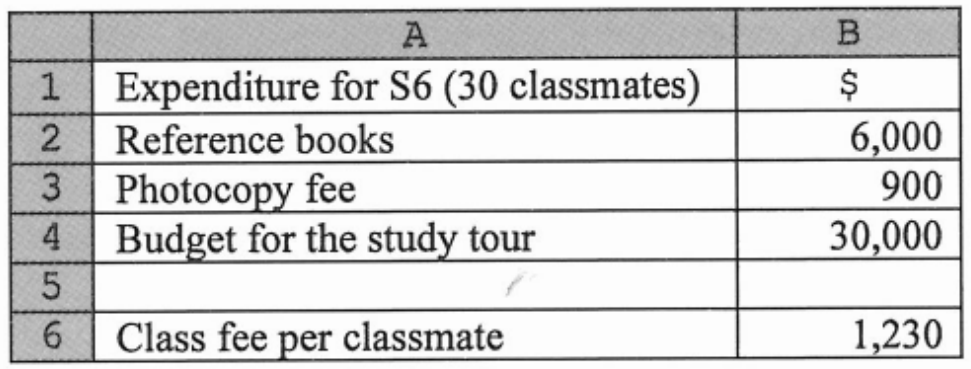
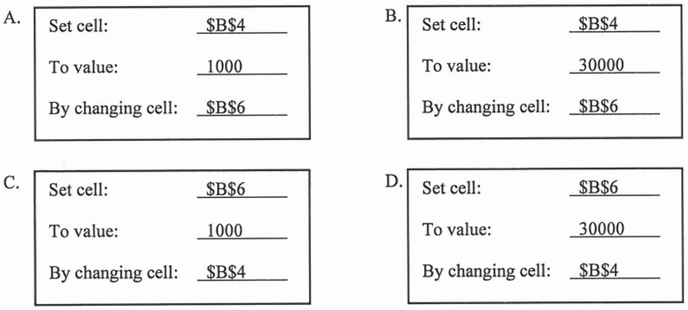
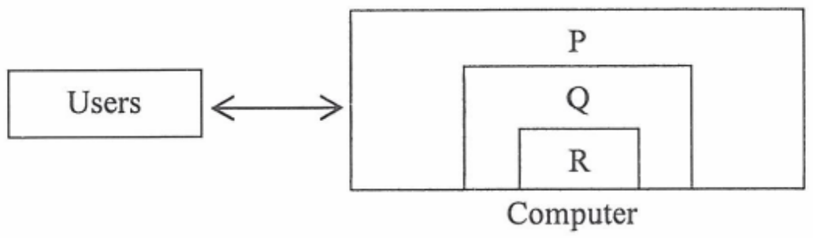
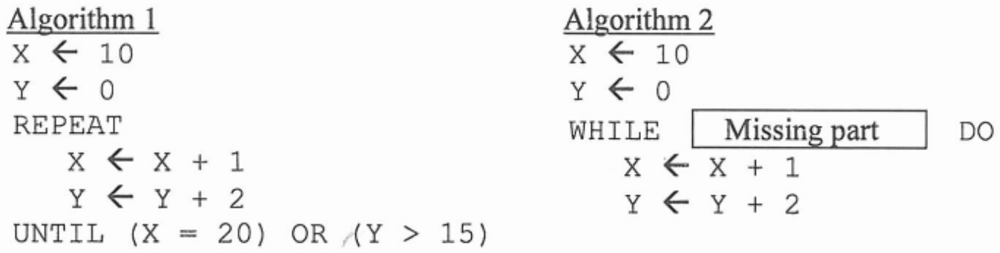

# There are 40 questions in this paper.  Choose the most suitable answers.

**1.** A computer receives the three data sequences, shown below. Each sequence includes a parity bit. Two of the sequences are found to be corrupted during transmission.

First:   0101 0111  
Second: 1101 0101  
Third:   1110 1011  

Which of the following best describes the situation?

| | Corrupted data sequence | Parity check |
|---|---|---|
| A. | The first and second | Even |
| B. | The second and third | Even |
| C. | The first and second | Odd |
| D. | The second and third | Odd |

**2.** A supermarket uses a database table FRUIT, which stores fruit name FNAME and the corresponding quantity in stock QTY. Which of the following best describes the result of the query below?



```text
SELECT FNAME
FROM FRUIT
WHERE QTY > 0
ORDER BY QTY DESC
```

A. Fruits are listed in descending order of fruit name.  
B. Fruits are listed in ascending order of the quantity in stock.  
C. Fruits with low quantities in stock are listed in ascending order of fruit name.  
D. Fruits are listed in descending order of the quantity in stock.  

**3.** What are the advantages of using the following calendar box over a text box for entering a date?



(1) Avoids impossible dates.  
(2) Ensures that the input is error-free.  
(3) Provides a user-friendly interface.  

A. (1) and (2) only  
B. (1) and (3) only  
C. (2) and (3) only  
D. (1), (2) and (3)  

**4.** Which of the following additions of 4-bit numbers using two's complement representation will result in an overflow error?

A. 0011 + 1001  
B. 1111 + 1111  
C. 1100 + 1011  
D. 1010 + 0100 + 0001  

**5.** How many bits are required to represent an image of 8×8 black-and-white pixels?

A. 64  
B. 64²  
C. 8⁸  
D. 2⁶⁴  

**6.** Which of the following is correct?

| | Information process | Example |
|---|---|---|
| A. | Data collection | Creating a statistical chart |
| B. | Data preparation | Validating questionnaires before input |
| C. | Data processing | Sorting questionnaires for data entry |
| D. | Data organisation | Designing an online questionnaire |

**7.** For a photo, the file size of its BMP image is larger than that of its JPG image because ____________.

(1) the BMP image is uncompressed  
(2) BMP represents a bitmap image  
(3) the BMP image cannot be shown in a browser  

A. (1) only  
B. (2) only  
C. (1) and (3) only  
D. (2) and (3) only  

**8.** Which of the following about mail merge are correct?

(1) A database file can be used as the data source for mail merge.  
(2) A main document and a data source can be merged to produce a merged document.  
(3) The content of merge fields is inserted in the merged document when the merging completes.  

A. (1) and (2) only  
B. (1) and (3) only  
C. (2) and (3) only  
D. (1), (2) and (3)  

**9.** Which of the following about a presentation of several slides supplemented with verbal annotation in presentation software is correct?

A. The presentation should be web-based.  
B. The presentation should be in a video file format such as MP4.  
C. Verbal annotation can be recorded for slides individually.  
D. The duration of each slide for verbal annotation is the same.  

**10.** In the following spreadsheet, a formula is entered in B6 based on B2:B4 to calculate the class fee. Classmates want to limit the class fee to $1,000 by cutting the budget for the study tour.



When using the 'goal seek' function for 'what-if' analysis, which of the following sets of data should be used?



**11.** Why should characters be represented by character sets such as ASCII in computers?

(1) To standardise the data representation  
(2) To enhance the data encryption  
(3) As data in computers is stored in binary numbers  

A. (1) only  
B. (2) only  
C. (1) and (3) only  
D. (2) and (3) only  

**12.** Why is information literacy important in a knowledge-based society?

(1) People should be able to identify fake information and hoaxes on the Internet.  
(2) People should be able to write artificial intelligence (AI) programs.  
(3) People should understand that some information from the Internet lacks credibility.  

A. (1) and (2) only  
B. (1) and (3) only  
C. (2) and (3) only  
D. (1), (2) and (3)  

**13.** When developing a management information system, which of the following should be the first item to be considered?

A. The technologies involved  
B. The personnel involved  
C. The cost of the system  
D. The purpose of the system  

**14.** Which of the following is/are the common specification(s) of a home use printer?

(1) 802.11n  
(2) Parallel port  
(3) 1200 dpi  

A. (1) only  
B. (2) only  
C. (1) and (3) only  
D. (2) and (3) only  

**15.** A standalone computer runs slow when working on database software. Which of the following hardware components should be upgraded?

(1) RAM  
(2) ROM  
(3) Network interface card  

A. (1) only  
B. (2) only  
C. (1) and (3) only  
D. (2) and (3) only  

**16.** Why would a fast food shop install a thermal printer instead of a laser printer to print receipts at the cashier?

(1) The printout is black and white.  
(2) The printer is smaller in size.  
(3) The text on the printout will fade faster.  

A. (1) only  
B. (2) only  
C. (1) and (3) only  
D. (2) and (3) only  

**17.** One day, Mary finds that she cannot access the Internet through her computer at home. Which of the following is a possible cause?

A. The size of ROM is small.  
B. The data transfer rate of the hard disk is low.  
C. The graphics card is out of order.  
D. The network interface card is out of order.  

**18.** Why do we need to regularly update software?

(1) Fix program bugs.  
(2) Provide new functions.  
(3) Improve the software performance.  

A. (1) and (2) only  
B. (1) and (3) only  
C. (2) and (3) only  
D. (1), (2) and (3)  

**19.** A company develops a computer system for autopilot driving, so that a vehicle can collect and use image data from the environment and drive on the road safely. It is a real-time processing system because ____________.

A. the computers involved should have a high processing power  
B. there should be no time delay between data input and the data processing  
C. a large amount of data should be collected over a period of time  
D. it provides resources and services to multiple users at a time  

**20.** There are one hundred 300GB surveillance video files. Without any file reorganisation and compression, how many 2TB hard disks are needed to store all the video files?

A. 15  
B. 16  
C. 17  
D. 32  

**21.** In a typical situation, what are P, Q and R?



| | P | Q | R |
|---|---|---|---|
| A. | Operating system | Hardware | Application software |
| B. | Application software | Operating system | Hardware |
| C. | Application software | Hardware | Operating system |
| D. | Operating system | Application software | Hardware |

**22.** Which of the following describe(s) the URL, https://www.abc.edu.hk/en/?

(1) en is a path on the web server.  
(2) The domain name is abc.  
(3) The web site is registered as an educational institution in Hong Kong.  

A. (1) only  
B. (2) only  
C. (1) and (3) only  
D. (2) and (3) only  

**23.** Which of the following are the potential benefits of e-learning?

(1) It can track individual learning progress.  
(2) It reduces computer hardware resources.  
(3) It provides flexible learning schedules.  

A. (1) and (2) only  
B. (1) and (3) only  
C. (2) and (3) only  
D. (1), (2) and (3)  

**24.** Which of the following should be considered when designing web pages?

(1) The time for loading web pages  
(2) The user-friendliness of browsing  
(3) The colour combination  

A. (1) and (2) only  
B. (1) and (3) only  
C. (2) and (3) only  
D. (1), (2) and (3)  

**25.** Fibre optics is used in a computer network because

(1) it supports both wired and wireless connections  
(2) its data transfer rate is very high  
(3) it supports a connection with a long distance  

A. (1) and (2) only  
B. (1) and (3) only  
C. (2) and (3) only  
D. (1), (2) and (3)  

**26.** Internet Protocol (IP) is used in a computer network because

A. data can be transmitted under the same communication rules  
B. computers in the network are installed with the same operating system  
C. the maximum data transfer rates between computers are the same  
D. the network is a LAN instead of a WAN  

**27.** Amy uses a computer to watch streaming videos. Which of the following should she consider?

(1) Network bandwidth  
(2) Anti-virus software  
(3) Hard disk storage size  

A. (1) only  
B. (2) only  
C. (1) and (3) only  
D. (2) and (3) only  

**28.** The final values of X and Y in the following two algorithms are the same:



```text
Algorithm 1
X ← 10
Y ← 0
REPEAT
    X ← X + 1
    Y ← Y + 2
UNTIL (X = 20) OR (Y > 15)

Algorithm 2
X ← 10
Y ← 0
WHILE [ Missing part ] DO
    X ← X + 1
    Y ← Y + 2
```

What is the missing part in Algorithm 2?

A. (X = 20) AND (Y > 15)  
B. (X = 20) OR (Y > 15)  
C. (X <> 20) AND (Y <= 15)  
D. (X <> 20) OR (Y <= 15)  

**29.** What input value for the algorithm below will not output 'Complete!'?


```text
Input N
flag ← TRUE
While flag = TRUE do
    If remainder of (N/4) > 0 then
        flag ← FALSE
Output 'Complete!'
```

A. 1  
B. 2  
C. 4  
D. 6  

Answer Questions 30 and 31 with reference to the following algorithm.


```text
j ← 0
Input N
While N <> 888 do
    j ← j + N
    Input N
Output j
```

**30.** What is the purpose of the algorithm?

A. Counts the number of input values.  
B. Finds the maximum input value.  
C. Calculates the sum of input values.  
D. Calculates the average of input values.  

**31.** What is the use of the value '888'?

A. Terminates the input.  
B. Checks positive input values.  
C. Limits the range of input values.  
D. Adds input values to j.  

**32.** What is the importance of a problem definition in problem-solving?

A. The design and the scope of work can be set.  
B. Problem analysis can be skipped.  
C. There is no need to define sub-problems.  
D. An error-free algorithm will be developed.  

**33.** Which of the following is/are the advantage(s) of modularity in programming?

(1) The user manual is simpler.  
(2) It is easier to trace a program.  
(3) It facilitates programming through team work.  

A. (1) only  
B. (2) only  
C. (1) and (3) only  
D. (2) and (3) only  

**34.** Why should appropriate test data be prepared?

(1) To detect mistakes in algorithms  
(2) To test whether exceptional input data can be handled  
(3) To verify expected results from given input data  

A. (1) and (2) only  
B. (1) and (3) only  
C. (2) and (3) only  
D. (1), (2) and (3)  

**35.** Peter just finds that he cannot open some important files in a computer in his office due to a ransomware attack. What should he do immediately?

A. Format the hard disk.  
B. Disconnect the network connection.  
C. Update anti-virus software.  
D. Enable a firewall.  

**36.** A shopping mall plans to develop a mobile application for customers to register their shopping records and gain bonus points for gifts. Which of the following considerations should be the least important?

A. Network security  
B. Personal data privacy  
C. Operating system  
D. Application file size  

**37.** John plays Internet games and uses social media all the time. Which of the following are likely the consequences of such indulgence in Internet activities?

(1) A higher chance of having anxiety and attention problems  
(2) Infringement of copyright in Internet activities  
(3) A decline in physical fitness  

A. (1) and (2) only  
B. (1) and (3) only  
C. (2) and (3) only  
D. (1), (2) and (3)  

**38.** Which of the following are appropriate when using a social media application?

(1) Understand the terms of use of the application.  
(2) Provide necessary personal information only.  
(3) Forward information sent from others to friends as soon as possible.  

A. (1) and (2) only  
B. (1) and (3) only  
C. (2) and (3) only  
D. (1), (2) and (3)  

**39.** Peter installs a software package on his computer. He also installs it on another computer. He does not infringe copyright because

(1) the license of the software package allows such installation  
(2) the two computers are located in different countries  
(3) the operating systems of the two computers are different  

A. (1) only  
B. (2) only  
C. (1) and (3) only  
D. (2) and (3) only  

**40.** Which of the following about the use of robots are correct?

(1) Robots can follow working procedures accurately.  
(2) Robots can replace the work of all the employees.  
(3) Robots can take up dirty, dangerous jobs.  

A. (1) and (2) only  
B. (1) and (3) only  
C. (2) and (3) only  
D. (1), (2) and (3)  

**END OF SECTION A**
