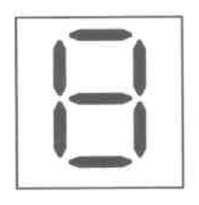
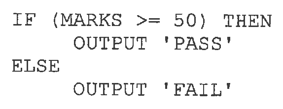
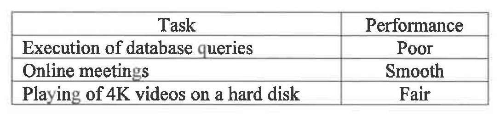
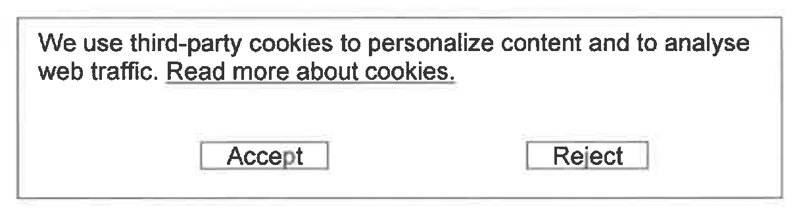
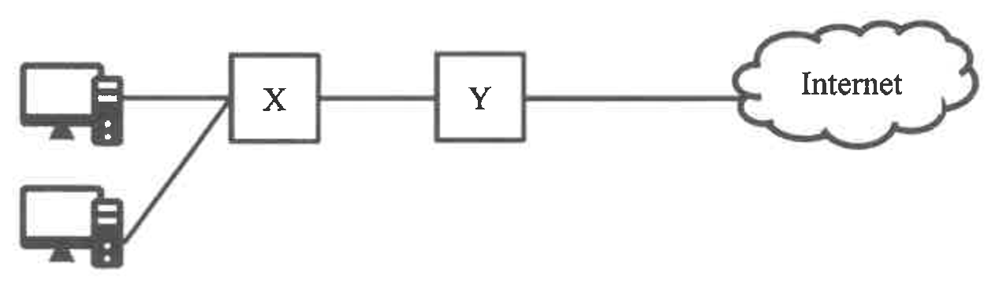
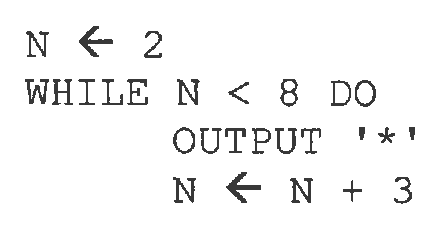
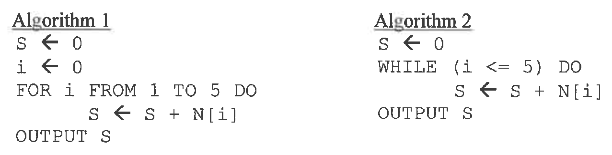
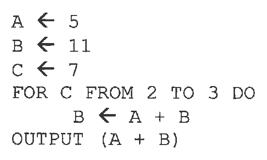
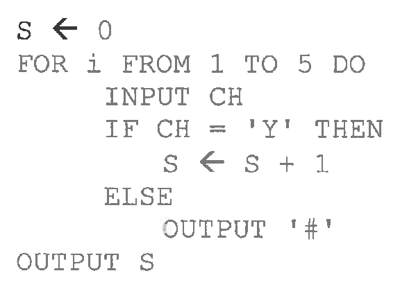
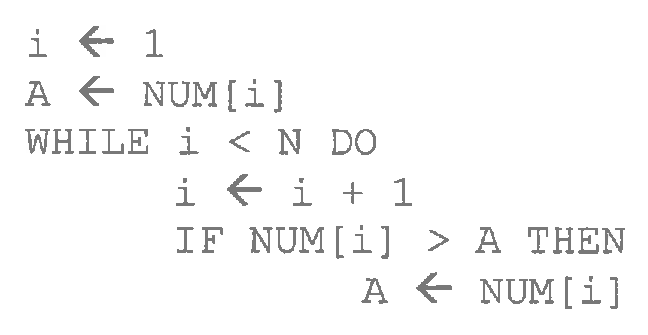

# There are 40 questions in this paper.  Choose the most suitable answers.

**1.** Which of the following statements about direct access on a storage device are correct?

(1) Writing the data of a file starts from the beginning of the storage device.  
(2) In general, the seek time to search for a file is faster than that of sequential access.  
(3) It is more commonly used in hard disks than sequential access.  

A. (1) and (2) only  
B. (1) and (3) only  
C. (2) and (3) only  
D. (1), (2) and (3)  

**2.** The following seven-segment display is widely used. Each segment is an LED light that can be turned on or off independently. Other than when all segments are turned off, how many different patterns can be generated by the display?



A. 10  
B. 63  
C. 127  
D. 255  

**3.** Mary only has a computer without any network connections. Which of the following systems can she carry out?

(1) Distributed processing system  
(2) Real-time system  
(3) Batch processing system  

A. (1) only  
B. (2) only  
C. (1) and (3) only  
D. (2) and (3) only  

**4.** In which of the following 8-bit representations will the addition of integers 01100000 and 01100000 result in an overflow error?

(1) Sign-and-magnitude  
(2) One's complement  
(3) Two's complement  

A. (1) and (2) only  
B. (1) and (3) only  
C. (2) and (3) only  
D. (1), (2) and (3)  

**5.** Which of the following clauses should be used in a SELECT SQL command for displaying information where salary is greater than 5000 in ascending order of salary?

A. WHERE salary > 5000 ORDER BY salary  
B. HAVING salary > 5000 ORDER BY salary  
C. WHERE salary > 5000 AND ORDER BY salary  
D. HAVING salary > 5000 OR ORDER BY salary  

**6.** Consider the following pseudocode for checking a normal school exam result:



```text
IF (MARKS >= 50) THEN
    OUTPUT 'PASS'
ELSE
    OUTPUT 'FAIL'
```

Which of the following sets of test values is appropriate?

A. -10    30    40  
B. 10    25    45  
C. 100    99    98  
D. 99    0    50  

**7.** Which of the following should be considered when creating a presentation for a project using presentation software?

(1) Layout of the slides  
(2) Colour scheme  
(3) Sequence of the slides  

A. (1) and (2) only  
B. (1) and (3) only  
C. (2) and (3) only  
D. (1), (2) and (3)  

**8.** When entering formulas in a spreadsheet, which of the following results is incorrect?

| | Formula | Result |
|---|---|---|
| A. | LEN("HKDSE") | 5 |
| B. | UPPER("technology") | Technology |
| C. | FIND("for","information") | 3 |
| D. | TRIM("    ICT ") | ICT |

**9.** Which of the following is not required for a mail merge using a word processor?

A. Data source  
B. Main document  
C. Merge fields  
D. Field length  

**10.** What is/are the benefit(s) of creating a report in PDF format instead of DOCX format?

(1) The text format can be preserved.  
(2) Hyperlinks can be inserted.  
(3) Colour fonts can be used.  

A. (1) only  
B. (2) only  
C. (1) and (3) only  
D. (2) and (3) only  

**11.** Which of the following image file formats support transparent background images?

(1) PNG  
(2) GIF  
(3) JPG  

A. (1) and (2) only  
B. (1) and (3) only  
C. (2) and (3) only  
D. (1), (2) and (3)  

**12.** Which of the following may involve Object Linking and Embedding (OLE)?

(1) Using mail merge to create documents  
(2) Creating a pivot table  
(3) Inserting images in a presentation slide  

A. (1) and (2) only  
B. (1) and (3) only  
C. (2) and (3) only  
D. (1), (2) and (3)  

**13.** Which of the following regarding Unicode and Big-5 code is correct?

A. In a computer, the use of Big-5 code and Unicode depends on the operating system.  
B. Big-5 code is used for representing characters in Chinese only.  
C. Unicode is used for representing characters in English and other languages.  
D. For web browsing, the use of a character set depends on the browser.  

**14.** For a CPU with the specifications of 16 cores, 5 GHz and a 30 MB cache, which of the following are correct?

(1) The clock rate of the CPU is 5 GHz.  
(2) The maximum number of programs that the CPU can handle at the same time is 16.  
(3) The CPU accesses data in the cache memory faster than that in RAM.  

A. (1) and (2) only  
B. (1) and (3) only  
C. (2) and (3) only  
D. (1), (2) and (3)  

**15.** Which of the following is the main function of a network interface card in a computer?

A. To connect to a wired router and project Wi-Fi signals to a designated area.  
B. To direct data packets from one network to another network.  
C. To filter and forward data packets from the computer to another device.  
D. To send and receive network signals.  

**16.** Which of the following are functions of an operating system?

(1) Allocate hardware resources.  
(2) Schedule jobs.  
(3) Store user programs permanently.  

A. (1) and (2) only  
B. (1) and (3) only  
C. (2) and (3) only  
D. (1), (2) and (3)  

**17.** Which of the following is not a specification of a projector?

A. WiFi 802.11ac supported  
B. 3800 lm (lumen)  
C. 4K UHD (Ultra High Definition)  
D. 5400 rpm (revolutions per minute)  

**18.** In a computer, the performance of each individual task is shown below:



Which of the following components should be upgraded?

(1) Network interface card  
(2) Display card  
(3) CPU  

A. (1) and (2) only  
B. (1) and (3) only  
C. (2) and (3) only  
D. (1), (2) and (3)  

**19.** John has just connected a new USB printer to a computer. Why is he able to use the printer immediately?

A. The RAM size of the printer is large enough to store the data for printing.  
B. The operating system of the computer already has a driver program for the printer.  
C. USB printers do not need driver programs.  
D. There is a built-in CPU in the printer to manage the printing.  

**20.** Which of the following about the use of HTTP is correct?

A. It can convert a domain name into an IP address.  
B. It can distinguish a wireless network from a wired network.  
C. It can retrieve a web page from a web server.  
D. It can encrypt and decrypt data through a secure channel.  

**21.** Peter browses a new web site and sees the following message:



Which of the following is/are the consequence(s) of clicking the 'Accept' button?

(1) Personal information may be collected.  
(2) The bandwidth of the network may be decreased.  
(3) The address book of his email account may be disclosed.  

A. (1) only  
B. (2) only  
C. (1) and (3) only  
D. (2) and (3) only  

**22.** Mary uploads a photo to her social media account through a browser. Which of the following protocols will probably be involved?

(1) IP  
(2) DNS  
(3) HTTP  

A. (1) only  
B. (2) only  
C. (2) and (3) only  
D. (1), (2) and (3)  

**23.** In the following network diagram, computers can access the Internet. What are X and Y?



| | X | Y |
|---|---|---|
| A. | Switch | Router |
| B. | Firewall | Switch |
| C. | Firewall | Router |
| D. | Router | Switch |

**24.** Which of the following about IP addresses is/are correct?

(1) They contain location information and make network devices accessible for communication.  
(2) They are used to reassemble the data received back into the original order.  
(3) They can be used with both the Internet and Intranet.  

A. (1) only  
B. (2) only  
C. (1) and (3) only  
D. (2) and (3) only  

**25.** Which of the following is the common input and output of a domain name system (DNS) server?

| | Input | Output |
|---|---|---|
| A. | HTML | IP address |
| B. | IP address | MAC address |
| C. | Domain name | MAC address |
| D. | Domain name | IP address |

**26.** Which of following about wired networks and wireless networks is correct?

| | Wired network | Wireless network |
|---|---|---|
| A. | A more stable connection | Flexible network access |
| B. | Higher network security | A more stable connection |
| C. | Flexible network access | Higher network security |
| D. | Flexible network access | A more stable connection |

**27.** Dry run the following algorithm. How many '*' are output?



```text
N ← 2
WHILE N < 8 DO
    OUTPUT '*'
    N ← N + 3
```

A. 0  
B. 2  
C. 3  
D. 4  

Answer Questions 28 and 29 with reference to the following algorithms.



```text
Algorithm 1
S ← 0
i ← 0
FOR i FROM 1 TO 5 DO
    S ← S + N[i]
OUTPUT S

Algorithm 2
S ← 0
WHILE (i <= 5) DO
    S ← S + N[i]
OUTPUT S
```

**28.** Suppose that all values in the array N are 2. What is the output of Algorithm 1?

A. 0  
B. 5  
C. 10  
D. 20  

**29.** The purposes of Algorithm 1 and Algorithm 2 should be the same. What are the missing statements in Algorithm 2?

(1) i ← 0  
(2) i ← 1  
(3) i ← i + 1  
(4) IF i=1 THEN i ← i+1  

A. (1) and (3) only  
B. (2) and (3) only  
C. (1) and (4) only  
D. (2) and (4) only  

**30.** What is the output of the following algorithm?



```text
A ← 5
B ← 11
C ← 7
FOR C FROM 2 TO 3 DO
    B ← A + B
OUTPUT (A + B)
```

A. 16  
B. 21  
C. 26  
D. 32  

**31.** What is the output of the following algorithm for the input 'Y', 'N', 'Y', 'N', 'Y'?



```text
S ← 0
FOR i FROM 1 TO 5 DO
    INPUT CH
    IF CH = 'Y' THEN
        S ← S + 1
    ELSE
        OUTPUT '#'
OUTPUT S
```

A. 1#2#3  
B. 1#1#1  
C. ##3  
D. ###  

**32.** NUM is an integer array with N values. What is the purpose of the following algorithm?



```text
i ← 1
A ← NUM[i]
WHILE i < N DO
    i ← i + 1
    IF NUM[i] > A THEN
        A ← NUM[i]
```

A. To count the number of values in NUM.  
B. To calculate the sum of values in NUM.  
C. To find the maximum value in NUM.  
D. To find the minimum value in NUM.  

**33.** Which of the following are advantages of using the modular approach when designing algorithms?

(1) A module can be reused in other scenarios.  
(2) The execution time of an algorithm is shorter.  
(3) The modules are easier to design and test.  

A. (1) and (2) only  
B. (1) and (3) only  
C. (2) and (3) only  
D. (1), (2) and (3)  

**34.** Which of the following is/are the advantage(s) of using open source software over freeware?

(1) It is easier to set up and use.  
(2) Users can improve the source code and share it in the community.  
(3) Open source software is cross-platform.  

A. (1) only  
B. (2) only  
C. (1) and (3) only  
D. (2) and (3) only  

**35.** Which of the following are proper measures when using social media platforms?

(1) Manage the privacy settings to control who can see your posts.  
(2) Use a strong login password and change it regularly.  
(3) Be aware of what personal information you have provided.  

A. (1) and (2) only  
B. (1) and (3) only  
C. (2) and (3) only  
D. (1), (2) and (3)  

**36.** Which of the following programs can enhance the security of using a computer?

(1) Adware  
(2) A firewall  
(3) An encryption program  

A. (1) and (2) only  
B. (1) and (3) only  
C. (2) and (3) only  
D. (1), (2) and (3)  

**37.** Which of the following can help bridge the digital divide?

(1) Providing free access to computers in public libraries.  
(2) Providing Internet access for students in need.  
(3) Providing online English lessons for students in need.  

A. (1) and (2) only  
B. (1) and (3) only  
C. (2) and (3) only  
D. (1), (2) and (3)  

**38.** What is/are the advantage(s) of using Secure Socket Layer (SSL) on web sites?

(1) The data transfer rate is higher.  
(2) The transferred data is encrypted.  
(3) The IP addresses of the web sites can be hidden.  

A. (1) only  
B. (2) only  
C. (1) and (3) only  
D. (2) and (3) only  

**39.** Why do many companies prefer commercial software to open source software?

(1) Open source software contains more software bugs.  
(2) Commercial software developers can provide better support.  
(3) Open source software cannot be modified by companies.  

A. (1) only  
B. (2) only  
C. (1) and (3) only  
D. (2) and (3) only  

**40.** How can updating an operating system frequently protect computers from virus attacks?

A. Security loopholes can be fixed.  
B. More support from the developer of the operating system can be provided.  
C. The computer performance can be enhanced.  
D. A virus check can be conducted.  

**END OF SECTION A**
