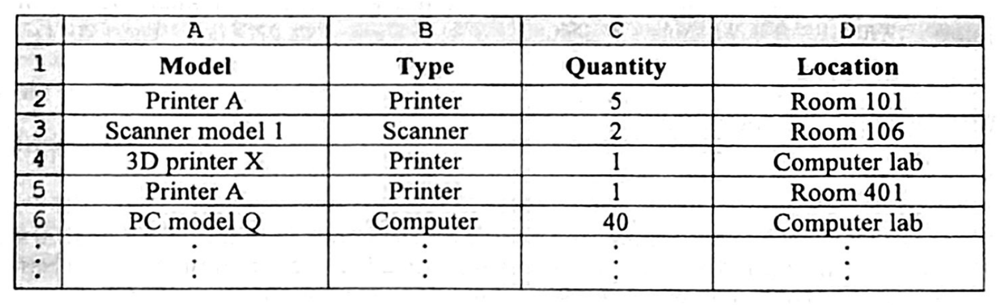
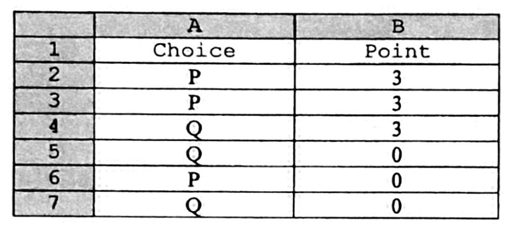
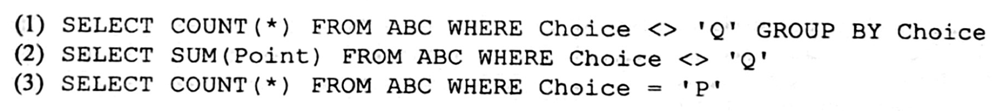
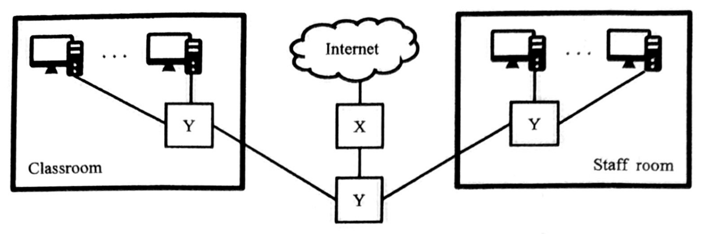
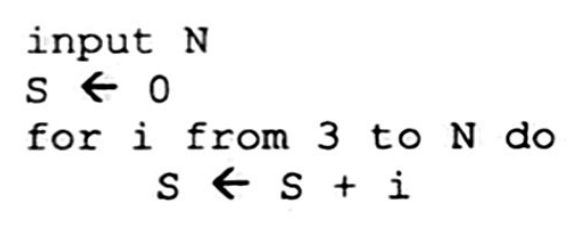
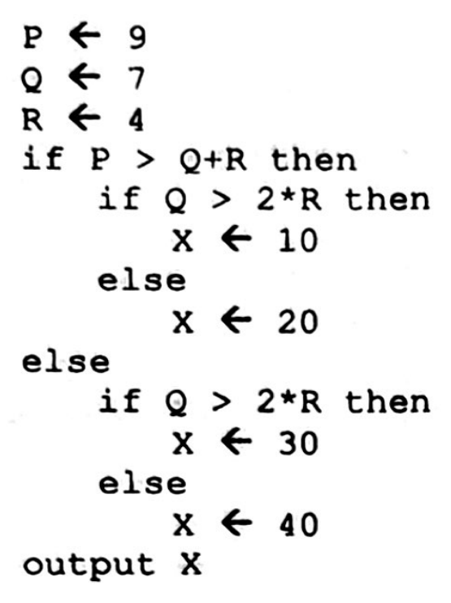
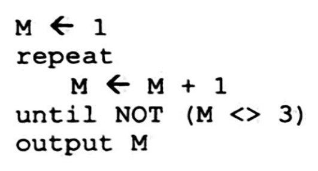
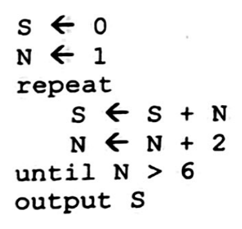
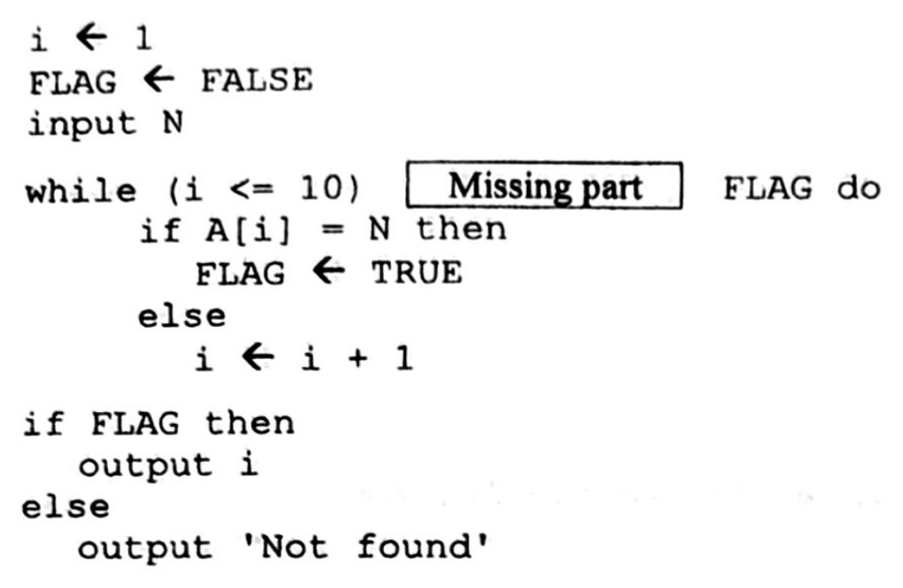
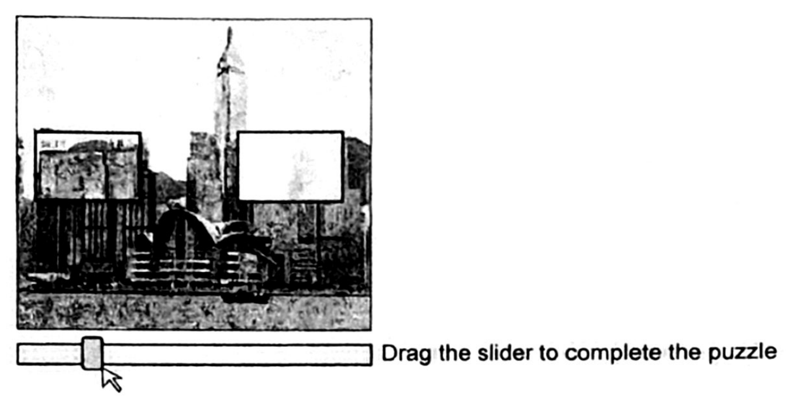

# There are 40 questions in this paper.  Choose the most suitable answers.

**1.** What is the range of 8-bit two's complement?

A. -2⁷ to 2⁷  
B. -2⁷ to 2⁷ - 1  
C. -2⁷ + 1 to 2⁷  
D. -2⁷ + 1 to 2⁷ - 1  

**2.** A teacher sends notes in PDF format instead of in DOCX format to students. Why?

(1) The layout of the notes can be viewed the same across different operating systems.  
(2) DOCX files might contain viruses.  
(3) Hyperlinks to web sites can be included.  

A. (1) only  
B. (2) only  
C. (1) and (3) only  
D. (2) and (3) only  

**3.** Which of the following is/are image file format(s)?

(1) mov  
(2) png  
(3) ai  

A. (1) only  
B. (2) only  
C. (1) and (3) only  
D. (2) and (3) only  

**4.** The spreadsheet below records school equipment.



Which of the following can help display the total number of devices of the same type?

A. Multiple worksheets  
B. Sorting  
C. Pivot table  
D. What-if analysis  

**5.** A text file contains English, traditional Chinese and simplified Chinese characters. Which of the following character sets should be used?

(1) UTF-8  
(2) ASCII  
(3) GB code  

A. (1) only  
B. (2) only  
C. (1) and (3) only  
D. (2) and (3) only  

**6.** The MAC address of a network card consists of 6 groups of 2-digit hexadecimal numbers, as shown in the following example:

00:0A: 95:9D:67: 16

How many possible addresses can be represented by this format?

A. 2⁶  
B. 2¹²  
C. 2²⁴  
D. 2⁴⁸  

**7.** Which of the following is correct?

A. Object linking is used to adjust the layout of database reports.  
B. The queries in databases are used to extract information from databases.  
C. The reports in databases are used to help users store data.  
D. Object embedding is used to execute application programs.  

**8.** What is the advantage of using a form to input data into a database?

A. The storage size for the data is smaller.  
B. The data filtering is faster.  
C. It facilitates the data input.  
D. The execution of SQL is faster.  

**9.** What are the advantages of using a web-based presentation tool to create a presentation?

(1) The file size of the presentation is smaller than that created by presentation software.  
(2) Users can collaborate with each other to work on the same presentation simultaneously.  
(3) The most up-to-date functions can be provided for creating the presentation.  

A. (1) and (2) only  
B. (1) and (3) only  
C. (2) and (3) only  
D. (1), (2) and (3)  

**10.** Peter considers using the 'table of contents' function in word processing. Why?

(1) It automatically generates hyperlinks of headings.  
(2) It increases the readability of documents.  
(3) It facilitates updates to the page numbers.  

A. (1) and (2) only  
B. (1) and (3) only  
C. (2) and (3) only  
D. (1), (2) and (3)  

Answer Questions 11 and 12 with reference to the following spreadsheet.



**11.** What are the results of the following two formulas?

| | =COUNT(B2:B7) | =RANK(3, B2:B7) |
|---|---|---|
| A. | 3 | 1 |
| B. | 3 | 2 |
| C. | 6 | 1 |
| D. | 6 | 2 |

**12.** The spreadsheet is converted to a database table ABC. Which of the following SQL statements generate the same result?



```text
(1) SELECT COUNT(*) FROM ABC WHERE Choice <> 'Q' GROUP BY Choice
(2) SELECT SUM(Point) FROM ABC WHERE Choice <> 'Q'
(3) SELECT COUNT(*) FROM ABC WHERE Choice = 'P'
```

A. (1) and (2) only  
B. (1) and (3) only  
C. (2) and (3) only  
D. (1), (2) and (3)  

**13.** Which of the following member information in a sport club can be defined as a Boolean data type?

(1) VIP member  
(2) Bank account number  
(3) Education level  

A. (1) only  
B. (2) only  
C. (1) and (3) only  
D. (2) and (3) only  

**14.** Which of the following additions of 8-bit numbers using two's complement representation will result in an overflow error?

A. 1001 1100 + 1100 1110  
B. 1001 1100 + 1111 1011  
C. 0010 0110 + 1111 0110  
D. 0010 0110 + 1110 1100  

**15.** Which of the following is not commonly used for connecting to a home-use laser printer?

A. Bluetooth  
B. USB cable  
C. WiFi  
D. Fibre optics  

**16.** Eva experiences power failure when working on word processing on a desktop computer. Some of her working data can be restored. Why?

(1) The working data is saved in the hard disk.  
(2) The working data is saved in the RAM.  
(3) The working data is saved in the ROM.  

A. (1) only  
B. (2) only  
C. (1) and (3) only  
D. (2) and (3) only  

**17.** Driver programs P and Q are used in video conferencing and printing respectively. Which of the following descriptions is reasonable?

A. P allows the operating system and web cameras to interact with each other.  
B. Q can be executed in different operating systems.  
C. P controls the number of concurrent users.  
D. Q controls the user rights for using printers.  

**18.** Amy finds that her computer is infected by ransomware. What should she do immediately?

A. Execute an anti-virus program to scan for and clean viruses.  
B. Install a firewall to block unauthorised access.  
C. Disconnect the network connection and shut down the computer.  
D. Format the hard disk.  

**19.** Where is a bootstrap program for starting up a computer usually stored?

A. CPU  
B. RAM  
C. ROM  
D. SSD  

**20.** Which of the following statements about cache memory is correct?

A. It is a type of ROM.  
B. It can only be found in the CPU.  
C. It stores frequently-used data and instructions.  
D. The data access rate of cache memory is lower than that of RAM.  

**21.** Which of the following are the functions of an operating system?

(1) Interact with devices and facilitate input/output operations.  
(2) Play video files.  
(3) Facilitate a computer to connect to a network.  

A. (1) and (2) only  
B. (1) and (3) only  
C. (2) and (3) only  
D. (1), (2) and (3)  

**22.** Which of the following temporarily hold the data or instructions?

(1) Accumulator  
(2) Instruction register  
(3) Memory address register  

A. (1) and (2) only  
B. (1) and (3) only  
C. (2) and (3) only  
D. (1), (2) and (3)  

**23.** Ms Ng has registered abc.edu.hk as the domain name for a school. Which of the following URLs can she use?

(1) http://abc.hk  
(2) http://hk.abc.edu.hk  
(3) http://hk.abc.edu  

A. (1) only  
B. (2) only  
C. (1) and (3) only  
D. (2) and (3) only  

**24.** Which of the following protocols is/are usually involved in audio streaming services?

(1) FTP  
(2) DNS  
(3) IP  

A. (1) only  
B. (2) only  
C. (1) and (3) only  
D. (2) and (3) only  

**25.** In the following network diagram, what is the major function of X?



A. To connect a server to multiple workstations.  
B. To control the access rights of connected devices.  
C. To connect multiple computers together.  
D. To connect multiple networks together.  

**26.** Greg develops a web site for friends to browse. Which of the following should he be concerned about?

(1) The file sizes of multimedia elements used  
(2) The storage capacity of friends' computers  
(3) The user-friendliness of web pages  

A. (1) and (2) only  
B. (1) and (3) only  
C. (2) and (3) only  
D. (1), (2) and (3)  

**27.** In the following algorithm, the final value of S is greater than 15. What is the smallest possible input value of N?



```text
input N
S ← 0
for i from 3 to N do
    S ← S + i
```

A. 5  
B. 6  
C. 7  
D. 8  

**28.** What is the output of the following algorithm?



```text
P ← 9
Q ← 7
R ← 4
if P > Q+R then
    if Q > 2*R then
        X ← 10
    else
        X ← 20
else
    if Q > 2*R then
        X ← 30
    else
        X ← 40
output X
```

A. 10  
B. 20  
C. 30  
D. 40  

**29.** What is the output of the following algorithm?



```text
M ← 1
repeat
    M ← M + 1
until NOT (M <> 3)
output M
```

A. 2  
B. 3  
C. 4  
D. There is no output.  

**30.** What is the output of the following algorithm?



```text
S ← 0
N ← 1
repeat
    S ← S + N
    N ← N + 2
until N > 6
output S
```

A. 3  
B. 4  
C. 9  
D. 16  

Answer Questions 31 and 32 with reference to the following algorithm that searches for a value in an array A.



```text
i ← 1
FLAG ← FALSE
input N
while (i <= 10) [ Missing part ] FLAG do
    if A[i] = N then
        FLAG ← TRUE
    else
        i ← i + 1
if FLAG then
    output i
else
    output 'Not found'
```

**31.** What is the missing part above?

A. OR  
B. AND  
C. OR NOT  
D. AND NOT  

**32.** What is the purpose of using the variable FLAG?

A. To store the location of the found value.  
B. To store the number of matching.  
C. To act as an index.  
D. To control the loop.  

**33.** Which of the following are the advantages of using modularity in writing programs?

(1) Some modules can be reused.  
(2) It is easier to debug programs.  
(3) It is faster to define a problem.  

A. (1) and (2) only  
B. (1) and (3) only  
C. (2) and (3) only  
D. (1), (2) and (3)  

**34.** Which of the following is used to filter incoming and outgoing network traffic?

A. Spyware  
B. Security token  
C. Firewall  
D. Digital signature  

**35.** What is/are the purpose(s) of the task shown on the following screen when logging in to an online store?



(1) To check that the login information is correct.  
(2) To verify that the login is done by a human.  
(3) To make sure that the login device is equipped with a touch screen.  

A. (1) only  
B. (2) only  
C. (1) and (3) only  
D. (2) and (3) only  

**36.** When Tom registers a user account on a web site, he receives an email from the web site with a code for him to input. What is/are the purpose(s) of the code?

(1) To verify his identity.  
(2) To ensure that the email is not a spam email.  
(3) To ensure that the web site and his account are protected by SSL.  

A. (1) only  
B. (2) only  
C. (1) and (3) only  
D. (2) and (3) only  

**37.** Mary is a photographer and shares her photos with Peter and John. Which of the following will probably violate her intellectual property rights?

(1) Mary shares the photos with Peter and John via Bit Torrent (BT).  
(2) Peter sells the photos to an advertising company.  
(3) Peter edits the photos using illegally copied software.  

A. (1) only  
B. (2) only  
C. (1) and (3) only  
D. (2) and (3) only  

**38.** Which of the following statements about open source software is/are correct?

(1) Everyone can use and modify the source code.  
(2) The software developers are responsible for providing software updates.  
(3) Everyone can rename and redistribute the software.  

A. (1) only  
B. (2) only  
C. (1) and (3) only  
D. (2) and (3) only  

**39.** What ergonomic improvement should be made when using the computer below?


A. Installing a trackball.  
B. Installing a touch screen.  
C. Using a smaller table.  
D. Installing armrests on the chair.  

**40.** Which of the following are the major functions of PKI?

(1) To ensure the integrity of data transmitted over the Internet.  
(2) To support a longer password.  
(3) To support data encryption.  

A. (1) and (2) only  
B. (1) and (3) only  
C. (2) and (3) only  
D. (1), (2) and (3)  

**END OF SECTION A**
