# There are 40 questions in this paper.  Choose the most suitable answers.

**1.** The following spreadsheet shows the calculation of the retail prices of products. What is the formula in C4, that can be copied to C5 and the cells below?

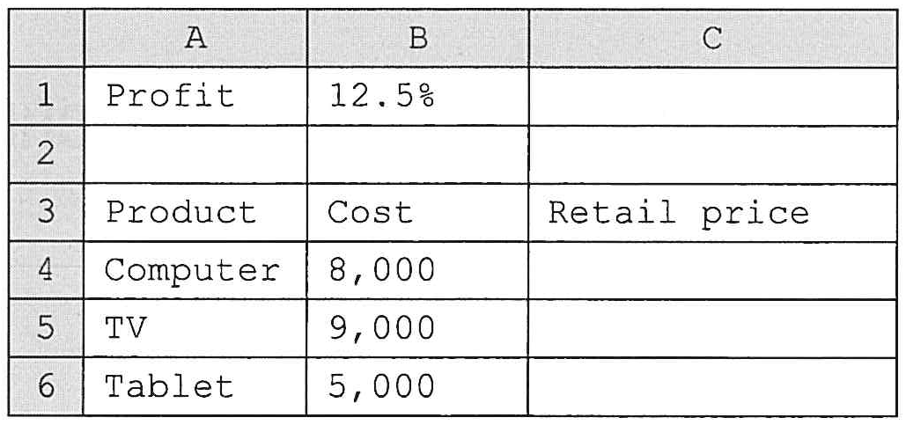

A. =B4*(1+B$1)  
B. =B4*(1+$B1)  
C. =$B$4*(1+B1)  
D. =$B$4*(1+$B$1)  

**2.** Which of the following will affect the output of an information system?

(1) Changing the input data.  
(2) Using a different CPU.  
(3) Changing the type of storage device.  

A. (1) only  
B. (2) only  
C. (1) and (3) only  
D. (2) and (3) only  

**3.** Data control is very important to an information system because

A. it controls the operations of data.  
B. it reduces the processing time.  
C. it speeds up the data transmission.  
D. it ensures the accuracy of the input data.  

**4.** Which of the following additions of 8-bit numbers using two's complement representation will result in 0000 0000?

A. 1110 1111 + 0001 0000  
B. 1110 1111 + 0001 0001  
C. 0111 1111 + 0000 0001  
D. 0000 0000 + 0000 0001  

**5.** Eva and her classmates are working on a project report. Eva does the following steps to complete the report.

(1) Eva's classmates give different parts of the report to her.  
(2) Eva checks the report and makes sure that there are no missing pages.  
(3) Eva counts the number of words in the report.  
(4) Eva hands in the completed report.  

Which steps are data collection and data analysis?

| | Data collection | Data analysis |
|---|---|---|
| A. | (1) | (2) |
| B. | (1) | (3) |
| C. | (2) | (4) |
| D. | (4) | (3) |

**6.** When changing the password of an e-mail account, which of the following steps is a way of data verification?

A. Inputting the user name.  
B. Inputting the old password.  
C. Inputting the new password twice.  
D. Answering a 'password reminder' question.  

**7.** A 24-bit display card can process a maximum of ____________ different colours.

A. 2×24  
B. 8×24  
C. 24²  
D. 2²⁴  

**8.** A teacher uploads a document in HTML format onto the Internet so that his students can view it through a browser directly. Which of the following will the teacher usually not do?

(1) Check the spelling of the text.  
(2) Compress the file before uploading.  
(3) Link to multimedia elements in the file.  

A. (1) only  
B. (2) only  
C. (1) and (3) only  
D. (2) and (3) only  

**9.** John publishes an article on the Internet. He considers using PDF instead of HTML because

A. a browser can be used to open the article.  
B. multimedia elements can be added to the article.  
C. the file size is smaller.  
D. it offers better document protection.  

**10.** There are 3 records in a database table STUD, as shown below:

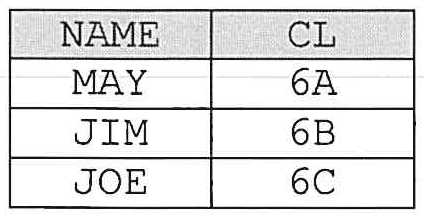

Which of the following SQL statements will output the fewest number of lines?

A. SELECT * FROM STUD WHERE CL='6A' OR CL='6B'  
B. SELECT * FROM STUD  
C. SELECT COUNT(*) FROM STUD  
D. SELECT NAME FROM STUD  

**11.** Mr Wong creates a form using a database management system tool for his colleagues to enter data because

(1) the data is not important.  
(2) it provides a user-friendly interface.  
(3) his colleagues can input data online.  

A. (1) only  
B. (2) only  
C. (3) only  
D. (1) and (3) only  

**12.** Which of the following are the functions of an operating system?

(1) Managing input and output devices.  
(2) Managing system security.  
(3) Managing computer's memory.  

A. (1) and (2) only  
B. (1) and (3) only  
C. (2) and (3) only  
D. (1), (2) and (3)  

**13.** Which of the following are examples of applications of virtualisation?

(1) Creating a virtual environment using a different operating system within the current operating system.  
(2) Partitioning a physical server into several virtual servers for running multiple application programs.  
(3) Combining several physical hard disks into a single virtual storage device.  

A. (1) and (2) only  
B. (1) and (3) only  
C. (2) and (3) only  
D. (1), (2) and (3)  

**14.** Which of the following are the characteristics of a distributed processing system?

(1) Information being exchanged between processors.  
(2) Each processor having its own memory for processing.  
(3) A processor being able to execute a process only after another processor completes its process.  

A. (1) and (2) only  
B. (1) and (3) only  
C. (2) and (3) only  
D. (1), (2) and (3)  

**15.** Which of the following is an advantage of using compression for a file transfer?

A. Increased network bandwidth.  
B. Avoiding virus infection.  
C. Shortening the transfer time.  
D. Minimising hacker attacks.  

**16.** When scanning a personal computer to detect computer viruses, which type(s) of memory will be used to store a virus checker and its data?

(1) Cache memory  
(2) ROM  
(3) RAM  

A. (1) only  
B. (2) only  
C. (1) and (3) only  
D. (2) and (3) only  

**17.** The sizes of memory addresses of Computers P and Q are 64-bit and 32-bit respectively. Which of the following is/are correct?

(1) P has a higher clock rate than Q.  
(2) P supports a larger accessible memory space compared with Q.  
(3) P transfers data at a slower rate than Q.  

A. (1) only  
B. (2) only  
C. (1) and (3) only  
D. (2) and (3) only  

**18.** Which of the following is/are valid IPv4 address(es)?

(1) 10.512.10.0  
(2) 1.2.3.4  
(3) 192.168.1.256  

A. (1) only  
B. (2) only  
C. (1) and (3) only  
D. (2) and (3) only  

**19.** Tom sets up a wireless network instead of a wired network for the Internet connection at home. Why?

(1) To enhance the flexibility of where computers can be placed.  
(2) To maintain a stable connection.  
(3) To enhance network security.  

A. (1) only  
B. (2) only  
C. (1) and (3) only  
D. (2) and (3) only  

**20.** After Computer C in the network below is shut down, which of the following activities can still be done?

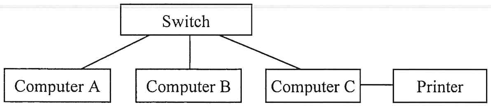

(1) Using Computer B to copy a file from Computer B to Computer A.  
(2) Using Computer A to print a document.  
(3) Using Computer A to delete a file in Computer B.  

A. (1) only  
B. (2) only  
C. (1) and (3) only  
D. (2) and (3) only  

**21.** What is the correct order of the following steps for a common e-Commerce activity?

(1) Collect a customer's product choices.  
(2) Record the transaction and payment details in a database.  
(3) Collect and validate the credit card information.  
(4) Provide a transaction number to the customer.  
(5) Deliver the product to the customer.  

A. (1) → (2) → (4) → (3) → (5)  
B. (1) → (2) → (3) → (4) → (5)  
C. (1) → (3) → (2) → (4) → (5)  
D. (1) → (4) → (3) → (2) → (5)  

**22.** Which of the following statements about HTML are correct?

(1) It is a programming language.  
(2) An HTML file consists of plain text.  
(3) It is cross-platform.  

A. (1) and (2) only  
B. (1) and (3) only  
C. (2) and (3) only  
D. (1), (2) and (3)  

**23.** A web page cannot display an image in a browser. What is/are the possible reason(s) for this?

(1) The resolution of the image is lower than that of the screen display.  
(2) The image file is stored in the wrong directory.  
(3) The operating system of the web server is different from that of the browser.  

A. (1) only  
B. (2) only  
C. (1) and (3) only  
D. (2) and (3) only  

**24.** Which of the following statements about transmitting data using TCP/IP are correct?

(1) An IP address is used to identify a device in a network.  
(2) Data packets are reassembled back to the original data at the destination.  
(3) The IP determines a fixed path to send data packets to the specific destination.  

A. (1) and (2) only  
B. (1) and (3) only  
C. (2) and (3) only  
D. (1), (2) and (3)  

**25.** Which of the following statements about the URL https://abc123.edu.hk/intro.docx are correct?

(1) The file will be converted into HTML format when accessing the URL in a browser.  
(2) The web site belongs to an educational institution.  
(3) The top level domain of the web site is 'abc123'.  
(4) Data is encrypted during the transmission on the Internet.  

A. (1) and (3) only  
B. (1) and (4) only  
C. (2) and (3) only  
D. (2) and (4) only  

**26.** Suppose that A = 3, B = 5 and C = 8. Which of the following Boolean expressions returns true?

A. (A + B > C) and ( (C > B) or (C > A) )  
B. ( (A + B > C) or (C > B) ) and (C > A)  
C. ( (A + B > C) and (C > B) ) and (C > A)  
D. (A + B > C) and ( (C > B) and (C > A) )  

**27.** Read the following algorithm.

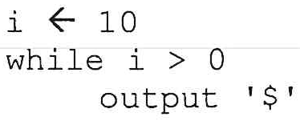

```text
i ← 10
while i > 0
    output '$'
```

Which of the following should be inserted into the loop to prevent an infinite loop from occurring?

A. output i  
B. if i < 10  
C. i ← i + 1  
D. i ← i - 1  

Answer Questions 28 and 29 with reference to the following case.

Peter designs two different algorithms, M1 and M2, to output a can of soda for every 5 credits in a vending machine, illustrated by the following two segmented flowcharts, where N represents the number of credits.

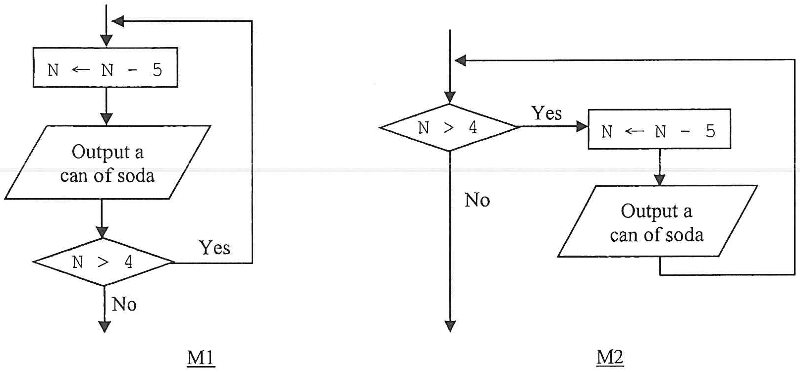

**28.** If N = 10, how many cans of soda are output by M1 and M2?

| | M1 | M2 |
|---|---|---|
| A. | 1 | 2 |
| B. | 2 | 1 |
| C. | 2 | 2 |
| D. | 2 | 3 |

**29.** Suppose that N = 0. Which of the following is correct?

A. Both algorithms output a can of soda.  
B. Both algorithms do not output any soda.  
C. Only M1 outputs a can of soda.  
D. Only M2 outputs a can of soda.  

**30.** The algorithm below checks whether a passenger of a bus is eligible to get a discounted fare.

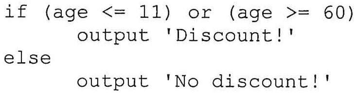

```text
if (age <= 11) or (age >= 60)
    output 'Discount!'
else
    output 'No discount!'
```

Which of the following data sets for age is the most suitable for testing the algorithm?

A. 11, 22, 33, 44, 55, 60  
B. 10, 11, 12, 59, 60, 61  
C. 7, 10, 11, 45, 55, 60  
D. 1, 2, 3, 4, 5  

**31.** In the following algorithm, what is the purpose of using the loop?

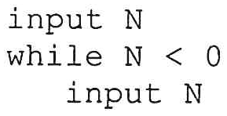

```text
input N
while N < 0
    input N
```

A. Data verification  
B. Data validation  
C. Data consolidation  
D. Data generation  

**32.** Versions 1 and 2 are algorithms with the same effect. What is the missing part in Version 2?

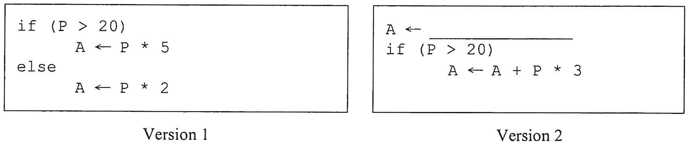

```text
Version 1
if (P > 20)
    A ← P * 5
else
    A ← P * 2

Version 2
A ← [            ]
if (P > 20)
    A ← A + P * 3
```

A. P  
B. P * 2  
C. P * 3  
D. P * 5  

**33.** Which value may be output in the following algorithm?

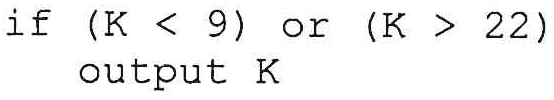

```text
if (K < 9) or (K > 22)
    output K
```

A. 9  
B. 10  
C. 22  
D. 23  

Answer Questions 34 and 35 with reference to the following algorithm.

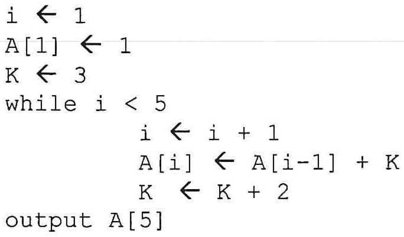

```text
i ← 1
A[1] ← 1
K ← 3
while i < 5
    i ← i + 1
    A[i] ← A[i-1] + K
    K ← K + 2
output A[5]
```

**34.** What is the final value of K?

A. 11  
B. 9  
C. 7  
D. 5  

**35.** What is the output of the algorithm?

A. 25  
B. 16  
C. 11  
D. 9  

**36.** What is the output of the following algorithm?

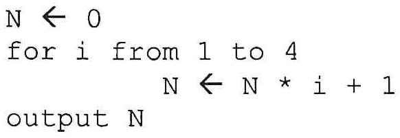

```text
N ← 0
for i from 1 to 4
    N ← N * i + 1
output N
```

A. 3  
B. 9  
C. 10  
D. 41  

**37.** What is the output of the following algorithm?

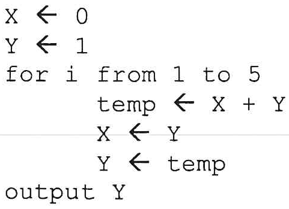

```text
X ← 0
Y ← 1
for i from 1 to 5
    temp ← X + Y
    X ← Y
    Y ← temp
output Y
```

A. 3  
B. 5  
C. 8  
D. 15  

**38.** What is the output of the following algorithm?

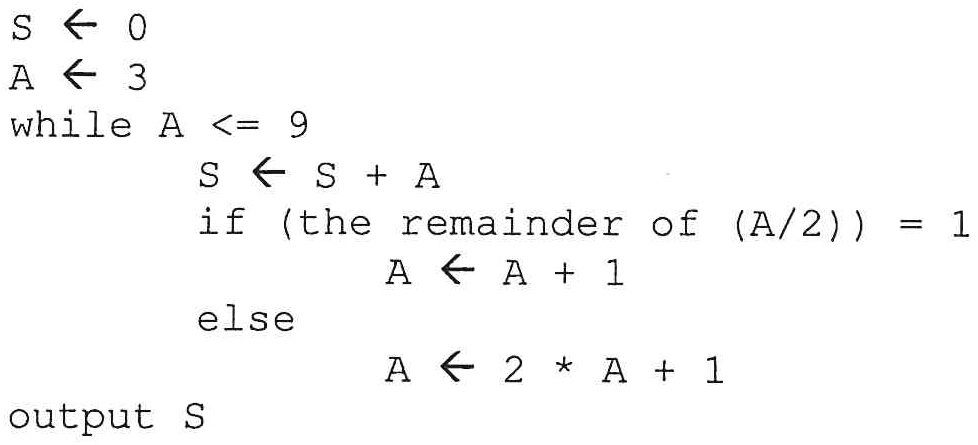

```text
S ← 0
A ← 3
while A <= 9
    S ← S + A
    if (the remainder of (A/2)) = 1
        A ← A + 1
    else
        A ← 2 * A + 1
output S
```

A. 7  
B. 9  
C. 10  
D. 16  

**39.** In general, which of the following are the advantages of open source software?

(1) It is free to use.  
(2) The source code can be modified for use.  
(3) The software can be continuously improved through collaboration.  

A. (1) and (2) only  
B. (1) and (3) only  
C. (2) and (3) only  
D. (1), (2) and (3)  

**40.** Which of the following unethical behaviours relate to intellectual property?

(1) Downloading a pirated copy of a movie.  
(2) Sending an e-mail with a virus to a friend.  
(3) Hacking into an online banking system.  
(4) Uploading a video of a TV programme to the Internet.  

A. (1) and (3) only  
B. (1) and (4) only  
C. (2) and (3) only  
D. (2) and (4) only  

**END OF SECTION A**
